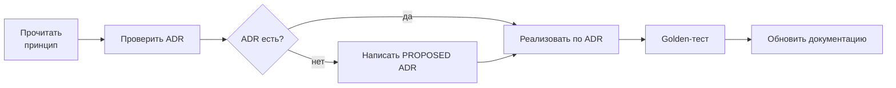

# 99_AI_CONTEXT

> Файл для ИИ-агентов, работающих с репозиторием.
> Цель: за 60 секунд понять проект и не нарушить его инварианты.

---

## 1. Что это за проект (30 секунд)

Платформа превращает изображение в **многослойную физическую маску**
для аэрографии сложных объектов (капот, мотоцикл, шлем, гитара, ноутбук).

```text
IMAGE → MASK PROJECT → MANUFACTURABLE MASK → PRODUCTION FILES → PHYSICAL RESULT
```

**Главный объект** — Mask Project (`MASK-000127`), не файл.
**Главный актив** — Mask Engine, не сайт.

## 2. Пять правил, которые нельзя нарушать

### ① AI не решает, можно ли это произвести

```text
AI предлагает → Geometry/Manufacturing Engine проверяет → Validator выносит вердикт
```

Никакой AI-вывод не попадает в проект без `Manufacturing Validator`.
Никакое число в инструкции не придумывается — только из данных проекта.

### ② Проект — источник истины, файлы — производные

SVG/DXF/PLT/PDF генерируются из Mask Project. Правка в файле = баг.
Проект хранит: исходник, геометрию, слои, граф, снимки профилей, валидацию,
артефакты, инструкцию, версии движка.

### ③ Технологические числа — в данных, не в коде

```rust
// НЕПРАВИЛЬНО
let min_width = 0.80;

// ПРАВИЛЬНО
let min_width = profile.effective_limits.line_width_mm;
```

Материал и оборудование — профили (JSON в БД), версионируемые.

### ④ Ошибки — человеческим языком

```text
❌ ERROR 48291
✅ ⚠ 7 элементов слишком маленькие для выбранного материала.
   Минимум: 0.80 мм. Худший элемент: 0.42 мм (слой 06, деталь D).
   [Исправить автоматически]  [Показать элементы]  [Другой материал]
```

### ⑤ Один визуальный слой ≠ один физический слой

Один цвет может требовать нескольких операций покраски. Физический слой
определяется кортежем `(PaintSystem, Technique, CoatOrder, OrderDependency)`.

## 3. Ориентир в репозитории

```text
engine/kernel/     ← чистая геометрия (Rust). Нет I/O, нет сети, нет БД.
engine/engine/      ← конвейер: image → layers → topology → validate → export
engine/wasm/        ← браузерная сборка того же кода
services/api/      ← HTTP, аутентификация (Go)
services/worker/   ← асинхронные прогоны
services/ai/       ← AI-сервис (Python). Предлагает, не распоряжается
web/               ← Platform + Studio (Next.js)
infra/             ← Docker Compose, конфигурация
docs/              ← эта документация
```

**Правило зависимостей:** `kernel` не знает ни о чём выше себя.

## 4. Единицы и система координат

| Аспект | Значение | Где зафиксировано |
|---|---|---|
| Длины | **миллиметры** | ADR-0004 |
| Углы | градусы | ADR-0004 |
| Ось Y | **вверх** | ADR-0009 |
| Начало координат | нижний левый угол детали | ADR-0009 |
| Точность вывода | ≤ 4 знака после запятой | `EXPORT_ENGINE.md` |

**Не смешивать px и mm.** Растр — только на входе и в превью.

## 5. Термины, которые чаще всего путают

| Путают | Правильно |
|---|---|
| «слой» как цвет изображения | **Visual Layer** — вход; **Physical Layer** — единица производства |
| «маска» как файл | **Mask Project** — объект; файл — артефакт |
| «качество» | **fidelity** — измеримое число 0..1 |
| «производимый» | прошёл Validator для конкретных профилей |
| «островок» | **island** — связная область, не соединённая с плёнкой |
| «мост» | **bridge** — элемент, удерживающий островок |
| «связка» | **Cutting Profile** = Material + Plotter |
| «слой БД» | **DXF layer** ≠ Mask Layer — не путать |

Полный словарь: `docs/00_FOUNDATION/GLOSSARY.md`.

## 6. Перед тем как писать код



| Вопрос | Что делать |
|---|---|
| Меняет ли это схему проекта? | ADR + обновить `MASK_PROJECT.md` |
| Меняет ли это формат данных? | ADR + обновить JSON Schema |
| Добавляет ли это технологическое число? | Вынести в профиль |
| Меняет ли это геометрию по умолчанию? | ADR + golden-тест |
| Затрагивает ли AI-границу? | ADR-0011 |
| Изменяет ли поведение? | Golden-тест обязателен |

## 7. Definition of Done (кратко)

- [ ] Измеримый критерий + автоматический тест
- [ ] Golden-тест на существующем fixture
- [ ] Нет зашитых чисел
- [ ] Ошибки с причиной и действием
- [ ] Детерминированно (повтор = тот же результат)
- [ ] Документация обновлена
- [ ] Нет молчаливых panic/unwrap на пользовательских данных

## 8. Частые ошибки

| Ошибка | Почему неверно | Что делать |
|---|---|---|
| Изменить SVG вручную | Артефакт — производный | Исправить проект, перегенерировать |
| Зашить `0.8mm` в код | Нарушает P-05 | Добавить в `MaterialProfile` |
| Позволить AI выставить `PASS` | Нарушает P-01 | Только Validator |
| Растянуть картинку по габаритам | Искажение | Model Fit с сохранением пропорций |
| Принять список слоёв вместо графа | Не выразить частичные пересечения | Layer Graph |
| «Оптимизировать» число слоёв в ущерб точности | Нарушает P-06 | Приоритет: производимость → сходство |
| Начать с AI/commerce/UI | Нарушает порядок | Geometry → … → Export |
| Снизить порог профиля, чтобы прошёл проект | Подгонка вместо калибровки | Физический тест → новая версия профиля |
| Написать «качественно» в документации | Не измеримо | `fidelity 0.91`, `min width 0.80 mm` |

## 9. Куда смотреть по типу задачи

```mermaid
flowchart TB
  T{"Тип задачи"}
  T -->|Геометрия| G["docs/05_GEOMETRY/TOPOLOGY_ENGINE.md"]
  T -->|Слои| L["docs/04_ENGINE/LAYER_ENGINE.md<br/>docs/04_ENGINE/LAYER_GRAPH.md"]
  T -->|Правила, материал| M["docs/06_MANUFACTURING/MANUFACTURING_ENGINE.md"]
  T -->|Проверки| V["docs/06_MANUFACTURING/VALIDATOR.md"]
  T -->|Экспорт| E["docs/06_MANUFACTURING/EXPORT_ENGINE.md"]
  T -->|Привязка к детали| F["docs/06_MANUFACTURING/MODEL_FIT.md"]
  T -->|Разбиение на плитки| N["docs/06_MANUFACTURING/NESTING_ENGINE.md"]
  T -->|AI| A["docs/08_AI/AI_ARCHITECTURE.md"]
  T -->|API| AP["docs/09_API/API_ARCHITECTURE.md"]
  T -->|Схема БД| D["docs/10_DATABASE/DATABASE_ARCHITECTURE.md"]
  T -->|Тесты| TS["docs/12_TESTING/TESTING_STRATEGY.md"]
  T -->|Процесс| P["docs/00_FOUNDATION/DEVELOPMENT_PROCESS.md"]
```



## 10. Текущий фокус

| Этап | Статус | Фокус |
|---|---|---|
| 1 — Foundation | **текущий** | ADR-0001…0015, JSON Schema, CI |
| 2 — Core Geometry | следующий | offset, boolean, measure, simplify |
| 3 — Layer Engine | запланирован | |
| 4 — Manufacturing | запланирован | |
| 5 — Export | запланирован | первая цель: физический прогон |

**Первая цель всего проекта** — не сайт, а файл, который можно вырезать
и нанести на реальную деталь. Всё, что не ведёт к этому, — вторично.

## 11. Формат коммита

```text
feat(geometry): offset with exact delta and collapse detection
fix(topology): bridge placement avoids min_gap violations
docs(engine): clarify cut ordering contract
perf(validate): two-phase width measurement (raster → offset)
```

## 12. Чего в репозитории пока нет

| Отсутствует | Появится на этапе |
|---|---|
| Код ядра | Stage 2 |
| ADR-файлы | Stage 1 |
| JSON Schema | Stage 1 |
| Миграции БД | Stage 1–3 |
| Golden fixtures | Stage 2 |
| Клиентский код | Stage 6 |
| AI-модели | Stage 8 |

**Не выдумывать то, чего нет.** Если задача требует несуществующего
артефакта — сначала ADR или явное TODO.