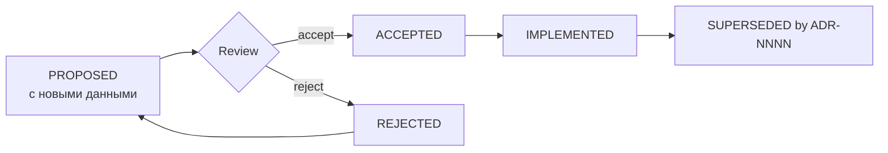

# ADR_PROCESS

Architecture Decision Record — механизм фиксации технических решений, которые
нельзя отменить дешёво.

## 1. Когда ADR обязателен

ADR пишется **до** реализации, если решение:

| Категория | Пример |
|---|---|
| Формат данных | Структура Mask Project v1 |
| Алгоритм геометрии | Алгоритм построения offset, стратегия триангуляции |
| Язык/рантайм ядра | Rust + WASM против Go |
| Зависимость | Библиотека polygon-offset |
| Производственное правило | Семантика моста по умолчанию |
| Инфраструктура | Разделение на S3-подобное хранилище |
| Обратная совместимость | Смена схемы API v1 → v2 |
| Отказ от принципа | «AI-вывод не попадает в проект напрямую» |

ADR **не** нужен для: локального рефакторинга, переименования, нового теста,
добавления фичи внутри существующего контракта.

## 2. Статусы

| Статус | Значение |
|---|---|
| `PROPOSED` | Обсуждается, реализации нет |
| `ACCEPTED` | Принято, реализуется |
| `IMPLEMENTED` | Реализовано и проверено |
| `SUPERSEDED by ADR-XXXX` | Заменено новым решением |
| `REJECTED` | Отклонено, остаётся в истории |
| `DEPRECATED` | Устарело, удаление запланировано |

## 3. Шаблон

```markdown
# ADR-XXXX · <Краткое название>

- Status: PROPOSED
- Date: YYYY-MM-DD
- Deciders: <роль/имя>
- Affects: <компоненты>
- Principles: P-01, P-05 (какие принципы затрагивает)
- Supersedes: ADR-XXXX (если заменяет)

## Context
Что требуется. Какие факты известны. Какие ограничения действуют.
Почему «просто сделать» недостаточно.

## Decision
Что именно решаем. Одна формулировка.

## Alternatives
### A. <Вариант>
Плюсы / минусы / стоимость.
### B. <Вариант>
Плюсы / минусы / стоимость.

## Consequences
### Positive
### Negative / Trade-offs
### Follow-up
Что должно быть сделано позже.

## Validation
Как проверяем, что решение верное. Критерий успеха.
```

## 4. Обязательные ADR для проекта

Эти решения должны быть приняты **до** соответствующей фазы:

| # | Тема | Не позднее | Статус |
|---|---|---|---|
| ADR-0001 | Маска как проект, а не как файл | Stage 1 | — |
| ADR-0002 | Профили как данные, а не код | Stage 1 | — |
| ADR-0003 | Язык и рантайм геометрического ядра | Stage 2 | — |
| ADR-0004 | Модель геометрической точности и единицы измерения | Stage 2 | **ACCEPTED** |
| ADR-0005 | Модель слоёв: visual → physical split | Stage 3 | — |
| ADR-0006 | Представление Layer Graph и алгоритм топологической сортировки | Stage 3 | — |
| ADR-0007 | Модель ошибок валидатора и severity-уровни | Stage 4 | — |
| ADR-0008 | Политика авто-фиксов и ограничение потери сходства | Stage 4 | — |
| ADR-0009 | Форматы экспорта и семантика координат/единиц | Stage 5 | — |
| ADR-0010 | Модель каталога объектов (иерархия часть → поверхность) | Stage 7 | — |
| ADR-0011 | Граница ответственности AI в конвейере | Stage 8 | — |
| ADR-0012 | Формат Production Manifest | Stage 5 | — |
| ADR-0013 | Стратегия встраивания ядра в браузер (WASM) | Stage 6 | — |
| ADR-0014 | Модель версионирования проекта и миграций | Stage 1 | — |
| ADR-0015 | Модель детерминизма и версионирование движка | Stage 1 | — |

> **ADR-0004 принят первым**, хотя в списке он четвёртый: от него зависят
> измерения в `TOPOLOGY_ENGINE`, `VALIDATOR` и `EXPORT_ENGINE`, а также
> `content_hash`, на котором держится воспроизводимость. Остальные ADR
> ссылаются на него как на источник истины по допускам и единицам.

## 5. Процесс



* Шаблон: `docs/adr/0000-template.md`.
* Хранилище: `docs/adr/`, имена `0001-korotkoe-imya.md`.
* ADR не удаляются никогда (кроме откровенно секретных данных).
* Одно решение — один ADR. «И ещё заодно» запрещено.

## 6. ADR как контракт для ИИ-агента

Агент, реализующий геометрию, обязан:

1. Проверить, нет ли уже ADR по теме.
2. Если решения нет — создать `PROPOSED` ADR, а **не** начинать реализацию.
3. Если решение противоречит ADR — не «улучшать» молча: предложить `SUPERSEDED`.
4. Указывать `Affects` и `Principles`, чтобы было видно влияние на инварианты.