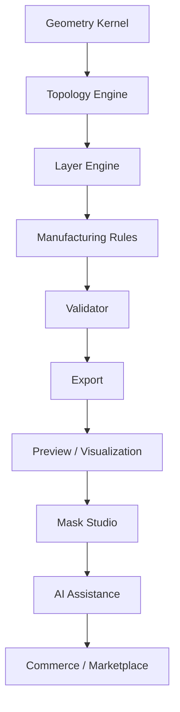
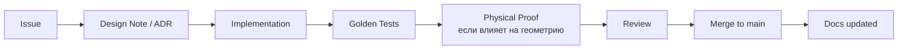

# DEVELOPMENT_PROCESS

Цель процесса — защитить **корректность производственной модели** от ускорения разработки.

## 1. Порядок разработки

Разработка идёт **снизу вверх**. Нельзя начинать слой, опирающийся на нереализованный
нижний слой, кроме как через явную заглушку с ADR.



**Правило:** задача берётся только из бэклога того слоя, который уже работает.

## 2. Цикл изменения



Обязательные шаги **для любого** изменения:

1. **Измеримость.** Определить, что именно должно измениться в цифрах.
2. **ADR** — если меняется архитектура, формат данных, зависимость, алгоритм
   геометрии или модель проекта.
3. **Эталонный тест** — golden test на существующем проекте, который «ломается»
   при неверном изменении.
4. **Регрессия производимости.** Проверка, что количество нарушений не выросло.
5. **Fidelity-чек.** Проверка, что визуальное сходство в допустимых пределах.
6. **Документация.** Обновить соответствующий `.md` в этом же PR.

## 3. Ветвление и коммиты

| Ветка | Назначение |
|---|---|
| `main` | Всегда зелёная: тесты, эталонные проекты проходят. |
| `feat/<stage>-<short>` | Фича. Привязана к этапу (см. `13_ROADMAP`). |
| `fix/<short>` | Исправление дефекта. |
| `spike/<topic>` | Исследование. Код не мержится в `main` кроме выживших частей. |

**Коммит-сообщения** — Conventional Commits, с обязательным указанием этапа:

```text
feat(geometry): support cubic bezier flattening tolerance
fix(topology): bridge islands formed by AA raster artifacts
docs(engine): clarify cut ordering contract
perf(validate): early-exit on fail-severity rules
```

**Atomic commits** — один коммит = одна логическая операция + её тесты + её доки.
Рефакторинг и изменение поведения — разные коммиты.

## 4. Definition of Done (функциональная)

Функция завершена, только если выполнено **всё**:

- [ ] Есть измеримый критерий корректности и он проверяется автоматически.
- [ ] Golden test: вход → ожидаемый выход зафиксирован.
- [ ] Ошибки выдаются человеческим языком с причиной и действием (P-09).
- [ ] Детерминированность: повторный прогон даёт побайтово тот же результат.
- [ ] Профиль/параметр, влияющий на поведение, вынесен в данные, а не в код (P-05).
- [ ] Версия движка и профилей фиксируется в артефактах.
- [ ] Документация обновлена.
- [ ] Нет молчаливых `unwrap`/`panic` на пользовательских данных — только типизированные ошибки.
- [ ] Покрытие тестами ≥ порога по модулю (см. `12_TESTING/TESTING_STRATEGY.md`).

## 5. Definition of Done (физическая)

Если изменение влияет на итоговую геометрию реза:

- [ ] Напечатан тестовый участок на реальном материале.
- [ ] Вырезан вручную или на реальном плоттере.
- [ ] Наложен на реальный объект.
- [ ] Зафиксирован результат: годен / требует коррекции профиля.
- [ ] Изменение внесено в профиль или правило, а не в «ручную поправку».

## 6. Code review

Обязательный чек-лист ревьюера:

| # | Проверка | Связанный принцип |
|---|---|---|
| 1 | Нет ли в коде зашитых технологических чисел | P-05 |
| 2 | Есть ли измеримый тест на заявленное поведение | P-08 |
| 3 | Не изменяется ли семантика Mask Project без ADR | P-02 |
| 4 | Не выдаётся ли непроверенный AI-вывод в проект | P-01 |
| 5 | Ошибки читаемы и содержат действие | P-09 |
| 6 | Деградация геометрии измерима | P-06 |
| 7 | Нет ли обращения к будущим сущностям без контракта | P-14 |

Размер PR: **до ~400 строк** логики без тестов. Крупное делится на подготовительные
(без изменения поведения) и изменяющие.

## 7. Работа с профилями и данными

* Профили меняются **только через миграцию данных**, не через код.
* Изменение профиля, влияющее на существующие проекты, требует:
  1. версии профиля (`profile_version`);
  2. указания, требуется ли пересчёт проектов;
  3. ADR, если меняется семантика полей.
* Эталонные проекты (`fixtures/`) хранят **снимки** профилей, с которыми они валидны.

## 8. Этапность: что можно и что нельзя

| Разрешено на любом этапе | Запрещено до прохождения этапа |
|---|---|
| Изменение геометрии ядра | Коммерция, подписки, тарифы |
| Новые правила и профили | Marketplace, загрузка чужих дизайнов за деньги |
| Версионирование Mask Project | Полноценный 3D-каталог с ручным моделированием |
| Локальный preview | Публичный маркетинг «мы умеем делать маски» |
| AI-предложения без публичного доступа | Автоматическое применение AI к заказам без ревью |

## 9. Обязательная отчётность по этапам

Каждый завершённый этап сопровождается документом `13_ROADMAP/STAGE_<N>_REPORT.md`:

* что реализовано;
* измеренные метрики (fidelity, manufacturable rate, время прогона);
* что не удалось и почему;
* какие физические прогоны проведены;
* что меняется в плане дальше.

## 10. Быстрый чек для ИИ-агента

Перед коммитом агент обязан:

1. Найти соответствующий раздел документации и обновить его.
2. Добавить/обновить golden test.
3. Проверить, что затронутый профиль теперь покрыт данными, а не кодом.
4. Отметить, требуется ли ADR, в описании PR.