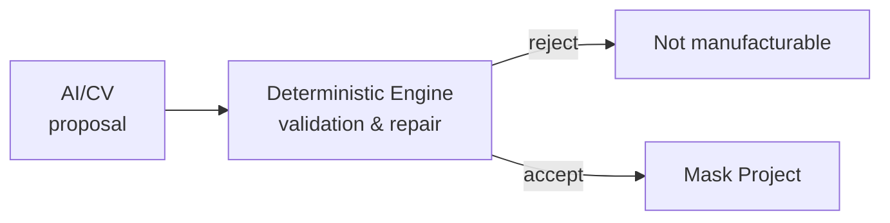

# PRINCIPLES

> Негласные правила, нарушение которых требует ADR.
> Эти принципы важнее любого частного технического решения.

## P-01 · AI предлагает — детерминированный движок распоряжается



AI **не имеет права** влиять на:

* выполнимость производства;
* технологические ограничения;
* финальную геометрию без валидации;
* числа в производственной документации.

AI **имеет право**:

* сегментировать, распознавать, предлагать структуру;
* помогать с векторизацией;
* предлагать разбиение на слои;
* генерировать читаемый текст инструкции.

**Правило:** ни одно AI-предложение не попадает в `Mask Project` без прохождения
`Manufacturing Validator`.

## P-02 · Главная сущность — Mask Project, а не файл

SVG/DXF/PLT/PDF — **производные артефакты**. Они генерируются, версионируются
вместе с параметрами и могут быть пересозданы в любой момент.

Если правка вносится в SVG вручную — это баг процесса, а не способ работы.

## P-03 · Геометрия — источник истины

Любое утверждение о форме проверяется геометрически, а не «на глаз» и не по модели.

* Ширина элемента — измеримая величина, а не ощущение.
* Производимость — результат проверки правил профиля.
* «Похоже на картинку» — измеримая метрика fidelity, а не субъективное суждение.

## P-04 · Один визуальный слой ≠ одна физическая операция

Цветовое разбиение изображения — **вход** для Layer Engine, а не его результат.
Физические слои определяются процессом покраски, а не палитрой исходника.

## P-05 · Правила не зашиты в код

Материалы и оборудование — **профили (данные)**. Код знает только схему профиля.

Добавление нового материала = добавление записи профиля, а не изменение кода.

## P-06 · Физическая корректность важнее визуальной красоты

Цель движка Auto-Simplify — **90% сходства при 100% производимости**.
Дизайн, который нельзя вырезать и снять без разрыва, — не дизайн, а брак.

## P-07 · Ядро независимо от веба

Mask Engine не знает о HTTP, пользователях, заказах и фронтенде.
Его вход — данные проекта, выход — артефакты и диагностика.

Это делает возможным запуск ядра:

* на сервере (batch, API);
* в браузере (WASM, интерактивный preview);
* в CLI (офлайн-производство и тестирование).

## P-08 · Воспроизводимость — обязательное требование

Любая операция над проектом детерминирована и версионируется.
Один и тот же вход + одна и та же версия движка + тот же профиль = один и тот же результат.

Версия движка записывается в проект.

## P-09 · Ошибки — человеческим языком

```text
❌ ERROR 48291

✅ ⚠ 7 элементов слишком маленькие для выбранного материала.
   Минимум: 0.80 мм. Текущий минимум в проекте: 0.42 мм.

   [Исправить автоматически]  [Показать элементы]
```

Система никогда не показывает код ошибки без объяснения, причины и действия.

## P-10 · Профили — версионируемые данные

Изменение профиля материала не должно ломать существующие проекты.
Каждый проект хранит **снимок (snapshot)** профилей, а не только ссылку.

## P-11 · Никаких технологий ради моды

Инструмент выбирается, если он решает текущую задачу лучше альтернатив,
и решение записывается в ADR. Rust в ядре — потому что геометрия и WASM, а не потому
что «так принято».

## P-12 · Тесты на реальной физике обязательны

Числовой прогон — не доказательство. Финальная точка — **физический прогон**
с напечатанной маской на реальном объекте.

## P-13 · Дизайн отделён от места нанесения

Дизайн создаётся независимо от конкретного экземпляра детали.
Привязка к геометрии — обязательна, привязка к конкретной геометрии экземпляра — нет.

## P-14 · Начинаем с доказательства, не с продукта

Порядок разработки: Geometry → Topology → Layers → Rules → Validation → Export
→ Visualization → Editor → AI → Commerce.

## P-15 · Документация — часть кода

Изменение поведения без изменения документации и ADR — не завершённая работа.

---

## Контроль принципов

| Принцип | Проверка | Где фиксируется |
|---|---|---|
| P-01 | Contract tests: AI-ответ не может попасть в проект напрямую | `08_AI` |
| P-02 | Проект регенерирует артефакты из данных | `03_DOMAIN` |
| P-03 | Все метрики — измеренные значения в отчёте валидации | `06_MANUFACTURING/VALIDATOR.md` |
| P-04 | Слои имеют physical-operation семантику | `04_ENGINE/LAYER_ENGINE.md` |
| P-05 | Профили в БД + версии | `06_MANUFACTURING/MANUFACTURING_ENGINE.md` |
| P-08 | `engine_version` в проекте, golden-тесты | `12_TESTING` |
| P-12 | Физический прогон в definition of done | `13_ROADMAP` |