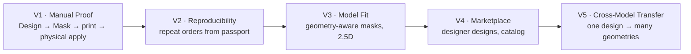

# VISION

> Статус: Living document
> Версия: 0.1
> Ответственность: Founder / CTO

## 1. Проблема

Сегодня многослойный аэрограф на сложных объектах (капот, мотоцикл, шлем, гитара, ноутбук,
консоль, мебель) делается вручную. Даже если художник — профессионал, результат
**не воспроизводим**:

* дизайн живёт в `.psd`/`.ai` конкретного исполнителя;
* привязка к геометрии детали отсутствует или хранится «в голове»;
* маска делается подручную, методом проб;
* через год при повреждении детали дизайн приходится восстанавливать заново;
* качество зависит от конкретного человека, его инструмента и настроения.

Итог: бизнес студии не может масштабироваться, а заказчик не владеет своим дизайном.

## 2. Что мы строим

Не «сайт с каталогом трафаретов». Мы строим **Mask Engine** — производственную
систему, которая превращает произвольное изображение в **воспроизводимый цифровой
проект физической многослойной маски**, привязанный к конкретной геометрии объекта.

```text
IMAGE
  ↓
DIGITAL MASK PROJECT   ← цифровой паспорт, воспроизводимый навсегда
  ↓
MANUFACTURABLE MULTILAYER MASK   ← доказанная производимость
  ↓
PRODUCTION FILES      ← SVG / DXF / PLT / PDF + Manifest + инструкция
```

## 3. Стратегическое отличие

| Рынок сегодня | MASK PLATFORM |
|---|---|
| Продажа плёнки как товара | Продажа **производственного проекта** |
| Дизайн = файл у исполнителя | Дизайн = версионированный объект в базе |
| Привязка к картинке | Привязка к **геометрии детали** |
| Один заказ = один раз | **Повторный заказ воспроизводим** |
| Качество = человек | Качество = **детерминированные правила** |
| Масштабирование = больше людей | Масштабирование = больше моделей в каталоге |

## 4. North Star

> **Воспроизводимость**: доля проектов, повторно произведённых из цифрового паспорта
> без участия автора дизайна, с нулевой регрессией качества.

Вспомогательные метрики:

* `Manufacturable Rate` — доля проектов, проходящих валидацию без ручного вмешательства.
* `Fidelity@Manufacturable` — медианное визуальное сходство при 100% производимости.
* `Repeat Order Rate` — доля выручки от повторных заказов.
* `Model Coverage` — количество геометрий в каталоге.
* `Auto-Fix Success Rate` — доля проблем, решённых автоматически без потери сходства.

## 5. Горизонт развития



## 6. Не-цели (зафиксировано осознанно)

* Не строить AI, который «рисует красивые картинки» ради AI.
* Не начинать с маркетплейса, оплаты и личных кабинетов.
* Не покупать оборудование и материалы до физического доказательства.
* Не делать систему, где качество зависит от конкретного художника.
* Не добавлять технологии без обоснования.

## 7. Критерий успеха проекта

Проект считается доказавшим концепцию, когда:

> Взять достаточно сложное изображение, автоматически или полуавтоматически
> преобразовать его в многослойный Mask Project, **доказать производимость**
> и получить корректные файлы для физического изготовления.

Ни сайт, ни AI-генерация не являются критерием успеха.