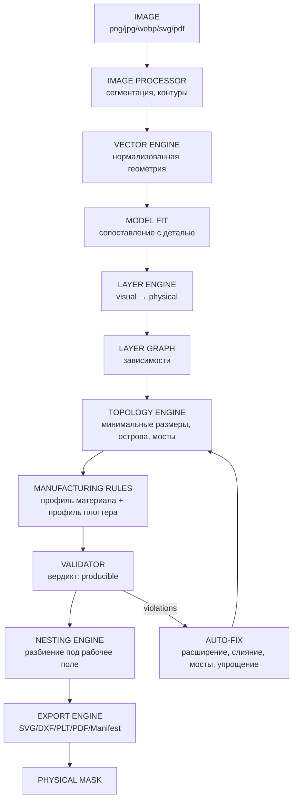
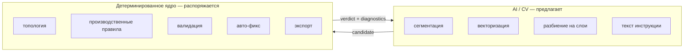
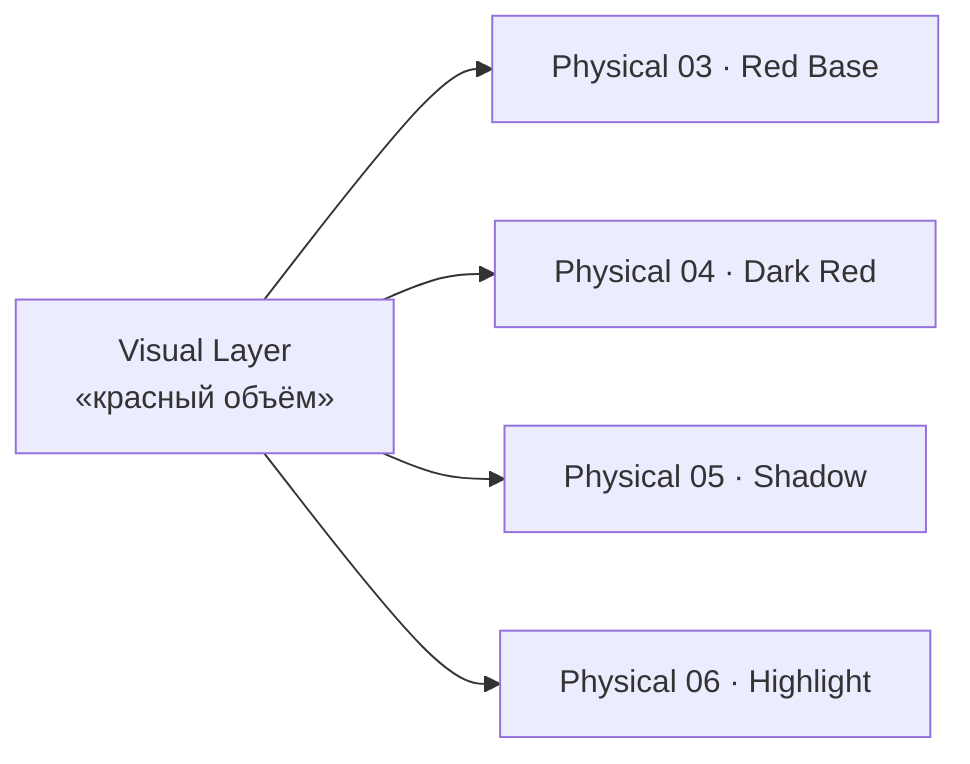
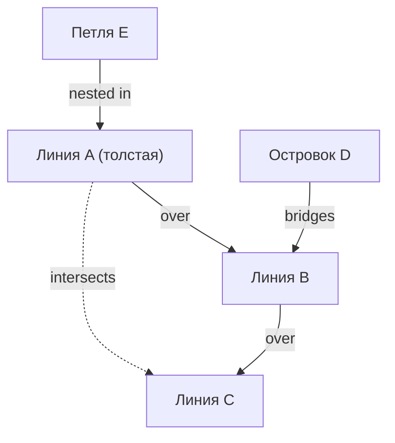
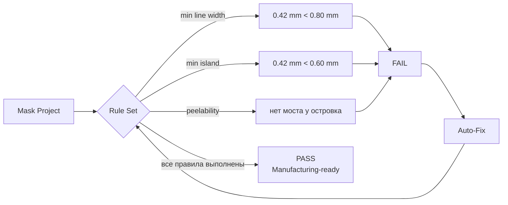
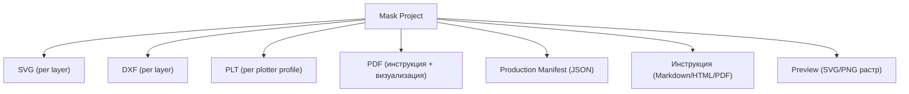
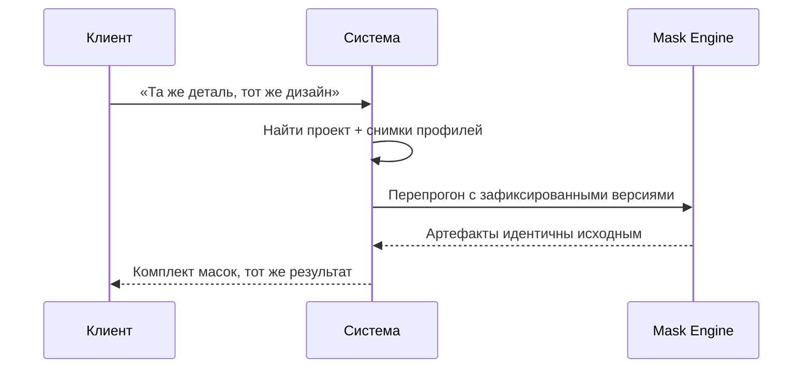

# CORE_CONCEPT

## 1. Ключевая идея

> **Дизайн отделён от места нанесения.**

Сейчас дизайн существует как картинка, и мастер «подгоняет» её под деталь руками,
каждый раз заново и по-своему. Мы делаем наоборот:

* **Дизайн** — самостоятельный цифровой объект, привязанный к геометрии, но не к
  конкретному экземпляру.
* **Маска** — производный артефакт из дизайна + модели + материала + оборудования.
* **Нанесение** — воспроизводимая процедура с инструкцией.

## 2. Цепочка преобразований



Обратите внимание: цикл `VALID → FIX → TOPO` может выполняться многократно, пока
не будет достигнута сходимость или зафиксирован неразрешимый конфликт.

## 3. Разделение ответственности: кто что решает



Ни одно решение о том, «можно ли это вырезать», не принимается AI.

## 4. Пять абстракций, на которых стоит всё

| # | Абстракция | Зачем | Документ |
|---|---|---|---|
| 1 | **Mask Project** | Паспорт дизайна: воспроизводимость | `03_DOMAIN/MASK_PROJECT.md` |
| 2 | **Vector Primitive** | Измеримая геометрия вместо «картинки» | `05_GEOMETRY/TOPOLOGY_ENGINE.md` |
| 3 | **Physical Layer** | Единица производства, не цвет | `04_ENGINE/LAYER_ENGINE.md` |
| 4 | **Layer Graph** | Переплетения, «поверх/под», мосты | `04_ENGINE/LAYER_GRAPH.md` |
| 5 | **Profile** | Материал и оборудование как данные | `06_MANUFACTURING/MANUFACTURING_ENGINE.md` |

## 5. Что делает «слой изображения ≠ слой маски»

Один визуальный слой может потребовать нескольких физических операций, потому что
реальная покраска устроена физически: база, тень, блик, бликовая кромка, выносная
линия, воздушный градиент — это разные операции с разными красками и разной плёнкой.



Обратное тоже верно: пять разных визуальных элементов могут уйти в одну
физическую маску, если краска одна и порядок не важен. Layer Engine выполняет
это разбиение и объединение, минимизируя количество физических операций
при сохранении внешнего вида.

## 6. Топология как язык сложных рисунков

Целевой класс изображений — не «логотип», а переплетающаяся графика: линии, петли,
узлы, ветвления, островки, пересечения, тонкие линии.



Что это даёт:

* **корректное наложение** — каждый элемент знает, кто сверху;
* **физическую целостность** — островки получают мосты;
* **решаемость** — циклы зависимостей обнаруживаются и не дают некорректный порядок.

## 7. Производимость как проверяемое свойство



## 8. Формат результата

Проект — это данные. Всё остальное выводится:



## 9. Воспроизводимость — центральная ценность



Для этого в проекте хранятся: `engine_version`, `profile_snapshots`, полный
вход (векторная геометрия, а не исходный растр), и весь результат.

## 10. Пример сквозного проекта

```text
MASK-000127
  Audi A4 B9 (2008–2012) · Hood

  Вход:        user_photo.png (3400×2200)
  Сегментация: 7 смысловых объектов
  Векторизация: 41 контур, 12 отверстий, 3 островка
  Слои:        6 физических слоёв
  Профиль:     matte-vinyl-090 / knife-25mm
  Валидация:   9 нарушений → 9 авто-фиксов → PASS
  Fidelity:    0.91
  Экспорт:     6×SVG, 6×DXF, 6×PLT, PDF, manifest.json
  Физический:  нанесён на капот, дефектов нет
```

## 11. Что система принципиально не делает

* Не растягивает изображение под размеры детали (см. `06_MANUFACTURING/MODEL_FIT.md`).
* Не доверяет AI в вопросах производимости.
* Не хранит «финальную маску» как единственный артефакт.
* Не требует художника-исполнителя для повторного производства.
* Не начинает производство без вердикта валидатора.