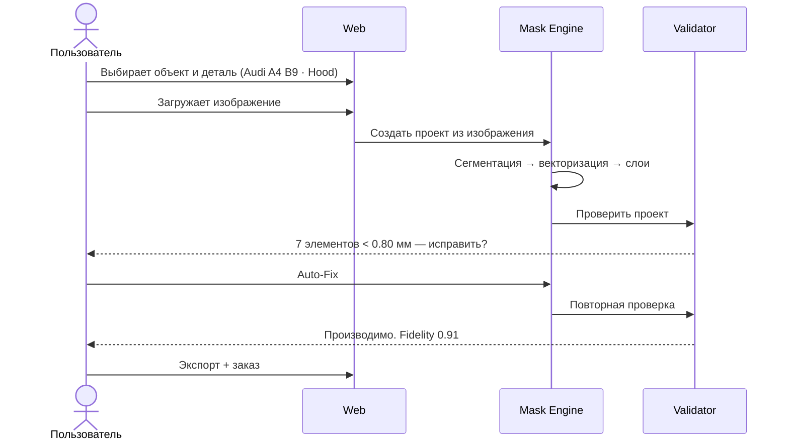
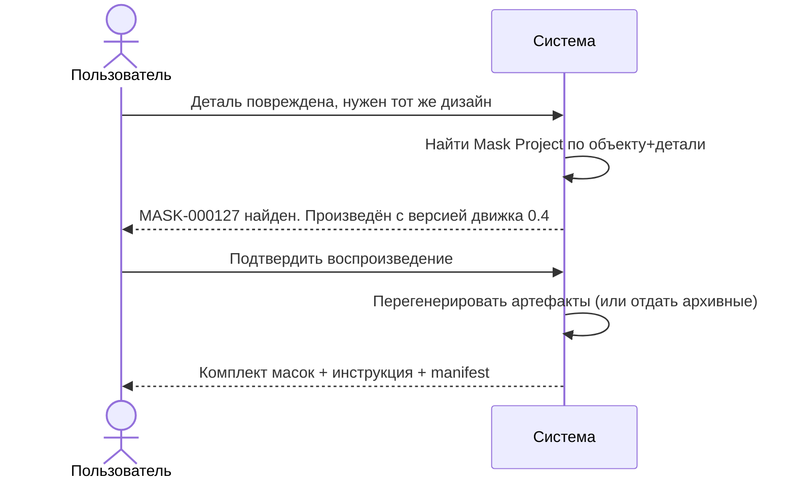
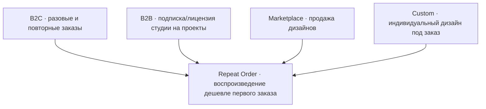
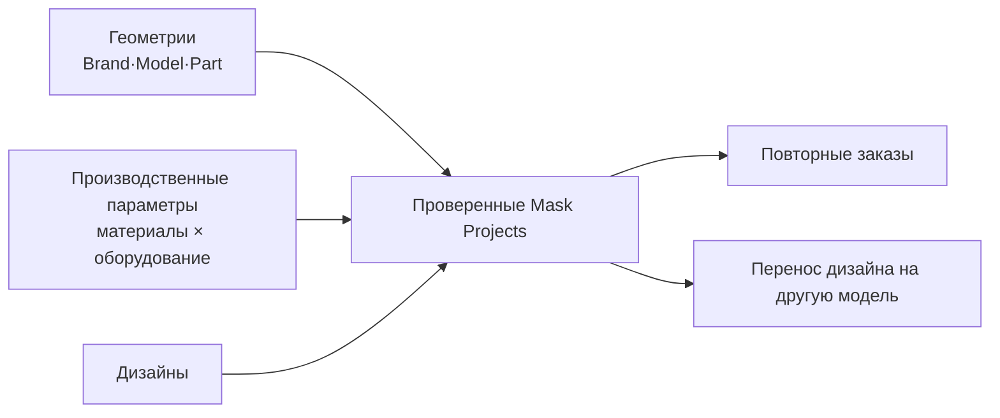

# PRODUCT_VISION

## 1. Что продаётся

Не кусок плёнки. Продаётся **воспроизводимый производственный проект**.

```text
DESIGN → DIGITAL PROJECT → MODEL → MASK → APPLICATION → REPRODUCTION
```

Клиент покупает результат, который:
* можно применить в любой аэрографической студии;
* можно повторить через год на новом экземпляре детали;
* не зависит от конкретного художника.

## 2. Кто клиент

| Сегмент | Проблема | Что покупает | Приоритет |
|---|---|---|---|
| **Энтузиаст / владелец** | «Хочу сложный многослойный аэрограф на своей детали, но не умею делать маски» | Готовый многослойный комплект под конкретную деталь | P0 — MVP |
| **Аэрографическая студия (B2B)** | «Каждый заказ с нуля: подготовка, маски, подбор элементов, часы работы» | Повторяемый проект + комплект масок | P0 — MVP |
| **Мотоциклет / кастом-мастер** | Сложная геометрия, нестандартные детали, много слоёв | Проект под конкретную модель | P1 |
| **Дизайнер-иллюстратор** | Хочет продавать дизайны, но не умеет в производственные параметры | Канал продажи + корректная упаковка дизайна в производственный проект | P2 — Marketplace |
| **Производитель масок** | Нужен предсказуемый поток заданий | Файлы + манифест, готовые к раскрою | P2 |

## 3. Ключевые пользовательские сценарии

### C-01 · Простект с нуля (B2C)



### C-02 · Повторный заказ через год (главная ценность)



### C-03 · Студия: повторяемый заказ

Студия сохраняет проекты, заказывает масски пачками, экономит часы на подготовке.

## 4. Ценностное предложение по сегментам

| Сегмент | Сегодня | С MASK PLATFORM |
|---|---|---|
| B2C | Ищет мастера, доверяет, ждёт, не может повторить | Получает проект + комплект, повторяет сам |
| Студия | Часы подготовки на каждый заказ | Воспроизведение из проекта, минуты |
| Дизайнер | Продаёт файл, отвечает за производство | Продаёт проект, производство стандартизировано |

## 5. Бизнес-модель



**Repeat Order** — главный экономический и удерживающий механизм: второй заказ
должен стоить заметно дешевле, потому что проектирование уже выполнено.

## 6. Data moat

Долгосрочный актив — не сайт, не AI-модель, а накопленная база:



Чем больше `Part × Material Profile` комбинаций проверено физически, тем дешевле
производство и тем точнее авто-фиксы.

## 7. Границы MVP

**Входит:**
* ограниченный каталог объектов (стартово 3–5 деталей);
* 1 материал, 1 плоттерный профиль;
* 2D preview и скачивание артефактов;
* валидация с auto-fix;
* ручная доводка в Studio;
* физический прогон.

**Не входит:**
* оплата, подписки, маркетплейс;
* 3D-каталог с полноценным моделированием;
* публичный AI;
* автоматическая сборка заказа без человека.

## 8. Метрики продукта

| Метрика | Формула | Стартовая цель |
|---|---|---|
| Manufacturable Rate | manufacturable / all projects | ≥ 70% без ручной правки |
| Fidelity@Manufacturable | median fidelity среди manufacturable | ≥ 0.90 |
| Auto-Fix Success | resolved / total violations | ≥ 80% |
| Median Engine Time | p50 полного прогона | < 20 s (1 Мпикс) |
| Physical Pass Rate | успешные физические прогоны / попытки | ≥ 60% на первом материале |
| Repeat Order Rate | повторные / все | отслеживать с первого месяца |

## 9. Риски продукта

| Риск | Признак | Реакция |
|---|---|---|
| Технология не даёт нужного качества | физические прогоны < 50% | Упрощать дизайн-требования, а не маскировать проблему в движке |
| Каталог объектов слишком дорог | каждая модель требует ручного моделирования | Начать с плоских/простых деталей, 2.5D |
| Клиент не доверяет «цифровым» маскам | много вопросов до заказа | Показывать результат на реальном объекте |
| Дизайнеры не готовы отдавать проекты | низкий приток в Marketplace | Отложить Marketplace, не строить под пустоту |

## 10. Связанные документы

* `VISION.md` — долгосрочная перспектива.
* `CORE_CONCEPT.md` — что именно означает проект.
* `13_ROADMAP/ROADMAP.md` — этапы и критерии выхода.