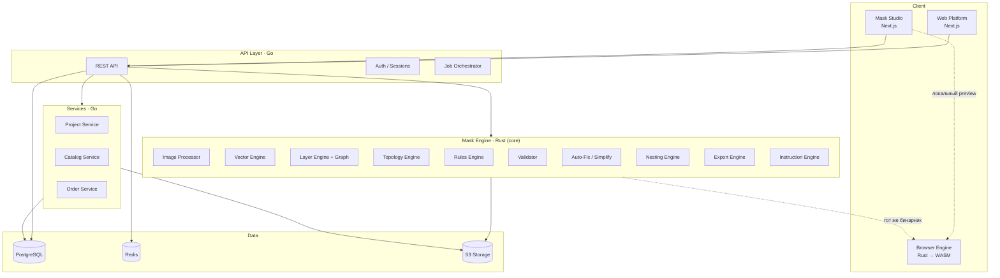
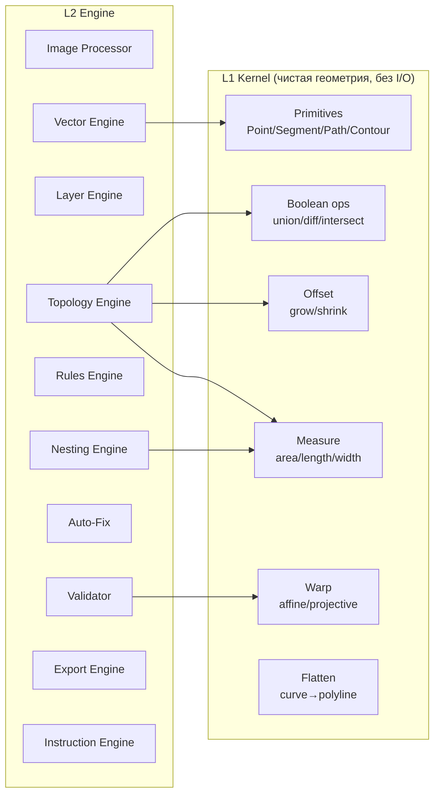
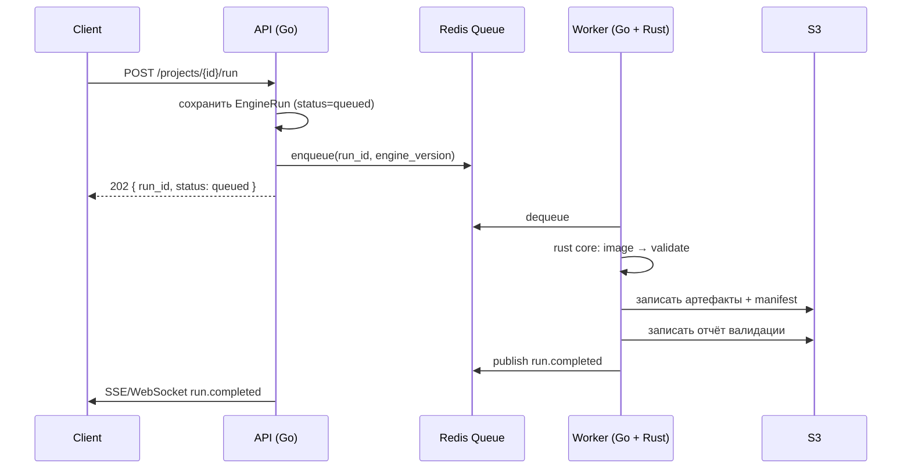
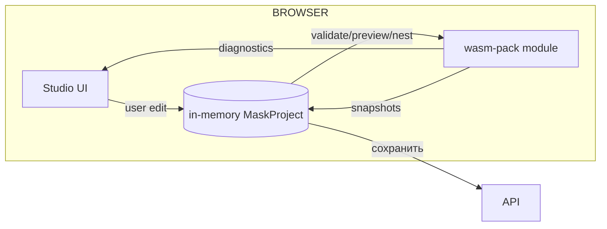
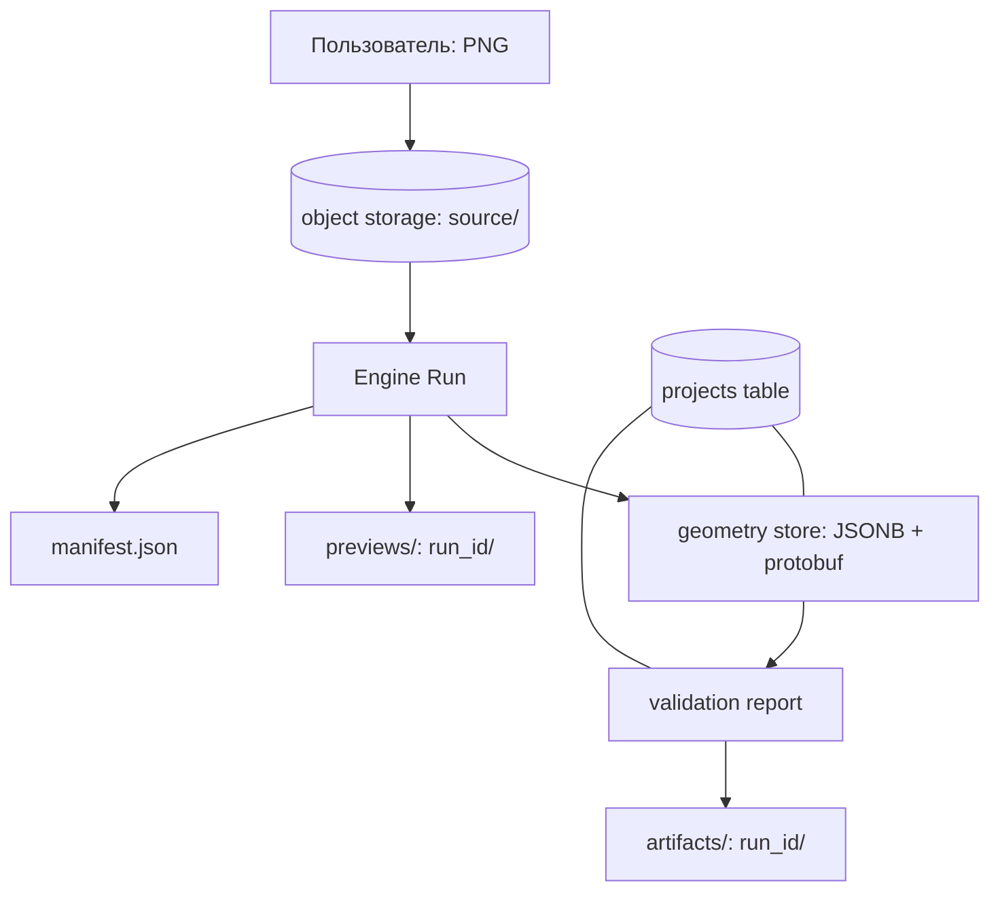
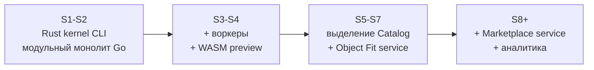

# SYSTEM_ARCHITECTURE

## 1. Общая схема

Ключевое: `CORE` и `WASM` — **один и тот же код**, собранный дважды.
Это возможно только при условии, что ядро не зависит от ОС, сети и файловой системы.

## 2. Слои системы

| Слой | Ответственность | Технологии | Зависит от |
|---|---|---|---|
| **L1 Kernel** | Геометрия, топология, offset, пересечения | Rust | ничего |
| **L2 Engine** | Конвейер: image → layer → rules → validate → export | Rust + L1 | L1 |
| **L3 Services** | Проекты, каталог, заказы, пользователи | Go | БД |
| **L4 API** | HTTP, авторизация, оркестрация | Go | L2, L3 |
| **L5 Clients** | Web, Studio, WASM-preview | Next.js, WASM | L4 (L1 опционально) |

Правило зависимостей: **вверх по строкам можно, вниз нельзя.** L1 не знает про L3.

## 3. Компоненты и их границы

### Контракт L1 → L2

L1 — чистые функции над структурами данных. Требования:

* никаких `Result`-обёрток с доменными ошибками (доменные ошибки — в L2);
* никакого доступа к файлам, сети, БД, времени, окружению;
* детерминированность: один вход → один выход, без плавающего порядка обхода;
* единицы измерения фиксированы (см. `05_GEOMETRY/TOPOLOGY_ENGINE.md`, ADR-0004).

## 4. Почему Rust в ядре, Go в сервисах

Это **не «модный стек»**, а разделение по требованиям.

| Требование | Rust | Go |
|---|---|---|
| Сложная геометрия, offset, boolean-операции | ✅ высокая производительность, строгая память, предсказуемое время | ⚠️ GC-паузы, отсутствие готовых robust-примитивов |
| Компиляция в WASM | ✅ первоклассная цель | ❌ не практично |
| Массовая параллельность воркеров | ✅ rayon, без GC | ✅ тоже хорошо |
| HTTP, ORM, бизнес-логика, оркестрация | ⚠️ медленнее разработка | ✅ стандарт индустрии |
| Скорость разработки CRUD-сервисов | ⚠️ | ✅ |
| Экосистема геометрии (clipper2, i_overlay, geo) | ✅ сильная | ❌ |

Вывод: **вычислительное ядро** — Rust; **системный слой** — Go. Разные профили нагрузки.

## 5. Модель исполнения задач

Синхронный (интерактивный) путь для быстрых операций: `validate`, `measure`,
`preview` — выполняются в том же процессе API, без очереди (budget < 2 s).

## 6. Browser Engine (WASM)

**Что обязано работать в браузере:** геометрия, топология, валидация, live-preview,
nest-превью. Узкое место — взаимодействие с Worker API для длительных операций.

**Что не работает в браузере:** обучение моделей, тяжёлый image processing,
экспорт в PLT/PDF (делается на сервере).

## 7. Потоки данных

## 8. Хранилища и их границы

| Хранилище | Что хранит | Почему там |
|---|---|---|
| **PostgreSQL** | Проекты, метаданные, слои, версии, валидации, каталог, пользователи | Транзакции, связи, версии |
| **PostgreSQL (JSONB)** | Геометрия слоёв, layer graph, снимки профилей | Гибкая схема + GIN-индексы |
| **Redis** | Очереди, кэш прогонов, idempotency keys, rate limit | Быстро, эфемерно |
| **S3** | Исходники, артефакты, превью, манифесты, инструкции | Большие объекты, версионирование |
| **ClickHouse (P2)** | Метрики прогонов и телеметрия геометрии | Аналитика больших объёмов |

Бинарная геометрия (сырые point-буферы) при необходимости выносится в S3,
в БД остаётся индекс и хеш.

## 9. Наблюдаемость

Три уровня телеметрии, все через OpenTelemetry:

| Уровень | Что измеряем |
|---|---|
| **Span** | Каждая стадия Engine Run: image_process, vectorize, layerize, topo, validate, fix, nest, export |
| **Metric** | `engine_stage_duration_ms`, `violations_count`, `fidelity`, `auto_fix_applied`, `paths_per_project` |
| **Log** | Структурированный, `project_id`, `run_id`, `engine_version`, `stage` |

**Обязательные алерты:**
* p95 полного прогона > целевого бюджета;
* доля `FAIL` валидаций > 30% на типовом входе;
* любая паника ядра (паника = дефект, не «обработать»).

## 10. Ограничения и явные «нет»

| Решение | Почему «нет» |
|---|---|
| Микросервисы на каждой сущности | Один разработчик, ранняя стадия. Модульный монолит + один worker |
| Kafka | Redis Streams достаточно |
| Kubernetes сразу | Docker Compose + один хост до реальной нагрузки |
| Event Sourcing | Версионирование проекта даёт нужную воспроизводимость проще |
| GraphQL | REST достаточно; контракт проще стабилизировать |
| Отдельный сервис превью | Превью — функция ядра |

## 11. Эволюция архитектуры

Каждое выделение сервиса требует ADR и реальной причины (границы владения данными,
изолированная нагрузка, независимый релиз).

## 12. Связанные документы

* `MASK_ENGINE.md` — внутреннее устройство ядра.
* `DATABASE_ARCHITECTURE.md` — схема хранения.
* `API_ARCHITECTURE.md` — контракты.
* `INFRASTRUCTURE.md` — окружения и развёртывание.