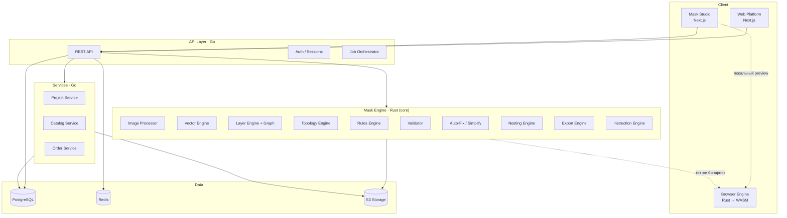

> **Статус документа: целевое состояние, не текущее.**
>
> Решение 2026-10-06 (**ADR-0016 не принято**; решение владельца, зафиксировано в
> `docs/BACKLOG/MASTER_BACKLOG.md` как DOC-006) — **вариант A1**: развивается ядро
> и Studio; сервисный слой отложен.
>
> ## Что существует на самом деле
>
> | Слой из §2 | Состояние |
> |---|---|
> | **L1 Kernel** | ✅ Реализован. `engine/kernel` — 8 модулей, ноль I/O, ноль зависимостей от кратов |
> | **L2 Engine** | ⚠️ Частично. Есть `rules`, `validate`, `nesting`, `export`, `wasm`. Нет слоя «Layer Engine + Graph», «Image Processor», «Vector Engine», «Instruction Engine», «Auto-Fix» как отдельного модуля |
> | **L3 Services** | ❌ Отсутствует. Ни одного `.go`, каталога `services/` нет |
> | **L4 API** | ❌ Отсутствует. HTTP-сервера нет; `web/` — статические страницы Next.js без API-роутов |
> | **L5 Clients** | ⚠️ Частично. `web/` — Studio с WASM-ядром, просмотр и измерение. Инструментов редактирования нет |
>
> ## Что из схемы §1 и §3 не имеет кода
>
> Ни одного вхождения: `.go`, `go.mod`, `go.sum`, `*.sql`, `Dockerfile*`, `compose*.y*ml`,
> `*.tf`. Зависимостей PostgreSQL, Redis, S3, OpenTelemetry, ClickHouse нет ни в одном
> `Cargo.toml`.
>
> `LayerGraph` — тип, на который ссылается инвариант I-3 в `PROJECT_MANIFEST.md` —
> **не существует в коде**. Единственное межслойное понятие — `LayerInput.application_order`
> для T-12.
>
> ## Почему это важно читать первым
>
> Документ написан как спецификация и звучит как описание. Он описывает систему,
> которой нет, и читатель, проектирующий по нему, будет исходить из того, что API и
> БД уже есть. Расхождение с кодом было найдено аудитом 2026-10-06 и обошлось в
> `docs/AUDIT_REPORT.md` (Documentation 3/10) и девять расхождений в этом самом файле.
>
> ## Что читать вместо §3–§13 на текущем этапе
>
> * `PROJECT_MANIFEST.md` — что система делает и чего принципиально не делает
> * `docs/13_ROADMAP/ROADMAP.md` — что сделано и что следующее
> * `docs/AUDIT_REPORT.md` — фактическое состояние, измеренное
> * `docs/adr/` — принятые решения
>
> ## Ограничение, сохраняющее смысл документа
>
> Правило зависимостей «вверх по строкам можно, вниз нельзя» и требование к L1 не
> зависеть от ОС, сети и файловой системы — **действуют и проверяются**. `kernel`
> не делает ни одного обращения к `std::fs`, `std::env`, часам и сети; ноль циклов
> зависимостей между кратами проверено обходом графа. Если L3/L4 появится, L1 уже
> готов быть их основанием.

---

# SYSTEM_ARCHITECTURE

## 1. Общая схема

> Диаграмма ниже — целевое состояние. Реализованы только `WASM` и части `CORE`.

Ключевое: `CORE` и `WASM` — **один и тот же код**, собранный дважды.
Это возможно только при условии, что ядро не зависит от ОС, сети и файловой системы.

> **Состояние:** из блоков выше реализованы `WASM` и `CORE` без `IMG`, `VEC`, `LAY`,
> `FIX`, `INST`. Блоки `EDGE`, `SVC`, `DATA` не имеют кода. Реальная форма конвейера
> сегодня: `maskctl` (CLI, синхронно, локальные файлы) и Studio, вызывающий тот же
> WASM напрямую — без API между ними, как и показано пунктиром.