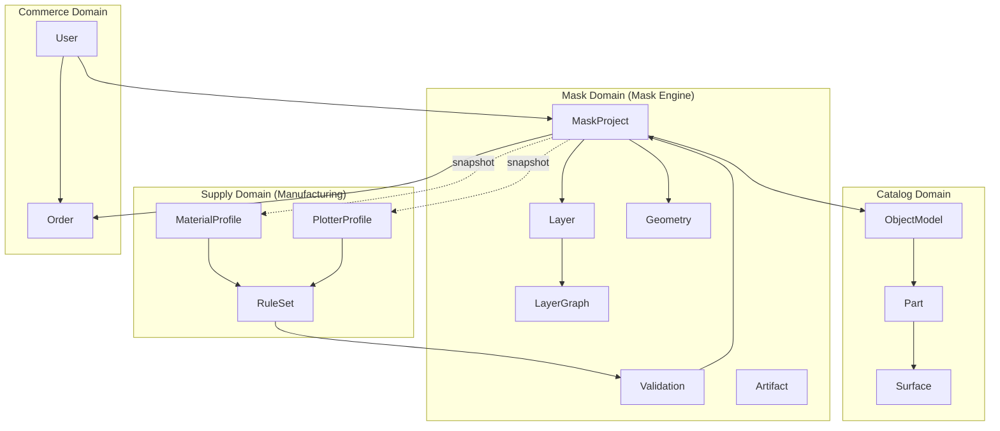
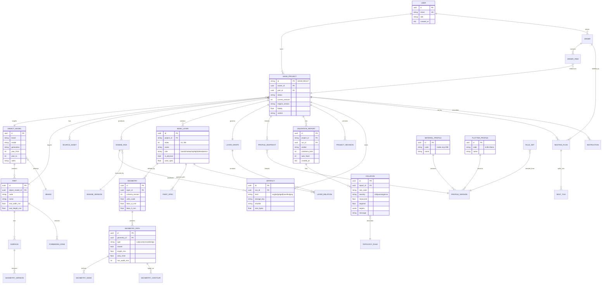
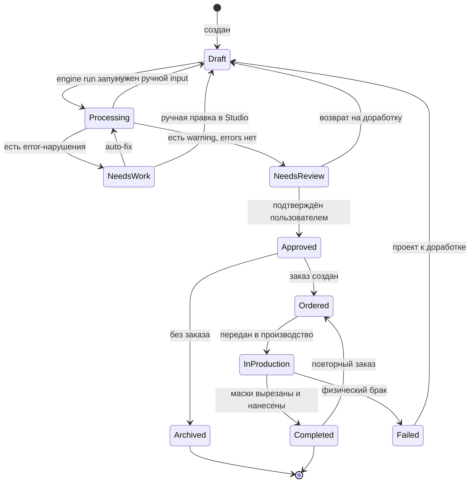

# DOMAIN_MODEL

## 1. Границы домена

**Правило зависимости:** ядро (`Mask Domain`) знает о `Supply` и `Catalog` только
**через снимки (snapshots)**. Если бы ядро читало каталог напрямую, его нельзя было бы
запустить офлайн и в браузере.

## 2. ERD

## 3. Агрегаты и границы согласованности

| Агрегат | Граница | Транзакция |
|---|---|---|
| **MaskProject** | Проект целиком, включая слои и граф | Одна транзакция при ревизии |
| **Geometry** | Геометрия одного слоя | Отдельная транзакция (может быть большой) |
| **ValidationReport** | Отчёт + нарушения | Атомарно заменяет предыдущий |
| **EngineRun** | Статус прогона | Отдельные обновления статуса |
| **Order** | Заказ + позиции | Одна транзакция |

**Инварианты (нарушение = ошибка, не предупреждение):**

| # | Инвариант |
|---|---|
| I-1 | У каждой ревизии проекта есть хотя бы один слой |
| I-2 | Порядковые номера слоёв уникальны в пределах ревизии |
| I-3 | Layer Graph ацикличен по отношениям `under`/`over` |
| I-4 | Каждый слой ссылается на существующую геометрию |
| I-5 | Verdict `PASS` возможен только при `violations_error = 0` |
| I-6 | `Manifest` существует ⇔ есть хотя бы один артефакт |
| I-7 | Каждая ревизия ссылается на снимки профилей, использованные в прогоне |
| I-8 | Артефакты привязаны к `engine_version` |

## 4. Жизненный цикл Mask Project

| Статус | Что означает | Разрешено |
|---|---|---|
| `Draft` | Проект редактируется | редактирование |
| `Processing` | Идёт прогон ядра | только чтение |
| `NeedsWork` | Есть блокирующие нарушения | auto-fix, правка |
| `NeedsReview` | Производимо, требует подтверждения | подтверждение |
| `Approved` | Зафиксирован как производственный | только чтение + новый заказ |
| `Ordered` | Есть заказ | чтение |
| `InProduction` | Физическое изготовление | отчёт о физическом прогоне |
| `Completed` | Нанесено, результат подтверждён | повторный заказ |
| `Failed` | Физический брак | обязательная доработка проекта |

## 5. Ключевые идентификаторы

| Сущность | Формат | Пример | Правило |
|---|---|---|---|
| Mask Project | `MASK-` + 6 цифр | `MASK-000127` | Монотонный, не переиспользуемый |
| Layer | `L` + индекс + short-id | `L03-a91f` | Индекс уникален в ревизии |
| Geometry | UUIDv7 | `0193…` | Времяупорядоченный |
| Engine Run | `RUN-` + 6 цифр | `RUN-004512` | Монотонный |
| Rule code | `snake_case` | `min_line_width` | Стабильный, в документации |
| Profile code | `kebab-case` | `matte-vinyl-090` | Стабильный |
| Artifact kind | snake_case | `cut_svg` | Стабильный |

**Идентификатор проекта — навсегда.** Он печатается на физической маске
и в инструкции, является ключом повторного заказа.

## 6. Границы контекстов и кому что принадлежит

| Контекст | Владеет | Не владеет |
|---|---|---|
| **Mask** | Project, Layer, Geometry, Graph, Validation, Nesting | каталог объектов, заказы |
| **Supply** | MaterialProfile, PlotterProfile, RuleSet | проекты |
| **Catalog** | ObjectModel, Part, Surface, ForbiddenZone | геометрия проектов |
| **Commerce** | User, Order | геометрия, правила |
| **Core** | EngineRun, Artifact | всё остальное |

## 7. Соглашения об именовании в БД

* Таблицы: `snake_case` во множественном числе.
* PK: `uuid` (v7 для упорядоченной вставки).
* Внешние ключи: `<table>_id`.
* Время: `timestamptz`, всегда UTC.
* Денежные величины: минимальная единица (копейки/центы) как `integer`.
* Размеры: `real`/`numeric` в **миллиметрах**.
* Проценты/доли: `numeric`/`float` в диапазоне `0..1`.

## 8. Что сознательно не моделируется

| Не моделируем | Почему |
|---|---|
| «Красивый результат» | Нет измеримого представления; заменяется `fidelity` |
| Конкретный экземпляр детали | Дизайн отвязан от места нанесения (P-13) |
| Полная 3D-модель | До Stage 7 это данные каталога, а не домен Mask |
| История правок попиксельно | Достаточно ревизий проекта |
| Количество отходов материала | Полезно, но не влияет на доменную корректность |

## 9. Связанные документы

* `MASK_PROJECT.md` — структура и схема проекта.
* `LAYER_ENGINE.md`, `LAYER_GRAPH.md` — слой и граф.
* `VALIDATOR.md` — отчёт валидации.
* `../10_DATABASE/DATABASE_ARCHITECTURE.md` — физическая схема.