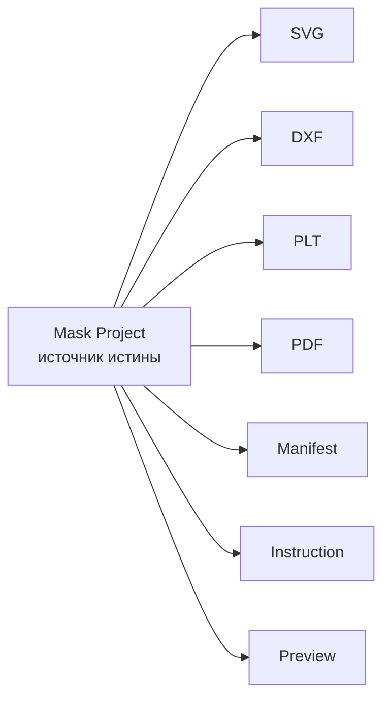
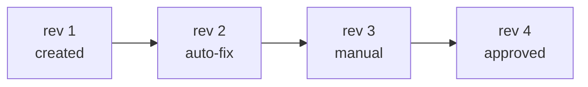
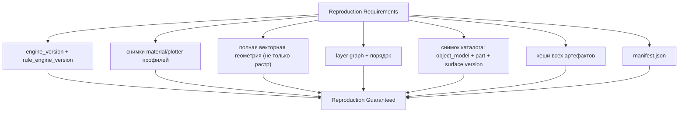

# MASK_PROJECT

Главная сущность системы. Не SVG. Не картинка. **Проект.**

## 1. Определение

`Mask Project` — полное, версионированное, воспроизводимое цифровое описание
производства физической многослойной маски для конкретной детали объекта.

Всё остальное — производные артефакты:



## 2. Структура

```text
MASK-000127
│
├── Identity            Customer, Owner, Status, Created
├── Source              исходные ассеты и процесс их получения
├── Target              ObjectModel + Part + поверхность
├── Geometry            привязка к геометрии детали, scale, зоны
├── Composition         слои + LayerGraph
├── Manufacturing       MaterialProfile + PlotterProfile + RuleSet + NestingPlan
├── Validation          отчёты, нарушения, история авто-фиксов
├── Visualization       превью, раскладка, 3D (будущее)
├── Instructions        сгенерированная инструкция + версии
└── Production Files    артефакты с хешами и engine_version
```

## 3. Полная схема (JSON, v1)

```json
{
  "schema_version": 1,
  "id": "MASK-000127",
  "status": "NeedsReview",
  "created_at": "2026-01-14T09:12:44Z",
  "updated_at": "2026-01-15T16:03:10Z",
  "owner": {
    "id": "usr_4a91",
    "display_name": "K. Weber",
    "contact": "ke@…"
  },

  "source": {
    "kind": "user_image",
    "assets": [
      {
        "asset_id": "ast_01",
        "role": "original",
        "mime": "image/png",
        "width_px": 3400,
        "height_px": 2200,
        "color_space": "sRGB",
        "sha256": "9f2c…",
        "storage_key": "projects/MASK-000127/source/original.png"
      },
      {
        "asset_id": "ast_02",
        "role": "ai_mask",
        "mime": "image/png",
        "generated_by": { "component": "segmentation", "model": "…", "params": {} }
      }
    ],
    "provenance": [
      { "step": "background_removal", "at": "…", "params": {} },
      { "step": "vectorize", "at": "…", "params": { "tolerance_mm": 0.05 } }
    ]
  },

  "target": {
    "object_model_id": "om_audi_a4_b9",
    "brand": "Audi",
    "model": "A4",
    "generation": "B9",
    "year_from": 2008,
    "year_to": 2012,
    "part": {
      "id": "pt_a4b9_hood",
      "code": "HOOD",
      "name": "Hood / Bonnet",
      "real_width_mm": 1412.0,
      "real_height_mm": 1046.0,
      "surface_id": "sf_hood_outer",
      "mapping": {
        "kind": "planar_2_5d",
        "uv_bounds": [0.0, 0.0, 1.0, 1.0],
        "curvature": "medium",
        "forbidden_zones": ["badge_mount", "wiper_pit", "emboss_logo"]
      }
    }
  },

  "geometry": {
    "design_space": {
      "width_mm": 1412.0,
      "height_mm": 1046.0,
      "origin": "part_uv_origin",
      "scale_policy": "fit_into_part_bounds_preserve_aspect"
    },
    "transform": {
      "kind": "affine",
      "matrix": [1.0, 0.0, 0.0, 1.0, 0.0, 0.0]
    },
    "units": "mm",
    "tolerance": { "flatten_mm": 0.05, "bool_epsilon_mm": 0.001 }
  },

  "composition": {
    "layers": [
      {
        "id": "L01-4f2a",
        "index": 1,
        "name": "Black Base",
        "role": "base",
        "visible": true,
        "paint": {
          "type": "solid",
          "rgb": [17, 17, 19],
          "system": "basecoat",
          "coat": 1,
          "opacity": 1.0
        },
        "operations": ["adhesive", "cut"],
        "geometry_id": "geo_L01",
        "nesting_required": false,
        "metrics": {
          "paths": 12,
          "islands": 0,
          "holes": 2,
          "min_width_mm": 1.42,
          "area_mm2": 412300.0
        }
      },
      {
        "id": "L02-71cd",
        "index": 2,
        "name": "Black Shadow",
        "role": "shadow",
        "paint": { "type": "solid", "rgb": [38, 38, 42], "system": "basecoat" },
        "geometry_id": "geo_L02",
        "metrics": { "paths": 9, "islands": 0, "holes": 0, "min_width_mm": 0.96 }
      },
      {
        "id": "L03-0b83",
        "index": 3,
        "name": "Red Base",
        "role": "base",
        "paint": { "type": "solid", "rgb": [196, 24, 32], "system": "basecoat" },
        "geometry_id": "geo_L03",
        "metrics": { "paths": 15, "islands": 3, "holes": 1, "min_width_mm": 0.81 }
      },
      {
        "id": "L04-aa10",
        "index": 4,
        "name": "Dark Red",
        "role": "shadow",
        "paint": { "type": "solid", "rgb": [118, 12, 20], "system": "basecoat" },
        "geometry_id": "geo_L04",
        "metrics": { "paths": 8, "islands": 2, "holes": 0, "min_width_mm": 0.88 }
      },
      {
        "id": "L05-3e6d",
        "index": 5,
        "name": "White",
        "role": "highlight",
        "paint": { "type": "solid", "rgb": [236, 238, 240], "system": "basecoat" },
        "geometry_id": "geo_L05",
        "metrics": { "paths": 11, "islands": 1, "holes": 3, "min_width_mm": 0.95 }
      },
      {
        "id": "L06-c90f",
        "index": 6,
        "name": "Detail",
        "role": "detail",
        "paint": { "type": "solid", "rgb": [214, 176, 38], "system": "detail" },
        "geometry_id": "geo_L06",
        "metrics": { "paths": 23, "islands": 5, "holes": 0, "min_width_mm": 0.80 }
      }
    ],
    "graph": {
      "version": 1,
      "nodes": ["L01-4f2a", "L02-71cd", "L03-0b83", "L04-aa10", "L05-3e6d", "L06-c90f"],
      "edges": [
        { "from": "L01-4f2a", "to": "L02-71cd", "type": "under" },
        { "from": "L02-71cd", "to": "L03-0b83", "type": "under" },
        { "from": "L03-0b83", "to": "L04-aa10", "type": "under" },
        { "from": "L04-aa10", "to": "L05-3e6d", "type": "under" },
        { "from": "L05-3e6d", "to": "L06-c90f", "type": "under" },
        { "from": "L03-0b83", "to": "L04-aa10", "type": "intersects" },
        { "from": "L06-c90f", "to": "L03-0b83", "type": "bridges" },
        { "from": "L05-3e6d", "to": "L01-4f2a", "type": "masks" }
      ]
    }
  },

  "manufacturing": {
    "material_profile": {
      "code": "matte-vinyl-090",
      "version": 4,
      "fingerprint": "sha256:44ac…"
    },
    "plotter_profile": {
      "code": "knife-25mm",
      "version": 2,
      "fingerprint": "sha256:91bd…"
    },
    "ruleset_id": "rs_matv090_knife25_v4_2",
    "nesting": {
      "required": true,
      "plan_id": "nest_004512",
      "tiles": 9,
      "waste_ratio": 0.187
    },
    "process": {
      "surface_prep": "clean_degrease_mask_area",
      "adhesive": "water_sensitive",
      "peel": "warm_slow_angle_low"
    }
  },

  "validation": {
    "verdict": "PASS_WITH_WARNINGS",
    "last_run_id": "RUN-004512",
    "violations_error": 0,
    "violations_warning": 2,
    "violations_info": 5,
    "auto_fix_applied": 9,
    "fidelity": 0.912
  },

  "instructions": {
    "current_id": "ins_004512",
    "languages": ["en", "de"],
    "format": "markdown",
    "generated_by": { "engine": "instruction", "ai_polish": true, "source": "deterministic" }
  },

  "production_files": [
    { "kind": "cut_svg", "layer": "L01-4f2a", "storage_key": "…/L01.svg", "sha256": "…", "bytes": 18422 },
    { "kind": "cut_dxf", "layer": "L01-4f2a", "storage_key": "…/L01.dxf", "sha256": "…" },
    { "kind": "cut_plt", "layer": "L01-4f2a", "storage_key": "…/L01.plt", "sha256": "…" },
    { "kind": "manifest", "storage_key": "…/manifest.json", "sha256": "…" },
    { "kind": "instruction_pdf", "storage_key": "…/instruction.pdf", "sha256": "…" }
  ],

  "lineage": {
    "engine_version": "0.4.2",
    "rule_engine_version": "1.1.0",
    "revisions": [
      { "n": 1, "at": "2026-01-14T09:12:44Z", "summary": "created from source" },
      { "n": 2, "at": "2026-01-14T09:31:02Z", "summary": "auto-fix: widen 7 paths, add 2 bridges" },
      { "n": 3, "at": "2026-01-15T16:03:10Z", "summary": "manual: split white layer, add shading" }
    ]
  }
}
```

## 4. Геометрия слоя (отдельный документ)

Геометрия хранится отдельно от проекта — она велика и изменяется чаще метаданных.

```json
{
  "schema_version": 1,
  "id": "geo_L03",
  "layer_id": "L03-0b83",
  "units": "mm",
  "bounds": { "x": 40.0, "y": 12.0, "w": 1330.0, "h": 980.0 },
  "paths": [
    {
      "id": "path_124",
      "role": "cut",
      "layer": 3,
      "closed": true,
      "fill_rule": "nonzero",
      "width": 0.82,
      "area": 14.2,
      "risk": "low",
      "commands": [
        { "c": "M", "p": [40.0, 12.0] },
        { "c": "C", "p": [180.0, 8.0, 320.0, 26.0, 400.0, 40.0] },
        { "c": "L", "p": [520.0, 44.0] },
        { "c": "Z" }
      ]
    },
    {
      "id": "path_131",
      "role": "bridge",
      "closed": true,
      "width": 2.4,
      "connects": ["path_208", "path_209"],
      "risk": "medium",
      "commands": [{ "c": "M", "p": [0, 0] }, { "c": "L", "p": [12, 0] }, { "c": "Z" }]
    }
  ],
  "topology_summary": {
    "islands": 3,
    "holes": 1,
    "self_intersections": 0,
    "nested_max_depth": 2,
    "fragments_after_simplify": 41
  }
}
```

## 5. Ревизии



Правила ревизий:

| Правило | Значение |
|---|---|
| Ревизия неизменяема | Изменение создаёт новую ревизию |
| Слои и граф — часть ревизии | Сравнение проектов = сравнение ревизий |
| Rev diff — структурный | Не побайтовый diff JSON, а семантический (добавлены слои, изменены paths) |
| Ревизия с verdict `FAIL` допустима | Проект может существовать непроизводимым — но не может быть заказан |
| Approved-ревизия неизменна навсегда | Изменения → новая ревизия → новое подтверждение |

## 6. Что обязательно хранится для воспроизводимости



**Правило:** если чего-то из этого нет — проект **не** может получить статус `Approved`.
Это проверяется инвариантом I-7.

## 7. Метаданные проекта (быстрый доступ)

Для списков и поиска:

```json
{
  "id": "MASK-000127",
  "status": "NeedsReview",
  "owner_id": "usr_4a91",
  "object_label": "Audi A4 B9 · Hood",
  "part_code": "HOOD",
  "layer_count": 6,
  "material_code": "matte-vinyl-090",
  "plotter_code": "knife-25mm",
  "verdict": "PASS_WITH_WARNINGS",
  "fidelity": 0.912,
  "created_at": "2026-01-14T09:12:44Z",
  "updated_at": "2026-01-15T16:03:10Z",
  "thumbnail_key": "projects/MASK-000127/preview/thumb.webp"
}
```

## 8. Ограничения размера

| Часть | Лимит | Обоснование |
|---|---|---|
| Слоёв на проект | 64 | Больше — признак ошибки разбиения |
| Paths на слой | 50 000 | Производительность и читаемость файлов |
| Точек на path | 20 000 | Разумный предел для плёнки |
| Проектов на пользователя (MVP) | 50 | |
| Размер исходного растра | 40 Мпикс | Защита от DoS |
| Активных прогонов | 3 одновременно | |

## 9. Идентификация в производстве

Физическая маска несёт:

```text
┌──────────────────────────────────────┐
│  MASK-000127        rev 4            │
│  Audi A4 B9 · Hood                  │
│  Layer 03/06 · Red Base              │
│  Material: matte-vinyl-090 v4        │
│  Engine: 0.4.2    Sheet 2 of 3       │
│  Tile B1    ▣ A1                    │
└──────────────────────────────────────┘
```

Это делает возможным: повреждение детали → сканирование кода → точное воспроизведение.

## 10. Связанные документы

* `DOMAIN_MODEL.md` — сущности и инварианты.
* `../04_ENGINE/MASK_ENGINE.md` — как создаётся.
* `../06_MANUFACTURING/VALIDATOR.md` — как проверяется.
* `../06_MANUFACTURING/EXPORT_ENGINE.md` — что производится из проекта.