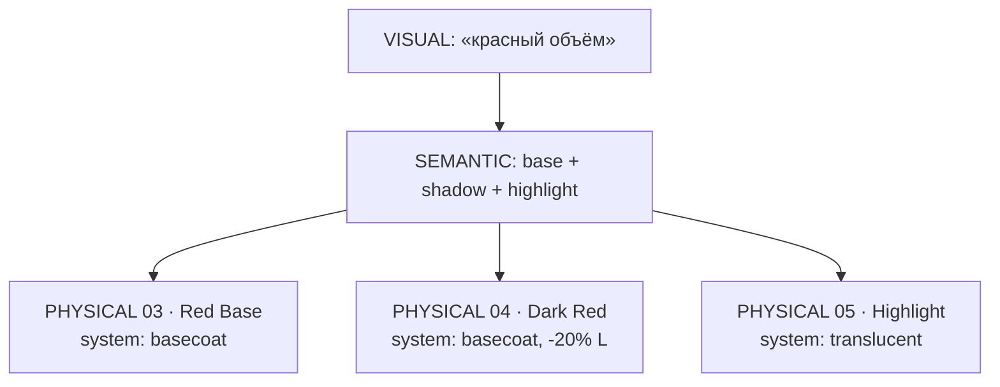
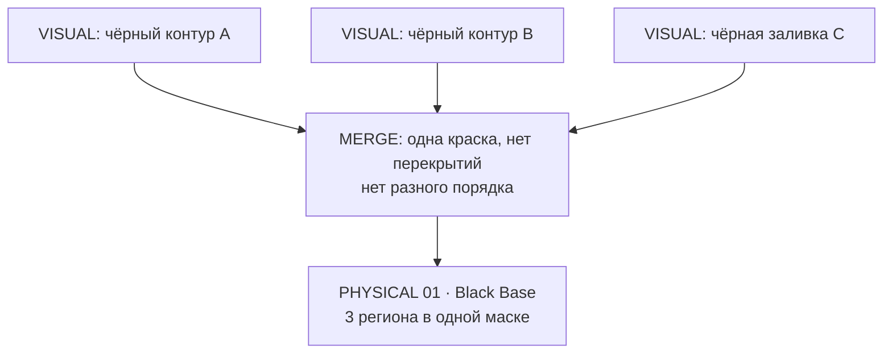
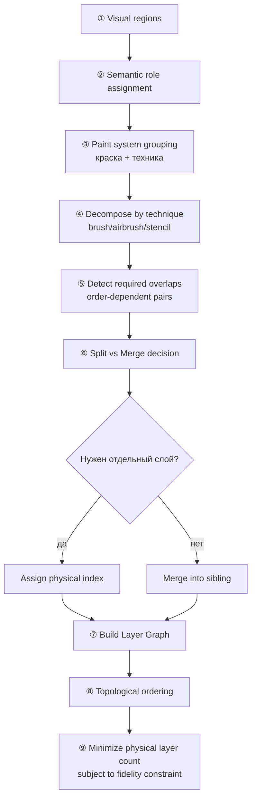
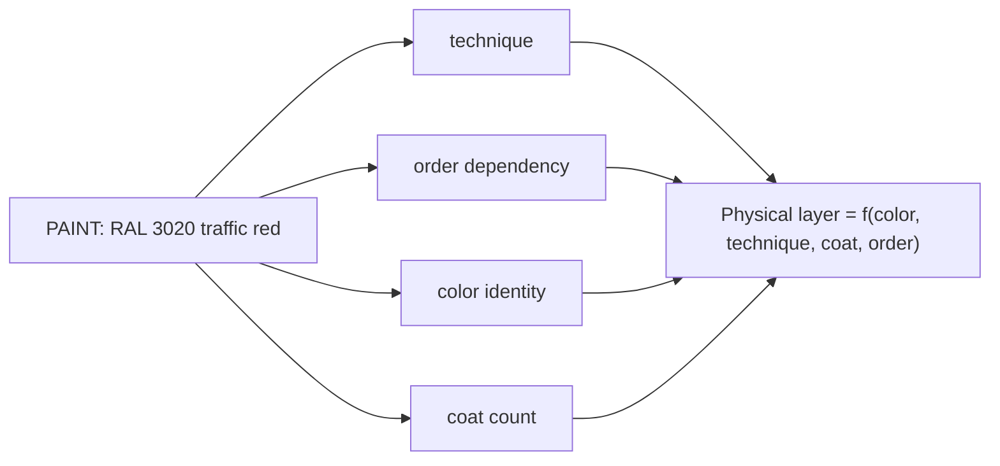
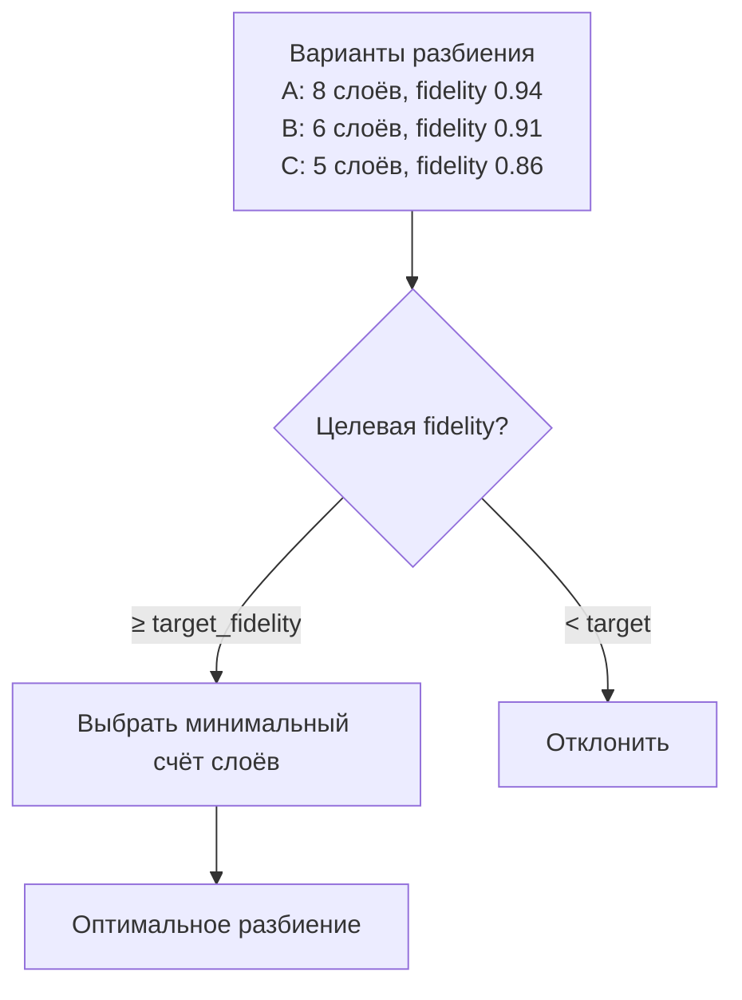
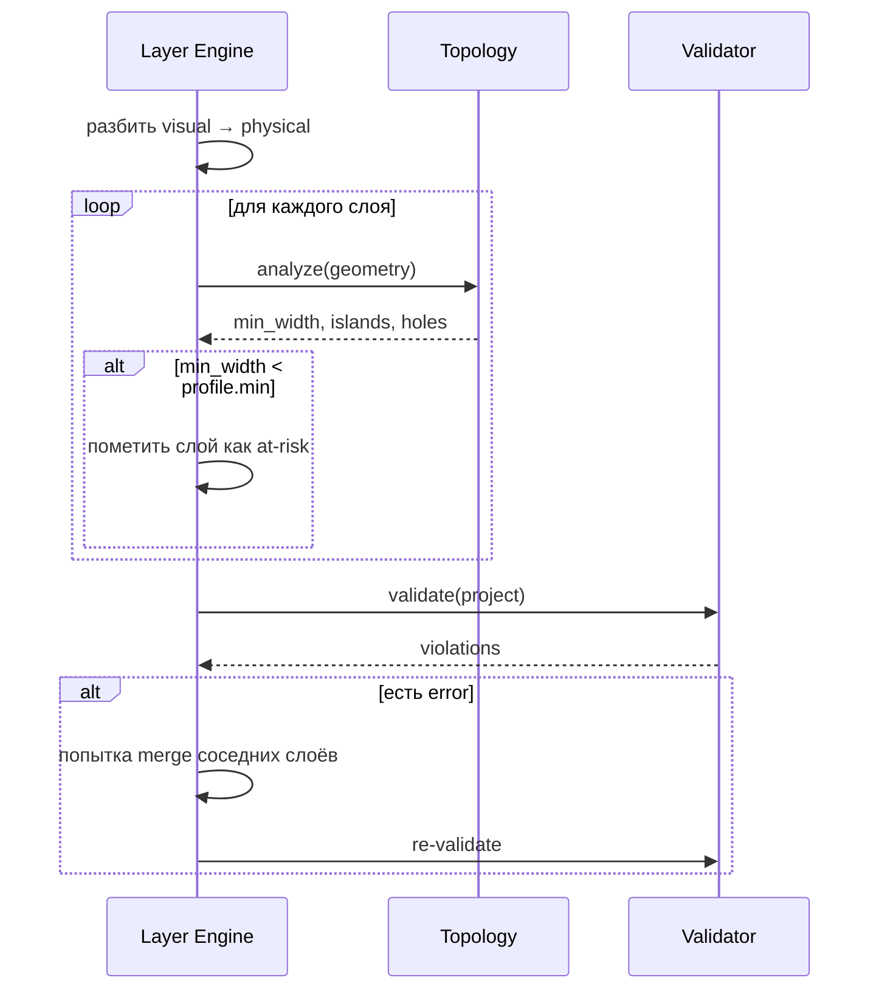
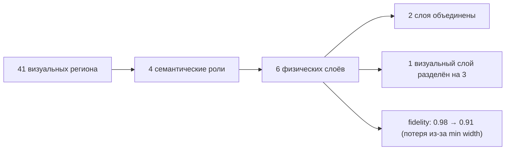

# LAYER_ENGINE

## 1. Главный принцип

> **Слой изображения ≠ обязательно один физический слой маски.**

AI предлагает смысловое разбиение. Layer Engine переводит его в **последовательность
физических операций покраски**, оптимизируя по реальному процессу, а не по палитре.

## 2. Три вида слоёв в системе


| Вид | Что это | Кто решает |
|---|---|---|
| Visual | Цветовое/пиксельное разбиение исходника | Image Processor (CV/AI) |
| Semantic | Роль элемента: base/shadow/highlight/detail/stencil | AI предлагает, правила нормализуют |
| **Physical** | **Одна маска = одна операция покраски** | **Layer Engine, детерминированно** |

## 3. Роли физического слоя

| Role | Физический смысл | Краска | Требования |
|---|---|---|---|
| `base` | Основной цвет заливки | база/база-коут | большие площади |
| `shadow` | Тень, тёмный тон | та же база, темнее | может требовать airbrush-градиента |
| `highlight` | Блик, светлая зона | светлый тон | тонкие элементы рискованны |
| `gradient` | Плавный переход | база + растворитель | порядок критичен |
| `detail` | Мелкие элементы, линии | акцент/деталь | **самый рискованный** |
| `stencil` | Закрывает зону от нанесения | — (маска-обратка) | перекрывает другие слои |
| `shim` | Подложка/прокладка | — | задаёт зазор |
| `cutaway` | Вырез в существующем слое | — | булева операция |

## 4. Одно визуальное свойство → несколько операций



### Почему так

| Причина | Следствие |
|---|---|
| Одна краска не может дать и базу, и тень | Нужны разные материалы краски |
| Тень наносится поверх базы | Нужен порядок |
| Блик наносится через airbrush с расстояния | Нужен отдельный слой с зазором |
| Разные площади → разная толщина элементов | Разные требования к min width |

## 5. Несколько визуальных элементов → одна операция



**Условия слияния (все должны выполняться):**
1. Краска совместима (один system/coat, либо безопасно смешиваются).
2. Нет перекрытий, требующих разного порядка.
3. Нет разной техники нанесения (brush vs airbrush vs spray).
4. Порядок не влияет на результат (нет overprint-эффекта).
5. Объединение не нарушает min-gap/минимальные размеры.

## 6. Алгоритм разбиения



## 7. Правила разбиения

| Правило | Формулировка |
|---|---|
| **LR-1** | Разные краски (несовместимые) → разные физические слои |
| **LR-2** | Разная техника нанесения → разные слои |
| **LR-3** | Порядок влияет на результат (overprint) → разделение |
| **LR-4** | Элемент перекрывает другой визуально → разделение + отношение `over` |
| **LR-5** | Элемент требует зазора для airbrush → отдельный слой или `shim` |
| **LR-6** | Область должна быть закрыта от нанесения → `stencil` слой |
| **LR-7** | Элемент слишком мал для профиля → сначала попытка merge, потом auto-fix |
| **LR-8** | Минимизировать число физических слоёв при сохранении fidelity |

## 8. Проблема «одна краска — один слой»



Физический слой определяется **не только цветом**, а кортежем:

```text
PhysicalLayer = (PaintSystem, Technique, CoatOrder, OrderDependency)
```

## 9. Paint Spec

```json
{
  "type": "solid",
  "system": "basecoat",
  "brand_hint": "…",
  "rgb": [196, 24, 32],
  "lab": { "l": 45.2, "a": 62.1, "b": 41.8 },
  "coat": 1,
  "technique": "airbrush_1_5G",
  "opacity": 1.0,
  "tolerance": { "delta_e": 2.5 }
}
```

| Поле | Зачем |
|---|---|
| `rgb` / `lab` | Идентификация цвета и контроль отклонения |
| `system` | Семейство краски (basecoat/clear/translucent/detail) |
| `coat` | Номер прохода в пределах слоя |
| `technique` | brush / airbrush / spray — влияет на физику |
| `tolerance` | Допустимое отклонение цвета при печати инструкции |

## 10. Минимизация числа слоёв



Целевая функция:

```text
minimize   |physical_layers|
subject to fidelity ≥ target_fidelity
           all layers manufacturable
           all order constraints satisfied
```

**Важно:** минимизация слоёв — вторична. Приоритет — производимость и сходство.
Это прямо следует из принципа P-06.

## 11. Взаимодействие с Validator



## 12. Диагностика разбиения



Выводится пользователю:

```
Слои сформированы:
  41 регион изображения → 6 физических слоёв
  Объединено: 5 чёрных элементов в слой 01
  Разделено: «красный объём» → 3 слоя (база, тень, блик)
  Причина потери сходства: элементы тоньше 0.80 мм упрощены (−0.07)
```

## 13. Ограничения

| Ограничение | Значение |
|---|---|
| Максимум физических слоёв | 64 (см. `MASK_PROJECT.md`) |
| Минимум физических слоёв | 1 |
| Разреженность (max операций) | 8 |
| Обязательная финальная проверка | каждый слой проходит Validator |

## 14. Связанные документы

* `LAYER_GRAPH.md` — зависимости и порядок.
* `MASK_ENGINE.md` — конвейер.
* `../06_MANUFACTURING/VALIDATOR.md` — проверка результата.
* `../05_GEOMETRY/TOPOLOGY_ENGINE.md` — метрики элементов.