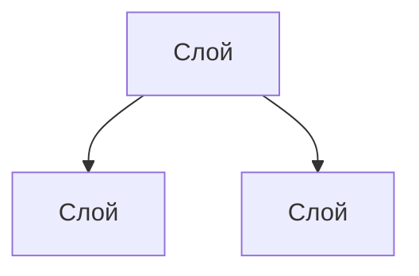
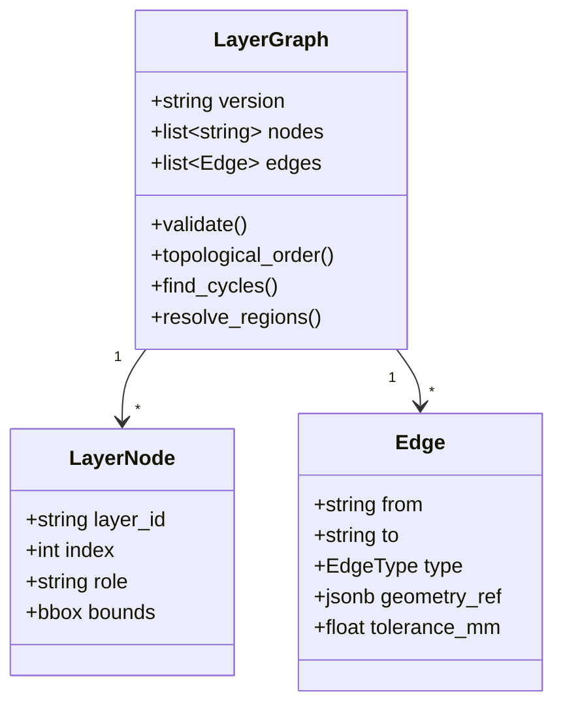
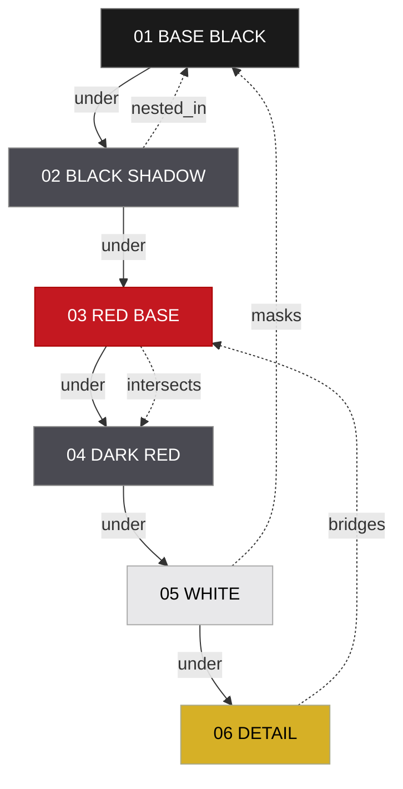
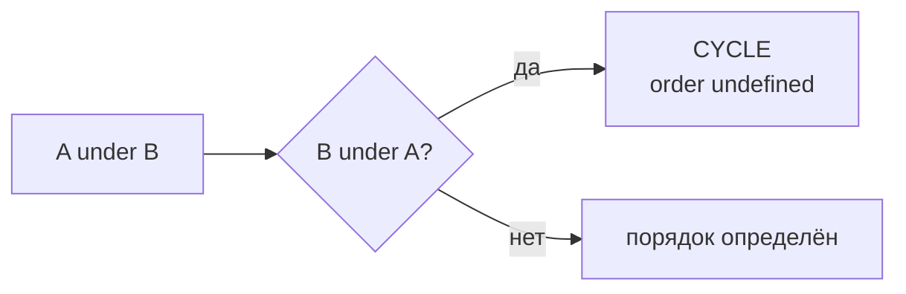
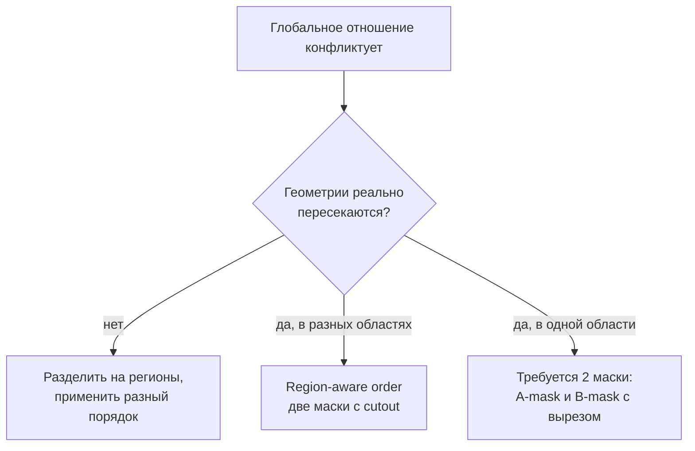
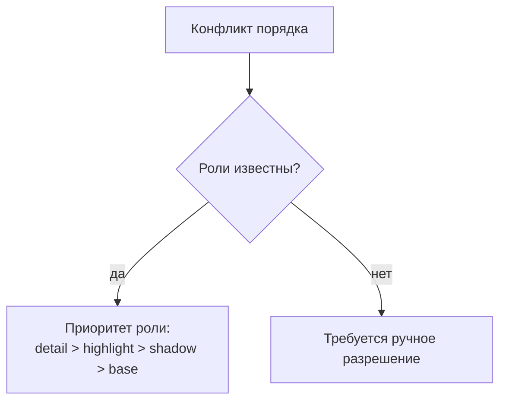
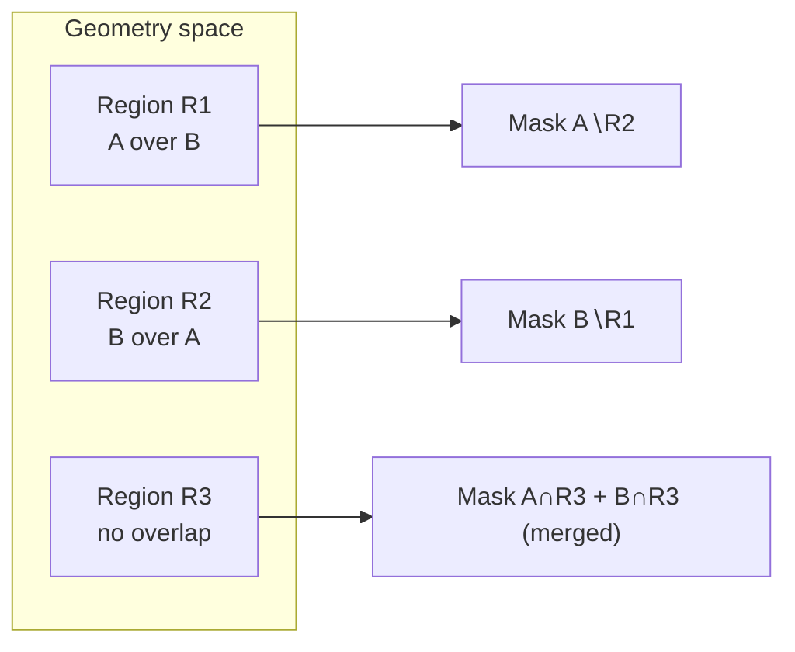
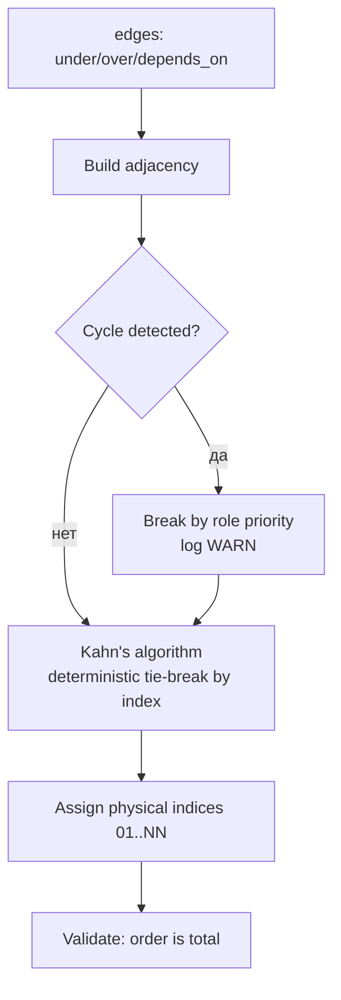
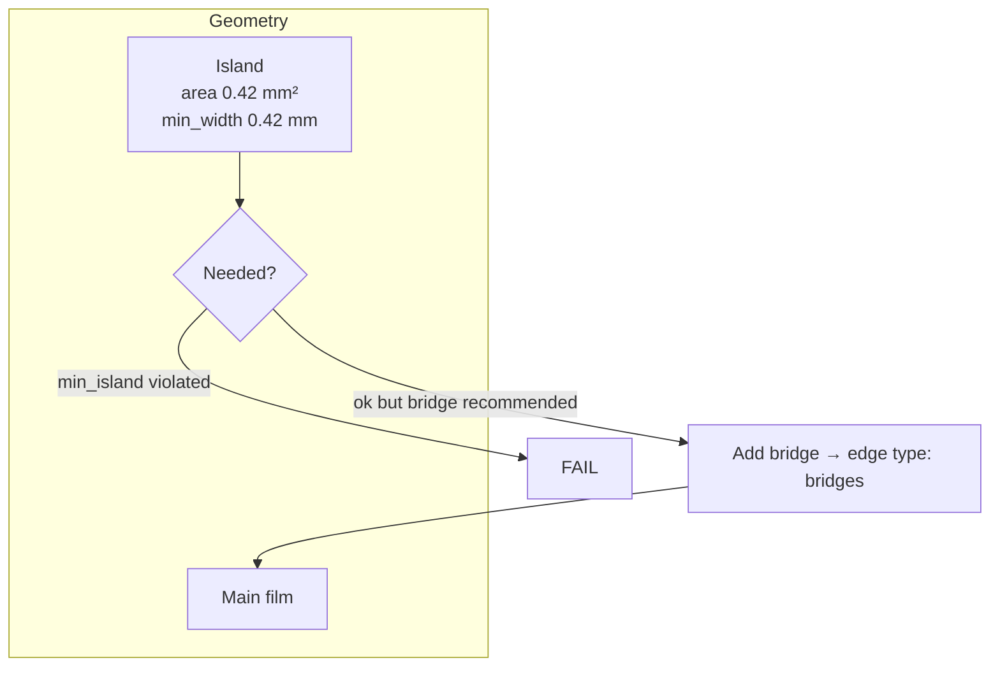
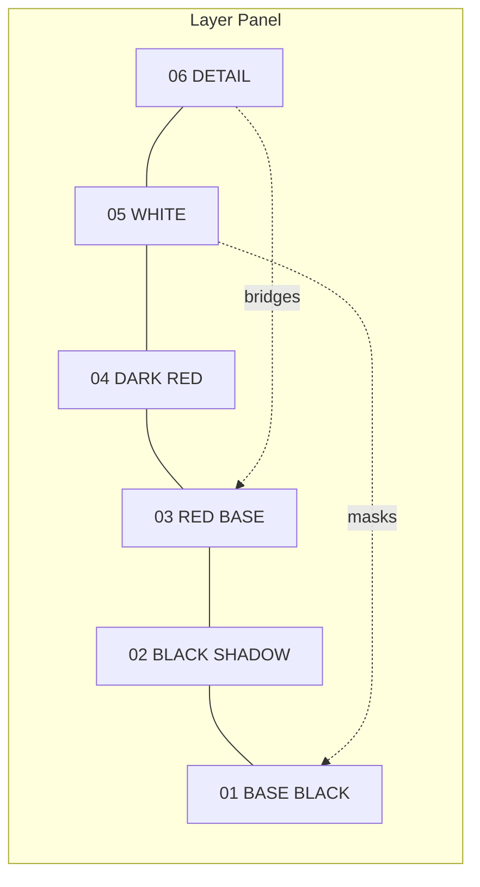

# LAYER_GRAPH

## 1. Зачем граф, а не список

Список слоёв подразумевает, что порядок — это просто последовательность.
Это верно только для непересекающихся элементов. Целевой класс графики —
переплетение линий, петли, ветвления, пересечения, вложенные контуры.

Примеры, где список не работает:

| Случай | Что ломается в списке |
|---|---|
| Линия A проходит **поверх** B, но B поверх C | Порядок противоречив в разных точках |
| Элемент D **пересекает** A, но должен быть **под** B | Нет способа выразить частичное отношение |
| Островок E пересекает B и требует **моста** к C | Нет структуры для хранения связей |
| Петля F **вложена** в A, но **выходит** из B | Простое сравнение индексов не работает |

Граф решает это явными отношениями и обнаружением циклов.

## 2. Типы отношений

| Тип | Смысл | Направление | Влияет на порядок | Влияет на геометрию |
|---|---|---|---|---|
| `under` | A наносится под B | да | да | нет |
| `over` | A наносится поверх B | да | да | нет |
| `intersects` | геометрии пересекаются | нет | по контексту | да (нужен cutout) |
| `bridges` | A соединяет B мостами | да | да | да |
| `nested_in` | геометрия A внутри B | нет | нет | да (вложенность) |
| `masks` | A закрывает зону для B | да | да | да |
| `depends_on` | A не может существовать без B | да | да | возможно |
| `same_paint_op` | A и B в одной операции | нет | нет | да (объединяются) |

## 3. Модель графа

## 4. Пример графа реального проекта

## 5. Разрешение противоречий

### 5.1 Цикл в `under`/`over`

Цикл в отношениях порядка — **фатальная ошибка**, не предупреждение.
Действие: попытаться разорвать цикл по силе отношения, иначе `FATAL`.

### 5.2 Частичные пересечения

Случай: A над B в области 1, но под B в области 2.

Решение: **геометрическое разрешение региона.** Слой разбивается на регионы
с разным порядком; в пересекающейся области создаются пары «маска + вырез».

### 5.3 Разрешение через приоритет роли

Таблица приоритетов (детерминированное правило, не AI):

| Роль | Приоритет | Обоснование |
|---|---|---|
| `stencil` | 100 | закрывает зону, наносится последним поверх |
| `cutaway` | 95 | вырезает предыдущие слои |
| `detail` | 80 | тонкие элементы поверх |
| `highlight` | 60 | |
| `gradient` | 50 | |
| `shadow` | 40 | |
| `base` | 20 | фундамент |
| `shim` | 10 | подложка внизу |

## 6. Региональное разрешение (region-aware order)

Алгоритм:

1. Разбить общую площадь на регионы по пересечению.
2. Для каждого региона определить локальный порядок.
3. Объединить регионы с одинаковым порядком в одну маску.
4. Проверить каждую результирующую маску на min width/gap.

## 7. Топологическая сортировка

Детерминированный tie-break: при равной «готовности» узлы сортируются
по `index`, затем по `layer_id`. Это гарантирует воспроизводимость (P-08).

## 8. Граф и физика: мосты

Тип отношения `bridges` в графе отражает **физическую связь** в геометрии:
мост — это path в слое-владельце, соединяющий островок с основной плёнкой.

## 9. Валидация графа

| Проверка | Severity | Сообщение |
|---|---|---|
| Ссылка на несуществующий слой | error | «Слой L07 упомянут в графе, но не существует» |
| Цикл в `under`/`over` | fatal | «Порядок слоёв не определён: A→B→C→A» |
| Один и тот же слой в `over` к двум слоям без приоритета | warning | «Неоднозначность порядка разрешена по приоритету роли» |
| Пересечение без отношения | warning | «L03 и L04 пересекаются, но отношение не задано» |
| Островок без моста при `bridges` ожидаемом | error | «Островок 3 в слое L03 не соединён» |
| Слой без входящих/исходящих рёбер | info | «Слой L01 изолирован» |

## 10. Визуализация в Studio

UI показывает:
* порядок (сверху вниз = сверху вниз по нанесению);
* связи не-последовательных слоёв — тонкой линией с подписью типа;
* конфликты — красной рамкой и счётчиком на панели.

## 11. Влияние на физическое производство

Граф — не только UI-структура. Он напрямую определяет:

| Что | Как влияет граф |
|---|---|
| Порядок нанесения | Топологическая сортировка |
| Нужен ли cutout в нижнем слое | Отношения `over` + `intersects` |
| Где нужны мосты | Отношения `bridges` + результат Topology |
| Какие слои нельзя слить | Наличие циклов/конфликтов |
| Размер заказа | Число физических слоёв |
| Текст инструкции | Порядок шагов генерируется из графа |

## 12. Связанные документы

* `LAYER_ENGINE.md` — как рождаются физические слои.
* `../05_GEOMETRY/TOPOLOGY_ENGINE.md` — мосты и островки.
* `../07_STUDIO/MASK_STUDIO.md` — UI графа.
* `../06_MANUFACTURING/VALIDATOR.md` — проверки графа.