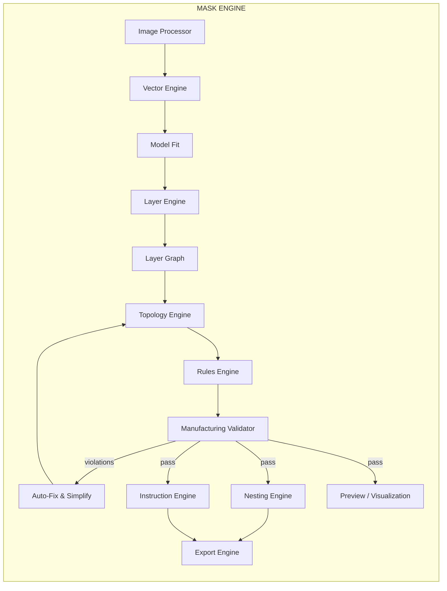
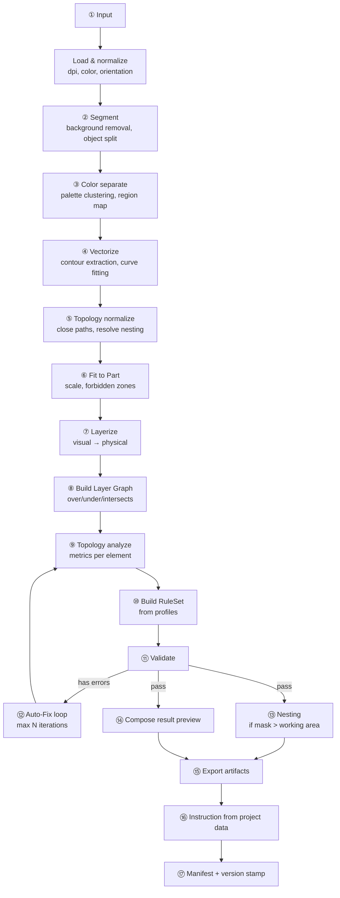
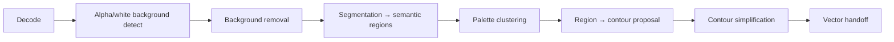

# MASK_ENGINE

Технологическое ядро. Преобразует изображение/вектор в производственный Mask Project.

## 1. Иерархия модулей



## 2. Модули и их ответственность

| Модуль | Вход | Выход | Детерминирован? | AI внутри? |
|---|---|---|---|---|
| **Image Processor** | растр, PDF, SVG | растр-маски + контуры-кандидаты | частично | да (CV) |
| **Vector Engine** | контуры/растр | нормализованная векторная геометрия | да | опционально (трассировка) |
| **Model Fit** | вектор + Part | размеченная в деталь геометрия | да | нет |
| **Layer Engine** | геометрия + палитра | физические слои + paint spec | да | предлагает, не решает |
| **Layer Graph** | слои + пересечения | граф зависимостей + порядок | да | нет |
| **Topology Engine** | геометрия слоя | метрики, нарушения, кандидаты фиксов | да | нет |
| **Rules Engine** | профили | RuleSet | да | нет |
| **Validator** | проект + RuleSet | вердикт + диагностика | да | нет |
| **Auto-Fix** | нарушения | применённые операции + отчёт | да | нет |
| **Nesting Engine** | геометрия + рабочее поле | Nests + tiles + метки | да | нет |
| **Export Engine** | проект | артефакты + manifest | да | нет |
| **Instruction Engine** | проект | инструкция | частично (текст) | только текст |
| **Preview** | проект | растр превью | да | нет |

## 3. Конвейер (полный)



### Бюджеты стадий (целевые, для проекта 1 Мпикс / 6 слоёв)

| Стадия | Бюджет | Комментарий |
|---|---|---|
| Load + normalize | 200 ms | |
| Segment | 800 ms | только если AI; иначе 0 |
| Color separate | 300 ms | |
| Vectorize | 1200 ms | самая тяжёлая |
| Topology normalize | 300 ms | |
| Fit | 100 ms | |
| Layerize | 250 ms | |
| Graph | 150 ms | |
| Topology analyze | 400 ms | |
| Validate | 250 ms | |
| Fix loop | 1500 ms | ≤ 3 итерации |
| Nest | 400 ms | |
| Export | 300 ms | |
| **Итого** | **≤ 6 s** | |

## 4. Точки расширения

### 4.1 Image Processor

Входные форматы и обработчики:

| Вход | Обработчик |
|---|---|
| PNG / JPG / WEBP | decode → linearize → threshold |
| SVG | path parse → same pipeline as vector |
| PDF | vector-first (pdfium/mupdf), затем rasterize для CV |

Пайплайн обработки:


### 4.2 Vector Engine

Отвечает за нормализацию геометрии. Ключевая ответственность — **метрики элемента**.

```json
{
  "id": "path_124",
  "layer": 3,
  "width": 0.82,
  "closed": true,
  "area": 14.2,
  "risk": "low"
}
```

Обязательные операции:
* `flatten(curve → polyline, tolerance)`;
* `dedupe(points, epsilon)`;
* `orient(contours, fill_rule)`;
* `build_nesting_tree(paths)` — вложенность контуров;
* `detect_self_intersections`;
* `measure(paths)` → area, length, min/max width, curvature.

### 4.3 Layer Engine

См. `LAYER_ENGINE.md`. Разбиение visual → physical с оптимизацией по числу операций.

### 4.4 Topology Engine

См. `../05_GEOMETRY/TOPOLOGY_ENGINE.md`.

### 4.5 Validator

См. `../06_MANUFACTURING/VALIDATOR.md`.

### 4.6 Nesting Engine

См. `../06_MANUFACTURING/NESTING_ENGINE.md`.

### 4.7 Export Engine

См. `../06_MANUFACTURING/EXPORT_ENGINE.md`.

## 5. Модель исполнения внутри ядра

```mermaid
flowchart TB
  subgraph REQ["EngineRequest"]
    R1[project_id]
    R2[input: geometry | source | target part]
    R3[options: simplify_level, autofix, nest]
    R4[profile snapshots]
  end
  REQ --> PLAN["Pipeline planner<br/>deterministic stage list"]
  PLAN --> EXEC["Stage executor<br/>with stage timing + errors"]
  EXEC --> CTX["EngineContext<br/>geometry, profiles, budget, logger"]
  EXEC --> OUT["EngineResult"]
  OUT --> O1[updated project]
  OUT --> O2[diagnostics]
  OUT --> O3[fidelity]
  OUT --> O4[metrics]
```

**EngineContext** — общий контекст стадии: геометрия, снимки профилей,
бюджеты, логгер, feature flags, `engine_version`.

## 6. Обработка ошибок

Ошибки делятся на три класса:

| Класс | Пример | Поведение | Severity |
|---|---|---|---|
| **Recoverable** | `ELEMENT_TOO_SMALL` | Auto-Fix может исправить | warning |
| **Blocking** | `NO_VALID_LAYER_ASSIGNMENT` | Прогон останавливается | error |
| **Fatal** | `MALFORMED_GEOMETRY`, `UNSUPPORTED_INPUT` | Прогон прерывается, ошибка пользователю | fatal |

Ошибки **никогда не приводят к молчаливой деградации** геометрии. Любая деградация — явный
`degradation` в отчёте.

## 7. Детерминизм

Требования к ядру:

| Аспект | Правило |
|---|---|
| Порядок обхода | Явная сортировка по стабильному ключу (index, id) |
| Плавающая точность | Фиксированная точность в расчётах площади/длины (ADR-0004) |
| Хеширование | Геометрия хешируется по канонической сериализации |
| Версия | `engine_version` семантическая, записывается в результат |
| Random | Только seeded random для jitter в auto-fix |
| Время | Не используется в вычислениях (только в метаданных) |

## 8. Конфигурация прогона

```json
{
  "engine_version": "0.4.2",
  "target_fidelity": 0.90,
  "simplify_strategy": "balanced",
  "autofix": {
    "enabled": true,
    "max_iterations": 3,
    "allow_bridge_add": true,
    "allow_widen": true,
    "allow_remove_detail": true,
    "max_fidelity_loss": 0.03
  },
  "nest": {
    "enabled": true,
    "orientation": "fixed",
    "rotation_step_deg": 0
  },
  "processing": {
    "flatten_tolerance_mm": 0.05,
    "curve_fit": "cubic",
    "palette_clusters": 8
  }
}
```

## 9. Метрики прогона

Каждый прогон возвращает:

```json
{
  "run_id": "RUN-004512",
  "stage_timings": { "vectorize_ms": 1180, "validate_ms": 240, … },
  "metrics": {
    "input_paths": 41,
    "output_paths": 38,
    "visual_layers": 4,
    "physical_layers": 6,
    "fragments_removed": 23,
    "bridges_added": 5,
    "min_width_before_mm": 0.42,
    "min_width_after_mm": 0.80,
    "fidelity": 0.912,
    "tiles": 9,
    "waste_ratio": 0.187
  }
}
```

## 10. Связанные документы

* `LAYER_ENGINE.md` — разбиение на физические слои.
* `LAYER_GRAPH.md` — граф зависимостей.
* `../05_GEOMETRY/TOPOLOGY_ENGINE.md` — геометрия и авто-фикс.
* `../06_MANUFACTURING/MANUFACTURING_ENGINE.md` — правила и профили.
* `../08_AI/AI_ARCHITECTURE.md` — границы AI.