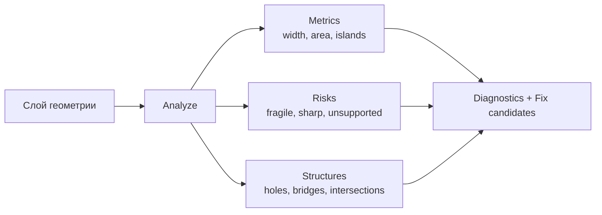
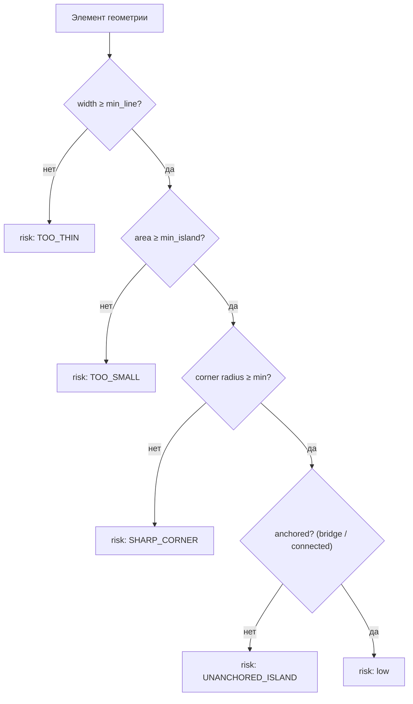
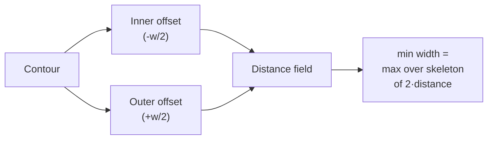
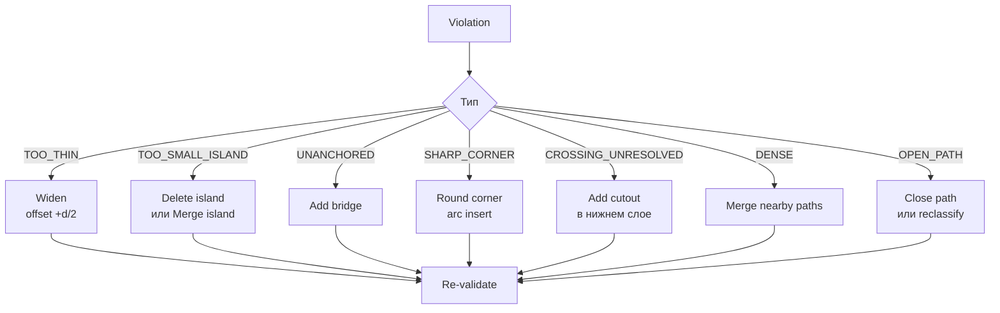
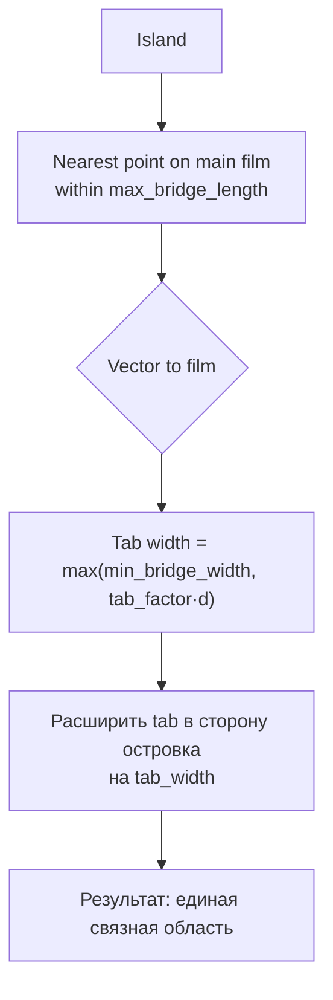
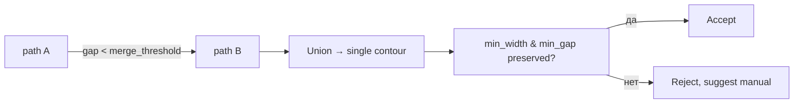
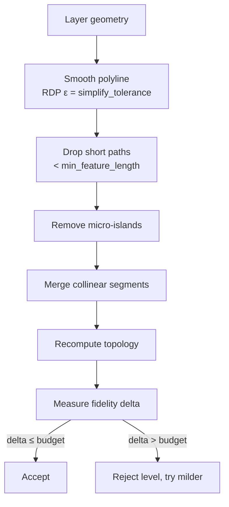
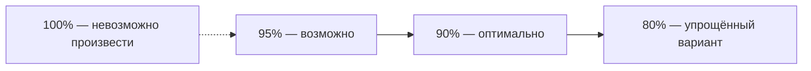
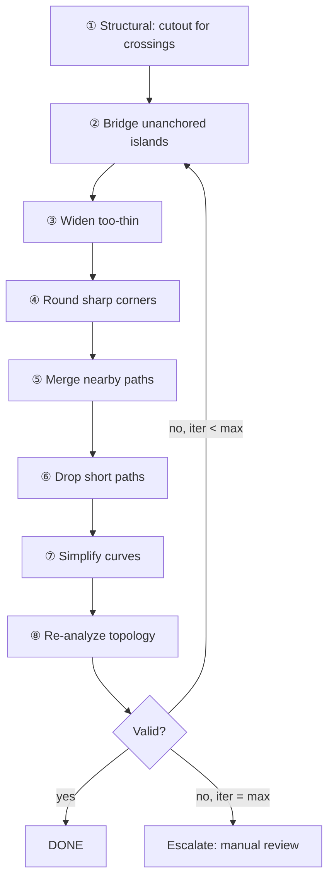

# TOPOLOGY_ENGINE

Модуль, который отвечает на вопрос: **будет ли эта маска физически целой?**

## 1. Задача

Топология маски — это не «красота вектора», а вопрос выживаемости плёнки:
* что останется после снятия;
* что выпадет при снятии;
* что порвётся при вырезании;
* что сольётся и не даст нужного рисунка.



## 2. Модель риска



## 3. Метрики элемента

```json
{
  "id": "path_124",
  "layer": 3,
  "type": "contour",
  "width": 0.82,
  "closed": true,
  "area": 14.2,
  "length": 41.7,
  "risk": "low",
  "perimeter_mm": 41.7,
  "min_gap_to_neighbor_mm": 1.10,
  "corner_radius_min_mm": 0.35,
  "is_island": false,
  "anchored": true,
  "self_intersections": 0
}
```

### 3.1 Как измеряется ширина элемента



Алгоритм (реализуемый в ядре):
1. Построить offset контура внутрь на `probe/2` и наружу на `probe/2`.
2. Если внутренний offset схлопывается — ширина < `probe`.
3. Уточнить бинарным поиском по `probe`.
4. Итоговое значение округляется до `MEASURE_REPORT_DP = 3` знаков.

**Сравнение с порогом** выполняется с полосой `MIN_WIDTH_EPS_MM = 1e-3 мм`:
элемент проходит, если `width ≥ threshold − MIN_WIDTH_EPS_MM`. Это устраняет
неопределённость на границе (`0.7995 мм` при пороге `0.80 мм` — не нарушение).
Все допуски определены в **ADR-0004**; здесь они не переопределяются.

**Проще и быстрее:** скелетизация растра в целочисленной сетке с масштабом
`1 мм = N px`, затем расстояние от скелета до края. Точность ограничена сеткой,
но для решения «0.42 vs 0.80 mm» более чем достаточно, и метод устойчив
к кривым. Финальная проверка — offset-методом.

## 4. Проверки

| # | Проверка | Метрика | Условие прохождения | Severity |
|---|---|---|---|---|
| T-01 | Минимальная ширина элемента | `min_width` | `≥ material.min_line_mm` | error |
| T-02 | Минимальный зазор | `min_gap` | `≥ material.min_gap_mm` | error |
| T-03 | Минимальный островок | `island.area` | `≥ material.min_island_mm²` | error |
| T-04 | Островок закреплён | `anchored` | `= true` или есть `bridge` | error |
| T-05 | Минимальный радиус угла | `corner_radius_min` | `≥ material.min_corner_radius_mm` | error |
| T-06 | Ширина моста | `bridge.width` | `≥ material.min_bridge_width_mm` | error |
| T-07 | Длина моста | `bridge.length` | `≤ material.max_bridge_length_mm` | warning |
| T-08 | Нет самопересечений | `self_intersections` | `= 0` | error |
| T-09 | Нет незамкнутых cut-контуров | `open_cut_paths` | `= 0` | error |
| T-10 | Минимальная длина элемента | `path.length` | `≥ material.min_feature_length_mm` | warning |
| T-11 | Снятие (peelability) | `peel_angle`, `tension` | по профилю | warning |
| T-12 | Нет пересечений без cutout | `crossing_paths` | каждый crossing разрешён | error |
| T-13 | Плотность элементов | `elements_per_100cm²` | `≤ material.max_density` | warning |
| T-14 | Нет острых внутренних углов < 30° | `min_angle` | `≥ material.min_angle_deg` | warning |
| T-15 | Совмещение регистрации | `registration_error_mm` | `≤ material.max_registration_mm` | error |

## 5. Диагностика: человеческий язык

```text
⚠ 7 элементов слишком маленькие для выбранного материала.
   Минимум: 0.80 мм.  Худший элемент: 0.42 мм (слой 06, деталь D).

   Причина: детализация ниже разрешающей способности материала.

   [Исправить автоматически]   [Показать элементы]   [Изменить материал]
```

```text
✖ 2 островка не соединены с основной частью маски.
   Слои 03 и 06, детали A7 и C2. Площадь островков 0.4 и 0.6 мм².

   Причина: при снятии маски островки выпадут.

   [Добавить мосты]   [Объединить с соседним элементом]   [Показать]
```

Полный формат — см. `../06_MANUFACTURING/VALIDATOR.md`.

## 6. Авто-фикс: операции

Реализовано: **6.1 Widen** (`--widen-to`) и **6.2 Add bridge** (`--bridge`,
частично — см. ниже). Остальные операции задокументированы, но не реализованы:
сглаживание кривых в частности невозможно до появления кривых в геометрии.



### 6.1 Widen

```mermaid
flowchart LR
  P["Contour, width 0.42"] --> O["offset +0.19"]
  O --> N["width 0.80"]
  N --> CHK{"fidelity loss?"}
  CHK -->|≤ max_fidelity_loss| OK["Accept"]
  CHK -->|>| max_fidelity_loss| ALT["Try partial widen<br/>or suggest manual"]
```

Смещение: `d_new = (target - actual)/2` outward для внешних контуров,
inward для отверстий. **Ограничение:** widen не применяется, если результат
создаёт `min_gap` violation.

### 6.2 Add bridge



Правила размещения моста (детерминированные):
1. Ближайшая точка на границе основной плёнки, находящаяся в пределах `max_bridge_length`.
2. Избегать зон с толстыми элементами и зон регистрации.
3. Мост не должен проходить через `min_gap` от других вырезов.
4. Предпочтительное направление — к ближайшей «массе» плёнки.

**Статус реализации.** Правило 1 и следствие из 4 выполнены в
`engine/kernel/src/bridge.rs`, команда `maskctl --bridge`, правила T-04 и T-07.
Мост строится прямоугольником шириной `bridge_width_mm` и накрывает оба конца
на половину своей ширины: мост, заканчивающийся ровно на границе, даёт контакт
нулевой площади, и объединение не сливает фигуры гарантированно.

Правила 2 и 3 **не реализованы**, и это зафиксировано в `bridge::KNOWN_GAPS`:
зоны регистрации заданы в профиле плоттера, а не в геометрии слоя, и угадывать их
положение означало бы класть мосты на метки, которые оператор видит, а код — нет.
Проверку `min_gap` для самого моста делает Валидатор.

Островок, до которого не дотянуться в пределах `max_bridge_length`, мостом **не
связывается**: команда сообщает расстояние и оставляет слой как есть, чтобы
Валидатор поднял T-04. Мост через `max_bridge_length` — это утверждение о
материале, которое никто не измерял.

### 6.3 Merge nearby paths



`merge_threshold` = `material.min_gap_mm × 2`. Объединение убирает
«ложные зазоры», которые не несут смысла.

### 6.4 Round corner

Вставка дуги радиуса `r = material.min_corner_radius_mm` в вершину угла
с внутренним радиусом < `r`. Кривая аппроксимируется по tolerance.

### 6.5 Auto-Simplify



## 7. Auto-Simplify и бюджет сходства



| Уровень | Tolerance | Что делает | Когда |
|---|---|---|---|
| `strict` | 0.02 mm | только сглаживание | ручная работа, ценные детали |
| `balanced` | 0.05 mm | + удаление микро-островков | default |
| `aggressive` | 0.12 mm | + агрессивное слияние, упрощение кривых | сложные проекты |
| `extreme` | 0.25 mm | минимальный набор операций | fallback |

**Цель: 90% сходства при 100% производимости** (P-06).

## 8. Порядок применения фиксов

Порядок важен — применение в неправильном порядке может портить геометрию:



## 9. Производительность

| Операция | Сложность | Замечание |
|---|---|---|
| Skeletonization | O(n) на растре | быстрый путь для оценки ширины |
| Offset | O(n log n) | требует надёжной реализации |
| Boolean ops | O(n log n)–O(n²) worst case | кэширование результатов |
| Pairwise distance | O(n log n) | spatial index обязателен |
| RDP simplify | O(n log n) | |
| Bridge placement | O(n log n) с kd-tree | |

Стратегия: двухфазная оценка.
1. **Быстрая** (растр + скелет): отсеять явно нормальные элементы.
2. **Точная** (offset): проверить только подозрительные.

Цель: слой 10 000 paths < 1.5 s в двухфазном режиме.

## 10. Кэширование

| Кэш | Ключ | Значение |
|---|---|---|
| geometry metrics | sha256(geometry) + tolerance | результаты measure |
| offset result | sha256(path) + delta + join_style | offset path |
| simplify result | sha256(path) + epsilon + strategy | упрощённый path |
| skeleton metrics | sha256(raster) + scale | карта ширин |

Инвалидация — по хешу содержимого, не по времени. Это обеспечивает
детерминизм (P-08).

## 11. Границы модуля

**Модуль не делает:**
* не решает, какие элементы удалить «по вкусу» — только по порогам;
* не знает о красках и порядке слоёв;
* не разбивает маску на tiles (это Nesting);
* не генерирует текст для пользователя.

**Модуль предоставляет:**
* метрики по каждому элементу;
* нарушения с человеческими описаниями;
* кандидаты фиксов с оценкой влияния на сходство;
* отчёт о применённых операциях.

## 12. Связанные документы

* `../04_ENGINE/MASK_ENGINE.md` — место в конвейере.
* `../04_ENGINE/LAYER_GRAPH.md` — мосты как отношение графа.
* `../06_MANUFACTURING/MANUFACTURING_ENGINE.md` — откуда берутся пороги.
* `../06_MANUFACTURING/VALIDATOR.md` — как нарушения попадают к пользователю.