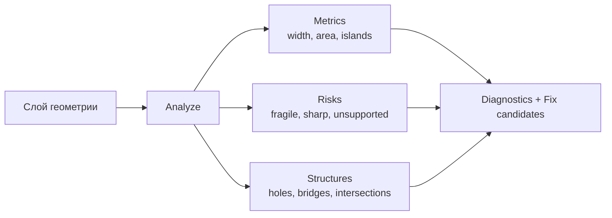
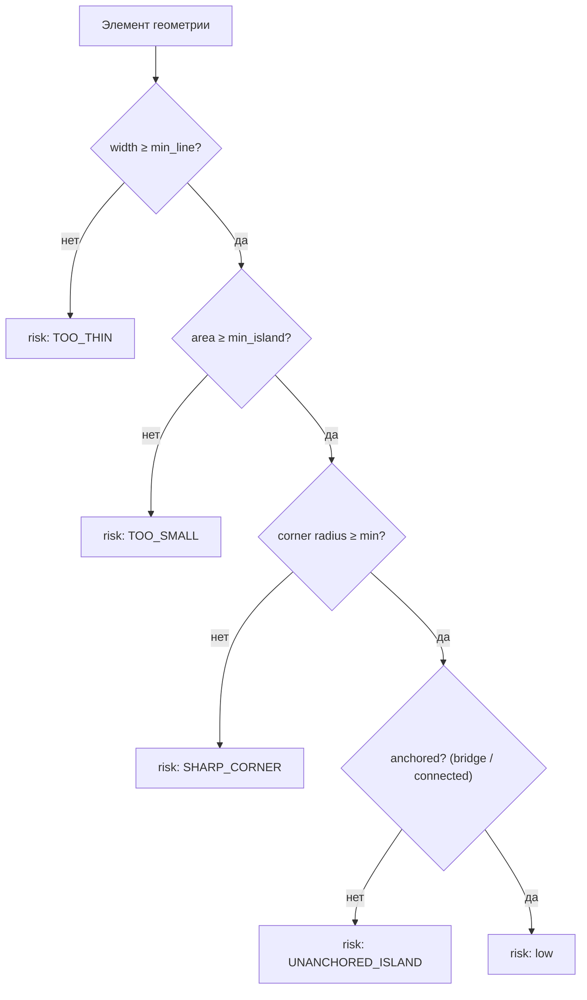
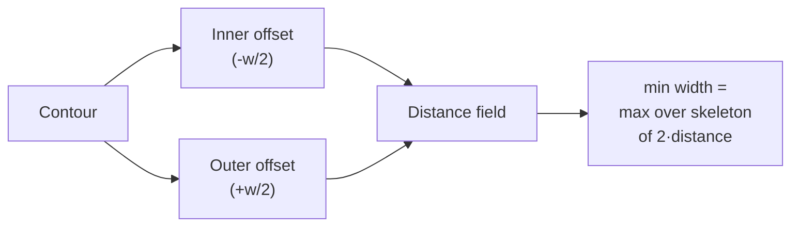
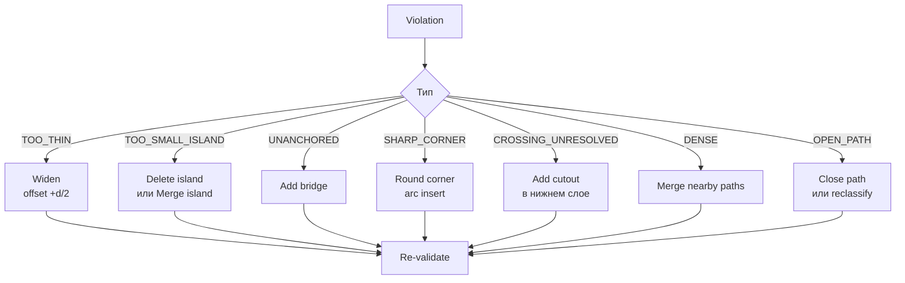
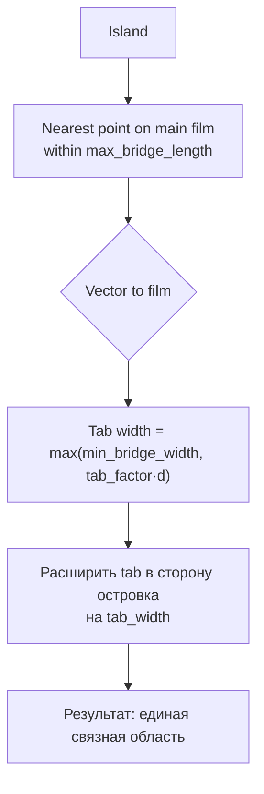
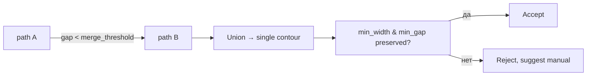
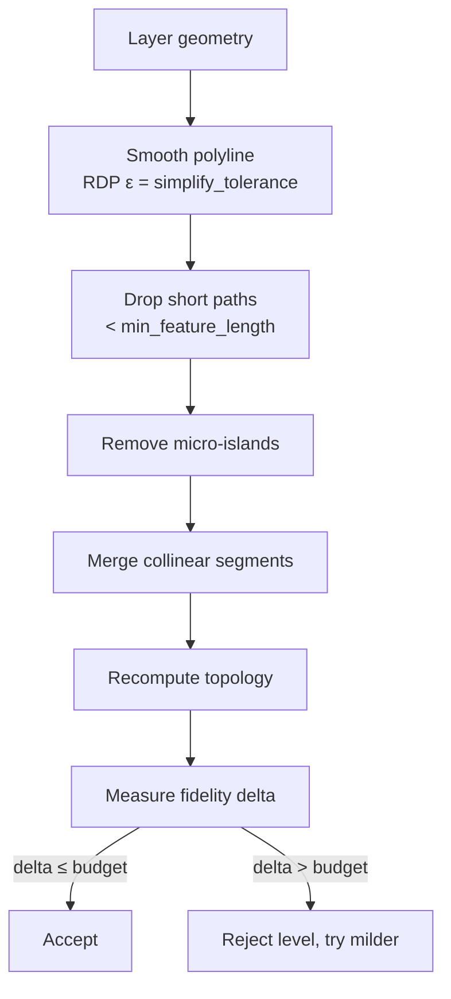
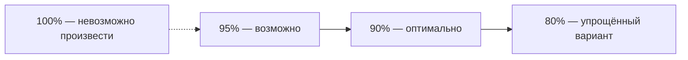
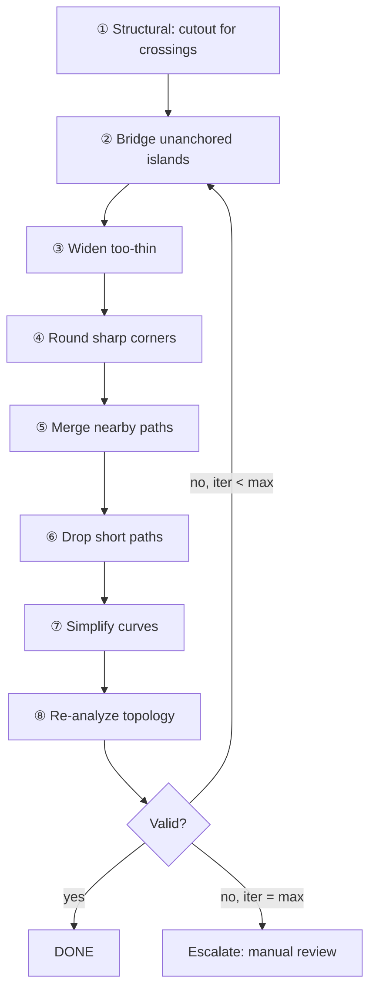

# TOPOLOGY_ENGINE

Модуль, который отвечает на вопрос: **будет ли эта маска физически целой?**

## 1. Задача

Топология маски — это не «красота вектора», а вопрос выживаемости плёнки:
* что останется после снятия;
* что выпадет при снятии;
* что порвётся при вырезании;
* что сольётся и не даст нужного рисунка.



## 2. Модель риска



## 3. Метрики элемента

```json
{
  "id": "path_124",
  "layer": 3,
  "type": "contour",
  "width": 0.82,
  "closed": true,
  "area": 14.2,
  "length": 41.7,
  "risk": "low",
  "perimeter_mm": 41.7,
  "min_gap_to_neighbor_mm": 1.10,
  "corner_radius_min_mm": 0.35,
  "is_island": false,
  "anchored": true,
  "self_intersections": 0
}
```

### 3.1 Как измеряется ширина элемента



Алгоритм (реализуемый в ядре):
1. Построить offset контура внутрь на `probe/2` и наружу на `probe/2`.
2. Если внутренний offset схлопывается — ширина < `probe`.
3. Уточнить бинарным поиском по `probe`.
4. Итоговое значение округляется до `MEASURE_REPORT_DP = 3` знаков.

**Сравнение с порогом** выполняется с полосой `MIN_WIDTH_EPS_MM = 1e-3 мм`:
элемент проходит, если `width ≥ threshold − MIN_WIDTH_EPS_MM`. Это устраняет
неопределённость на границе (`0.7995 мм` при пороге `0.80 мм` — не нарушение).
Все допуски определены в **ADR-0004**; здесь они не переопределяются.

**Проще и быстрее:** скелетизация растра в целочисленной сетке с масштабом
`1 мм = N px`, затем расстояние от скелета до края. Точность ограничена сеткой,
но для решения «0.42 vs 0.80 mm» более чем достаточно, и метод устойчив
к кривым. Финальная проверка — offset-методом.

### 3.2 Как измеряется зазор

Зазор — это расстояние между границами двух областей слоя: при снятии они
сливаются, и плёнка между ними рвётся вместе с соседним куском.

**Считается напрямую, а не оффсетом.** Очевидная реализация — растить одну
область до встречи с другой, как это делает `min_width`, — была написана и
оказалась неверной. `min_width` меряет *поперёк* полосы, где все направления
равнозначны. Зазор меряется *между* фигурами, где направление и есть смысл
измерения. Оффсет наружу соединяет углы митером, а митер выносит угол на
`d / sin(θ/2)` — для угла 90° это `d × 1.414`. Квадрат, выросший на 8 мм,
достаёт до 11.3 мм по диагонали.

Два квадрата с зазором 6 мм по x и 8 мм по y, то есть с истинным зазором
10 мм, читались как 8 мм. Ошибка в опасную сторону: зазор **занижается**, и
проект с настоящими 10 мм выглядит имеющим 8. В осевом случае этого не видно,
поэтому ошибка дожила до диагонального теста.

Итог: минимум по всем парам сегментов, точный и направленный, без бисекции.
Реализация: `engine/kernel/src/gap.rs`, правило T-02 в Валидаторе,
фикстуры `t6_min_gap_violated.json` и `t7_min_gap_ok.json`.

Зазор нулевой, а не «нет зазора», когда области касаются или перекрываются:
при снятии они сольются, и это другой отказ, чем слишком тонкий зазор.

Что не меряется, зафиксировано в `gap::KNOWN_GAPS`: расстояние от области до
собственной дырки (там по определению залита плёнка, риска для снятия нет) и
зазоры до края плитки и до меток регистрации — это зона nesting.

### 3.3 Острый угол и почему это не T-05

T-05 требует **минимальный радиус**. На многоугольных контурах такого числа нет:
у вершины радиус тождественно нулевой, поэтому проверка «радиус ≥ 0.4 мм» провалилась
бы на каждом углу каждой фигуры и не значила ничего. Сообщать радиус, которого в
геометрии нет, хуже, чем сказать, что проверка неприменима.

При этом `minimums.corner_radius_mm` документирован как «острый внутренний угол =
разрыв плёнки». Значит **требование — угол**, а радиус — только форма починки.
Поэтому T-14 меряет угол, а T-05 остаётся явной заметкой, которая теперь говорит,
что именно проверяется вместо неё.

**Измерение угла** всегда точное для многоугольной геометрии. Внутренний угол
через плёнку, в градусах. Неоднозначность: два ребра, выходящие из вершины, дают
одинаковые векторы и у выпуклого угла плёнки, и у выреза в ней — направление
плёнки короче определяет знак векторного произведения, и знать обмотку контура.

**Скругление** (авто-фикс 6.4) вставляет дугу по касательной к обоим рёбрам.
Дуга выдаётся сегментами: в геометрии нет примитива кривой, и выдумывать его здесь
не место. Отчёт `RoundReport` перечисляет углы, которые скруглить не удалось.

Две вещи, найденные при реализации:

- **Индексы вершин инвалидируются.** Заливка одной вершины вставляет точки и
  перенумеровывает все последующие, поэтому заливка «на месте» по заранее
  посчитанным индексам скругляет не ту вершину. Каждый контур перестраивается за
  один проход из снапшота.
- **Острый угол всегда не один.** Втягивание одного угла квадрата внутрь даёт две
  острые вершины (соседи, где диагональное ребро встречает прямые стороны) и одну
  рефлексную ~242° — сам втянутый угол, то есть вырез в плёнке, а не риск разрыва.

Реализация: `engine/kernel/src/corner.rs`, правило T-14 в Валидаторе, флаг
`maskctl --round-corners`, фикстуры `t8_ordinary_angles.json` и
`t9_sharp_angle.json`.

Скругление только убирает материал и никогда не добавляет, а на очень остром угле
съедает много: конус 14° требует касательной длиной 8.1 мм на ребре 10 мм при
фаске радиусом 1 мм. Это геометрия, а не дефект, и об этом сообщает отчёт.

### 3.4 Самопересечения и незамкнутые контуры

Это проверки целостности, а не производимости: они отвечают на вопрос «а это вообще
правильная геометрия», и ответ должен быть «нет» раньше, чем измерение вообще
что-то значит.

**Почему это важнее, чем кажется.** Знаковая площадь предполагает простой
многоугольник: рёбра пересекаются только в общих вершинах. Когда контур
пересекает сам себя, пересечения делят его на доли, которые взаимно сокращаются.
Площадь получается правдоподобным числом, но не площадью ничего, что лежит на
столе, и уходит не туда, куда поведёт обмотка.

Проект уже дважды получал дефекты именно этой формы — дырка с обмоткой внешнего
контура сообщала 500 мм² вместо 300, и ничего не возникало, потому что неверная
площадь выглядит как число. Самопересечение — тот же отказ с большей свободой в
том, как он пойдёт не туда, и оно доходит ещё и до экспортера.

**Почему детект, а не автоматическая починка.** `boolean::normalise` разрешил бы
всё это одним вызовом — и он не вызывается **нигде**. Это осознанно: разрешение
самопересечения меняет рисунок, а маска — физический объект, вырезаемый из
плёнки. Молча перерисовывать чужой дизайн ради прохождения проверки — неверный
выбор по умолчанию, даже когда результат геометрически безупречен. Модуль находит
и указывает точку, решение принимает оператор.

**Тонкость, найденная при реализации.** `build_layer` объединяет все области слоя
в один кусок — и union разрешает самопересечения. Бабочка (bow tie) входит одним
контуром с площадью **0 мм²** (доли сокращаются точно) и выходит двумя
треугольниками по 400 мм². Ничего не сообщается. Рисунок оператора был
неоднозначным, движок выбрал трактовку, и единственное свидетельство — геометрия,
которая уже не похожа на нарисованное.

Поэтому проверка целостности стоит на геометрии **как записано**, до
объединения. Фикстура `t10_self_intersection.json` — тот случай: CLI отказывается
работать, называет точку пересечения и площадь 0 мм².

Реализация: `engine/kernel/src/integrity.rs`, правила T-08 и T-09 в Валидаторе,
ворота `check_source_integrity` в CLI.

Не считаются самопересечениями: общая вершина соседних рёбер (иначе правило сработало
бы на каждом многоугольнике), параллельные рёбра, вырожденные «пинчи» — их ловит
проверка ширины и площади.

### 3.5 Островки и плотность (T-03, T-13)

**T-03 — два разных требования.** В доках T-03 был только про площадь, а правило
в таблице — только про ширину. В профиле при этом есть оба порога:
`minimums.island_area_mm2` и `minimums.island_width_mm`, то есть половина
требования была объявлена и не проверялась. Теперь это два правила:
`min_island_area` и `min_island_width`.

Проверяются **все** области слоя, а не только помеченные как островки: кусок,
соединённый с остальной плёнкой, всё равно должен удерживать сам себя.

**T-13 — верхняя граница, а не нижняя.** Общий рендер правил печатает
«измерено X, требуется Y», что для верхней границы указывает не туда: слою не
«не хватает» плотности, её слишком много. Поэтому это правило формулируется
отдельно, а в тексте сказано «максимум». Есть тест на это.

Плотность считается по **габаритам рисунка**, а не по суммарной площади плёнки.
Правило про труд: сколько отдельных кусков оператору нужно снять и положить на
единицу площади. Делить по площади чернил сделало бы разрежённый и трудный
рисунок «плотным».

## 3.6 Мосты: как T-06 и T-07 стали измеримы

Мост после вставки становится частью геометрии слоя и **неотличим** от любой
другой части: ни в `Shapes`, ни в `Contour` нет признака «это язычок». Измерить
ширину конкретного моста было невозможно — не из-за отсутствия формулы, а из-за
**отсутствия идентичности**. Проблема была не в измерении, а в том, что не о чем
спросить.

Решение: `LayerInput` теперь несёт список `bridges: Vec<BridgeRecord>` — что
записано в момент, когда язычок ставится. Запись содержит ширину, длину и точку
крепления к плёнке.

| правило | severity | порог |
|---|---|---|
| `bridge_width` (T-06) | error | `material.minimums.bridge_width_mm` |
| `bridge_length` (T-07) | warning | `material.minimums.bridge_length_mm` |

T-06 — error: мост уже оторвётся при снятии. T-07 — warning: длинный мост
вырезается, но рвётся при снятии.

Поле помечено `#[serde(default)]`, поэтому старые фикстуры и манифесты читаются
как раньше, а пустой список не порождает ничего — иначе каждый слой без моста
сообщал бы о мосте нулевой ширины.

Через WASM мосты не передаются: у браузерного фасада их нет, язычки ставит сервер.
Это отмечено в коде.

## 3.7 Найденное ограничение `min_width` (T-01)

`min_width` ищет **наибольший** внутренний отступ, при котором что-то остаётся, и
удваивает его. Для одной полосы это и есть её ширина. Для фигуры с горлышком —
нет: окружающая масса поддерживает результат непустым долго после того, как
горлышко уже схлопнулось.

Замерено:

```text
полоса 4 мм                     -> 4.000 мм
та же полоса + шейка 0.2 мм     -> 4.000 мм   ← шейка невидима
```

Значит **тонкий мост 0.2 мм проходит T-01**. Это настоящее ограничение уже
поставленной проверки, а не новый дефект.

Что сделано: ограничение описано в докстринге `min_width` вместе с числами,
закреплено двумя тестами — `a_plain_band_is_measured` (что работает) и
`a_thin_neck_is_invisible_and_that_is_pinned` (что не работает, и что это
ожидаемо). Тест на невидимость специально написан так, чтобы упасть, если метод
изменится: тогда придётся обновить и документацию.

Что **не** сделано и почему: нахождение настоящей медиальной оси требует
преобразования расстояний или разложения фигуры на части. Ни то, ни другое не
является локальной правкой этой функции, поэтому оно не сделано на бегу. Пока
это не сделано, T-01 честно измеряет ширину полосы и не видит горлышек.

### 3.8 Длина элемента: почему это кратчайшее ребро

Правило в доках записано как `path.length ≥ min_feature_length_mm`, а авто-упрощение
говорит «drop short paths». В этой модели геометрии **нет открытых путей** — каждый
контур замкнут, — поэтому буквально длину пути измерить нечем.

Измерима ближайшая честная величина: **кратчайшее ребро контура**.

Это не просто «что доступно», а что правильно. У ножа есть вынос и угол, поэтому он
не может довернуть впритык: ребро короче выноса не вырезается как нарисовано, его
закругляет инструмент. Такие рёбра — шум трассировки и крошечные погрешности
плавающей точки, и авто-упрощение существует именно чтобы их убрать.

Замерено на фигуре 90×55 мм с одним неколлинеарным изгибом 0.316 мм:

```text
⚠ Слой 1 «Short Kink»: самое короткое ребро — 0.316 mm (минимум 3.000 mm).
```

Severity — warning, не error: маска по-прежнему вырезается, просто выйдет немного не
так, как нарисовано. Есть тест, проверяющий, что одно короткое ребро не роняет
проект.

**Две вещи, найденные при реализации.**

Замкнутое ребро — то, что от последней точки к первой — обычно и есть короткое, и
его легче всего пропустить. Отдельный тест.

Первый вариант фикстуры сделал ступеньку **коллинеарной**, и boolean честно склеил
коллинеарные рёбра и убрал вершину. Предупреждения не было — и оно было ложным
отсутствием. Короткое ребро должно быть неколлинеарным, иначе оно не существует.

### 3.9 Регистрация (T-15)

Слои кладутся на деталь по очереди и должны лечь друг на друга. Ошибка складывается
из двух частей, и это разделение важно: одно исправляется в этом проекте, другое —
нет.

| источник | величина | откуда |
|---|---|---|
| плоттер | `plotter.accuracy.max_registration_error_mm` | из профиля |
| вложение | разброс якорей регистрации между слоями | из геометрии |
| **бюджет** | `material.physical.tolerance_registration_mm` | что плёнка терпит |

Проверяется сумма: `плоттер + вложение ≤ бюджет`.

Собственный бюджет в доках был назван `material.max_registration_mm`, а в профиле
такого поля нет — есть `physical.tolerance_registration_mm`. Это тот же смысл,
поэтому правило ссылается на реальное поле, а не на выдуманное.

Вложенный слой получает якорь — точку метки первого тайла на листе. Слои,
вложенные из одного начала, делят якорь и ничего не добавляют. Слои, вложенные по
разному, — нет, и разница между ними ровно та ошибка, которую впитает оператор.

**Почему якоря едут отдельной картой, а не расширяется карта тайлов.** Якоря нужны
только T-15. Удваивать параметр `nested_tiles` ради одного числа значило бы тащить
в Валидатор лишнее; `validate_with_nesting` остался обёрткой и по-прежнему
принимает только тайлы.

**Число в сообщении.** «Слои не совместятся» — не actionable. Сообщается оба
слагаемых отдельно, потому что плоттеру 0.30 мм нельзя помочь пересборкой
проекта, а вложение 0.40 мм — можно: переложить слои из одного начала.

## 4. Проверки

| # | Проверка | Метрика | Условие прохождения | Severity |
|---|---|---|---|---|
| T-01 | Минимальная ширина элемента | `min_width` | `≥ material.min_line_mm` | error |
| T-02 | Минимальный зазор | `min_gap` | `≥ material.min_gap_mm` | error |
| | | | **реализовано**, см. §4.1 | |
| T-03 | Минимальный островок | `island.area`, `island.width` | `≥ material.min_island_mm²` | error |
| | | | **реализовано**, см. §3.5 | |
| T-04 | Островок закреплён | `anchored` | `= true` или есть `bridge` | error |
| T-05 | Минимальный радиус угла | `corner_radius_min` | `≥ material.min_corner_radius_mm` | error |
| | | | **неприменима к многоугольной геометрии**, см. §3.3 | |
| T-06 | Ширина моста | `bridge.width` | `≥ material.min_bridge_width_mm` | error |
| | | | **реализовано**, см. §3.6 | |
| T-07 | Длина моста | `bridge.length` | `≤ material.max_bridge_length_mm` | warning |
| | | | **реализовано**, см. §3.6 | |
| T-08 | Нет самопересечений | `self_intersections` | `= 0` | error |
| | | | **реализовано**, см. §3.4 | |
| T-09 | Нет незамкнутых cut-контуров | `open_cut_paths` | `= 0` | error |
| | | | **реализовано**, см. §3.4 | |
| T-10 | Минимальная длина элемента | `shortest_edge` | `≥ material.min_feature_length_mm` | warning |
| | | | **реализовано как кратчайшее ребро**, см. §3.8 | |
| T-11 | Снятие (peelability) | `peel_angle`, `tension` | по профилю | warning |
| T-12 | Нет пересечений без cutout | `crossing_paths` | каждый crossing разрешён | error |
| T-13 | Плотность элементов | `elements_per_100cm²` | `≤ material.max_density` | warning |
| | | | **реализовано**, см. §3.5 | |
| T-14 | Нет острых внутренних углов < 30° | `min_angle` | `≥ material.min_angle_deg` | warning |
| | | | **реализовано**, см. §3.3 | |
| T-15 | Совмещение регистрации | `registration_error_mm` | `≤ physical.tolerance_registration_mm` | error |
| | | | **реализовано**, см. §3.9 | |

## 5. Диагностика: человеческий язык

```text
⚠ 7 элементов слишком маленькие для выбранного материала.
   Минимум: 0.80 мм.  Худший элемент: 0.42 мм (слой 06, деталь D).

   Причина: детализация ниже разрешающей способности материала.

   [Исправить автоматически]   [Показать элементы]   [Изменить материал]
```

```text
✖ 2 островка не соединены с основной частью маски.
   Слои 03 и 06, детали A7 и C2. Площадь островков 0.4 и 0.6 мм².

   Причина: при снятии маски островки выпадут.

   [Добавить мосты]   [Объединить с соседним элементом]   [Показать]
```

Полный формат — см. `../06_MANUFACTURING/VALIDATOR.md`.

## 6. Авто-фикс: операции

Реализовано: **6.1 Widen** (`--widen-to`) и **6.2 Add bridge** (`--bridge`,
частично — см. ниже). Остальные операции задокументированы, но не реализованы:
сглаживание кривых в частности невозможно до появления кривых в геометрии.



### 6.1 Widen

```mermaid
flowchart LR
  P["Contour, width 0.42"] --> O["offset +0.19"]
  O --> N["width 0.80"]
  N --> CHK{"fidelity loss?"}
  CHK -->|≤ max_fidelity_loss| OK["Accept"]
  CHK -->|>| max_fidelity_loss| ALT["Try partial widen<br/>or suggest manual"]
```

Смещение: `d_new = (target - actual)/2` outward для внешних контуров,
inward для отверстий. **Ограничение:** widen не применяется, если результат
создаёт `min_gap` violation.

### 6.2 Add bridge



Правила размещения моста (детерминированные):
1. Ближайшая точка на границе основной плёнки, находящаяся в пределах `max_bridge_length`.
2. Избегать зон с толстыми элементами и зон регистрации.
3. Мост не должен проходить через `min_gap` от других вырезов.
4. Предпочтительное направление — к ближайшей «массе» плёнки.

**Статус реализации.** Правило 1 и следствие из 4 выполнены в
`engine/kernel/src/bridge.rs`, команда `maskctl --bridge`, правила T-04 и T-07.
Мост строится прямоугольником шириной `bridge_width_mm` и накрывает оба конца
на половину своей ширины: мост, заканчивающийся ровно на границе, даёт контакт
нулевой площади, и объединение не сливает фигуры гарантированно.

Правила 2 и 3 **не реализованы**, и это зафиксировано в `bridge::KNOWN_GAPS`:
зоны регистрации заданы в профиле плоттера, а не в геометрии слоя, и угадывать их
положение означало бы класть мосты на метки, которые оператор видит, а код — нет.
Проверку `min_gap` для самого моста делает Валидатор.

Островок, до которого не дотянуться в пределах `max_bridge_length`, мостом **не
связывается**: команда сообщает расстояние и оставляет слой как есть, чтобы
Валидатор поднял T-04. Мост через `max_bridge_length` — это утверждение о
материале, которое никто не измерял.

### 6.3 Merge nearby paths



`merge_threshold` = `material.min_gap_mm × 2`. Объединение убирает
«ложные зазоры», которые не несут смысла.

### 6.4 Round corner

**Реализовано** как `maskctl --round-corners`.

Вставка дуги радиуса `r = material.min_corner_radius_mm` в вершину с внутренним
углом меньше `material.min_angle_deg`. Дуга аппроксимируется сегментами по
`tolerance`, число которых решается из условия стрелы прогиба
`r(1 − cos(Δ/2)) ≤ tolerance`.

### 6.5 Auto-Simplify



## 7. Auto-Simplify и бюджет сходства



| Уровень | Tolerance | Что делает | Когда |
|---|---|---|---|
| `strict` | 0.02 mm | только сглаживание | ручная работа, ценные детали |
| `balanced` | 0.05 mm | + удаление микро-островков | default |
| `aggressive` | 0.12 mm | + агрессивное слияние, упрощение кривых | сложные проекты |
| `extreme` | 0.25 mm | минимальный набор операций | fallback |

**Цель: 90% сходства при 100% производимости** (P-06).

## 8. Порядок применения фиксов

Порядок важен — применение в неправильном порядке может портить геометрию:



## 9. Производительность

| Операция | Сложность | Замечание |
|---|---|---|
| Skeletonization | O(n) на растре | быстрый путь для оценки ширины |
| Offset | O(n log n) | требует надёжной реализации |
| Boolean ops | O(n log n)–O(n²) worst case | кэширование результатов |
| Pairwise distance | O(n log n) | spatial index обязателен |
| RDP simplify | O(n log n) | |
| Bridge placement | O(n log n) с kd-tree | |

Стратегия: двухфазная оценка.
1. **Быстрая** (растр + скелет): отсеять явно нормальные элементы.
2. **Точная** (offset): проверить только подозрительные.

Цель: слой 10 000 paths < 1.5 s в двухфазном режиме.

## 10. Кэширование

| Кэш | Ключ | Значение |
|---|---|---|
| geometry metrics | sha256(geometry) + tolerance | результаты measure |
| offset result | sha256(path) + delta + join_style | offset path |
| simplify result | sha256(path) + epsilon + strategy | упрощённый path |
| skeleton metrics | sha256(raster) + scale | карта ширин |

Инвалидация — по хешу содержимого, не по времени. Это обеспечивает
детерминизм (P-08).

## 11. Границы модуля

**Модуль не делает:**
* не решает, какие элементы удалить «по вкусу» — только по порогам;
* не знает о красках и порядке слоёв;
* не разбивает маску на tiles (это Nesting);
* не генерирует текст для пользователя.

**Модуль предоставляет:**
* метрики по каждому элементу;
* нарушения с человеческими описаниями;
* кандидаты фиксов с оценкой влияния на сходство;
* отчёт о применённых операциях.

## 12. Связанные документы

* `../04_ENGINE/MASK_ENGINE.md` — место в конвейере.
* `../04_ENGINE/LAYER_GRAPH.md` — мосты как отношение графа.
* `../06_MANUFACTURING/MANUFACTURING_ENGINE.md` — откуда берутся пороги.
* `../06_MANUFACTURING/VALIDATOR.md` — как нарушения попадают к пользователю.