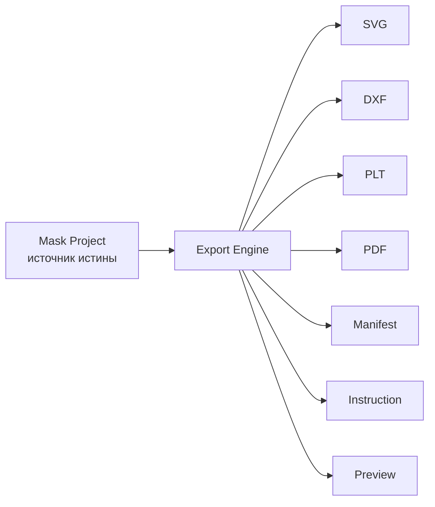
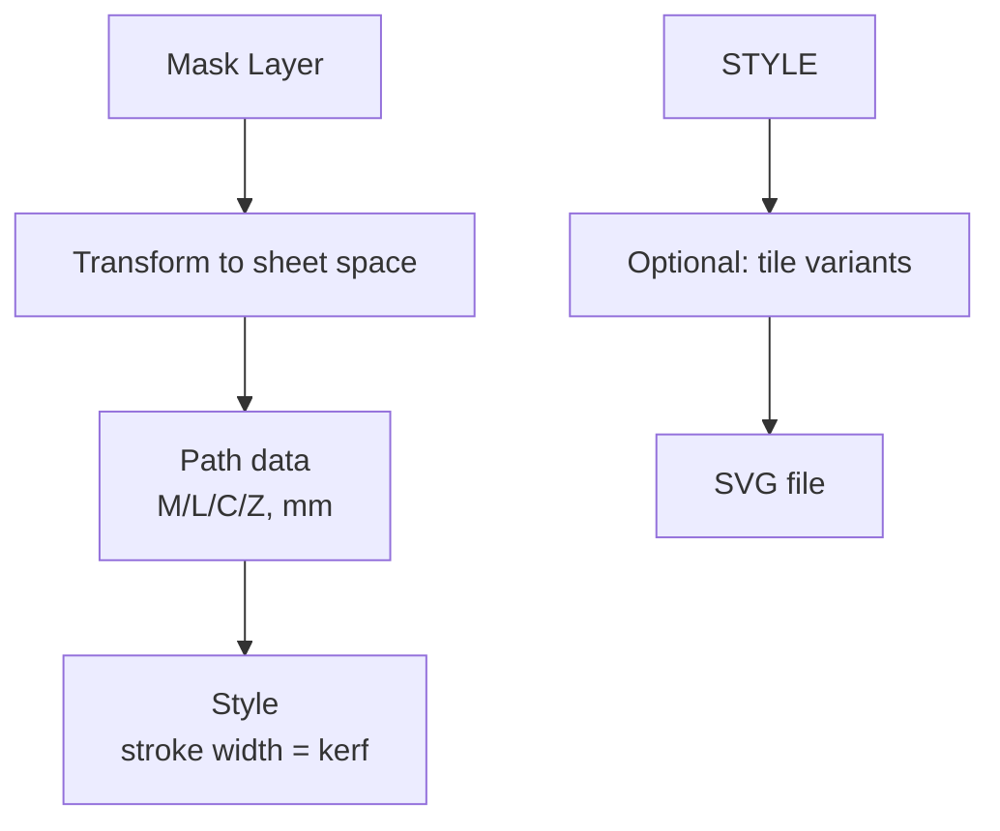
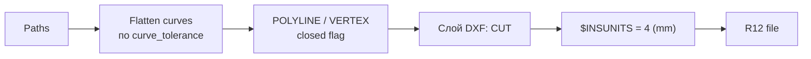
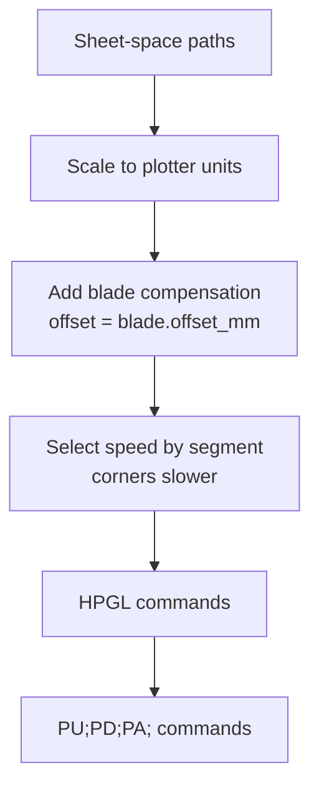
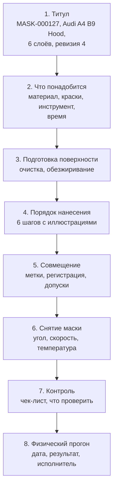
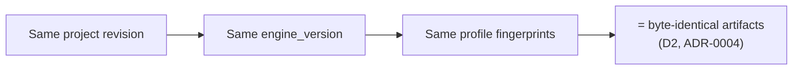

# EXPORT_ENGINE

Экспорт — последний шаг, но он делает проект физическим.

## 1. Принцип



Экспорт **никогда** не изменяет проект. Он только читает и преобразует.
Любое «исправление» в экспортированном файле = ошибка архитектуры.

## 2. Форматы и назначение

| Формат | Назначение | Обязателен | Спецификация |
|---|---|---|---|
| **SVG** | Просмотр, печать в PDF, ручной резак, веб-превью | да | SVG 1.1, mm-координаты |
| **DXF** | Импорт в CAD/ArtCAM, подготовка к лазеру | да | AutoCAD R12 (максимальная совместимость) |
| **PLT/HPGL** | Прямая выдача на плоттер | да | HPGL/2 |
| **PDF** | Инструкция + визуализация для мастера | да | PDF 2.0 |
| **JSON Manifest** | Машиночитаемое описание проекта | да | Схема ниже |
| **PNG** | Превью, быстрый просмотр | желательно | 8-bit RGBA |
| **WebP** | Превью для веба | желательно | quality 82 |
| **STEP / STL** | Передача 3D-поверхности мастеру | P2 | — |
| **3MF** | Заготовка для 3D-печати ( держатели, клипсы) | P2 | — |

## 3. SVG



```svg
<?xml version="1.0" encoding="UTF-8"?>
<svg xmlns="http://www.w3.org/2000/svg"
     version="1.1"
     width="284mm" height="1184mm"
     viewBox="0 0 284 1184">
  <metadata>
    <maskproject xmlns="https://maskplatform.dev/ns/1">
      id: MASK-000127
      layer: L03-0b83
      layer_index: 3
      revision: 4
      material: matte-vinyl-090 v4
      plotter: knife-25mm v2
      engine: 0.4.2
      tile: A1
    </maskproject>
  </metadata>

  <g id="registration" fill="none" stroke="#000" stroke-width="0.2">
    <path d="M 10,3 L 10,13 M 5,8 L 15,8"/>
    <text x="18" y="10" font-size="4">A1</text>
  </g>

  <g id="cut" fill="none" stroke="#000" stroke-width="0.15"
     stroke-linecap="round" stroke-linejoin="round">
    <path id="path_124" d="M 40,12 C 180,8 320,26 400,40 L 520,44 Z"/>
    <path id="path_131" d="M 210,300 L 222,300 L 216,312 Z"/>
  </g>
</svg>
```

### Правила SVG

| Правило | Значение |
|---|---|
| Единицы | `mm`, `viewBox` в мм (1 unit = 1 mm) |
| Ось Y | вверх (как в плоттере) — **фиксировано ADR-0009** |
| Команды пути | только абсолютные `M`/`L`/`C`/`Z`, без сокращений — **ADR-0004** |
| Stroke width | равен `kerf` для визуализации реза |
| Нет `<text>` в cut-слое | только в registration-слое |
| Порядок элементов | детерминированный, по `path_id` |
| Metadata | обязательна: id проекта, слой, ревизия, профили |
| Числа | координаты — 4 знака после запятой (`CANON_QUANTUM_MM = 1e-4`), **ADR-0004** |

## 4. DXF

Выбран **AutoCAD R12** как цель: максимальная совместимость
(ArtCAM, laser software, старые плоттеры, инспекция в текстовом редакторе).



| Правило | Значение |
|---|---|
| Версия | `AC1009` (R12) |
| Кривые | аппроксимируются POLYLINE, точность = `blade.curve_tolerance_mm` |
| Слои | `CUT`, `REGISTRATION`, `INFO` |
| Единицы | `$INSUNITS = 4` (миллиметры) |
| Кодировка | ASCII, переносы строк CRLF |
| Заголовок | комментарии с метаданными проекта в секции `HEADER` |

## 5. PLT / HPGL



### Пример

```text
IN;SP1;
!A1 MASK-000127 L03 rev4;
!material=matte-vinyl-090v4 kerf=0.15;
VS10;FS60;PA0,0;
PU1200,50;PD1200,580;PU;
PU30,50;PD30,580;PU;
PU2500,50;PD2500,580;PU;
PU30,580;PD2500,580;PU;
PU30,50;PD2500,50;PU;
PU;SP0;
```

| Параметр | Источник | Применение |
|---|---|---|
| `VS` | профиль плоттера | масштаб |
| `FS` | профиль плоттера | units |
| Скорость по углам | `motion.force_profile` | замедление на острых поворотах |
| `SP` (выбор пера) | номер пера/слоя | разные слои на одном плоттере |
| Комментарии `!` | метаданные | идентификация на ленте плоттера |

**Важно:** `PU` (подъём) / `PD` (опускание) критичны. Ошибка = порванная плёнка
или прорубленный лезвием материал. Порядок перемещений оптимизируется
(shortest-path по видимым переходам) — это не влияет на результат,
но снижает время.

## 6. PDF

Два разных документа:

| Тип | Содержание | Для кого |
|---|---|---|
| `mask_sheet.pdf` | Чертёж маски: слои, размеры, метки | Для подготовки, реза |
| `instruction.pdf` | Пошаговая инструкция нанесения | Для мастера |

### Структура instruction.pdf



**Правило:** все числа в инструкции берутся из профилей и проекта.
AI может отполировать формулировки, но **не может вписать числа**
(см. `../08_AI/AI_ARCHITECTURE.md`).

## 7. Production Manifest

```json
{
  "manifest_version": 1,
  "project": {
    "id": "MASK-000127",
    "revision": 4,
    "status": "Approved",
    "created_at": "2026-01-15T16:03:10Z"
  },

  "target": {
    "object": "Audi A4 B9",
    "part": "Hood",
    "part_code": "HOOD",
    "dimensions_mm": [1412.0, 1046.0]
  },

  "manufacturing": {
    "material": { "code": "matte-vinyl-090", "version": 4, "fingerprint": "sha256:44ac…" },
    "plotter": { "code": "knife-25mm", "version": 2, "fingerprint": "sha256:91bd…" },
    "cutting_profile": "matv090__knife25__v4_2",
    "kerf_mm": 0.15,
    "effective_limits": { "line_width_mm": 0.80, "gap_mm": 0.95, "corner_radius_mm": 0.45 }
  },

  "validation": {
    "verdict": "PASS_WITH_WARNINGS",
    "report_id": "val_004512",
    "violations": { "error": 0, "warning": 2, "info": 5 },
    "fidelity": 0.912
  },

  "lineage": {
    "engine_version": "0.4.2",
    "rule_engine_version": "1.1.0",
    "geometry_hash": "sha256:a91b…"
  },

  "layers": [
    {
      "index": 1,
      "id": "L01-4f2a",
      "name": "Black Base",
      "role": "base",
      "paint": { "rgb": [17, 17, 19], "system": "basecoat", "technique": "airbrush_1_5G" },
      "application": {
        "distance_mm": 120,
        "angle_deg": 90,
        "passes": 1,
        "dry_minutes": 15,
        "sequence": 1
      },
      "tiles": [
        { "id": "A1", "file": "L01_A1.svg", "sha256": "…" },
        { "id": "A2", "file": "L01_A2.svg", "sha256": "…" }
      ],
      "elements": { "paths": 12, "islands": 0, "bridges": 0, "min_width_mm": 1.42 }
    }
  ],

  "artifacts": [
    { "kind": "cut_svg", "layer": 1, "file": "L01_A1.svg", "sha256": "…", "bytes": 18422 },
    { "kind": "cut_dxf", "layer": 1, "file": "L01_A1.dxf", "sha256": "…", "bytes": 92140 },
    { "kind": "cut_plt", "layer": 1, "file": "L01_A1.plt", "sha256": "…", "bytes": 2410 },
    { "kind": "instruction_pdf", "file": "instruction.pdf", "sha256": "…", "bytes": 2840110 }
  ],

  "physical_proof": {
    "performed": true,
    "date": "2026-01-22",
    "material_lot": "MV090-L14",
    "result": "pass",
    "notes": "Нанесено за 2 ч 40 мин. Дефектов нет.",
    "inspector": "operator_01"
  },

  "signatures": {
    "generated_by": "export-engine/0.4.2",
    "manifest_hash": "sha256:…"
  }
}
```

## 8. Детерминированность экспорта



| Требование | Реализация |
|---|---|
| Порядок обхода | Сортировка по `layer_index`, затем `path_id` |
| Числовой формат | Квантование `CANON_QUANTUM_MM`, локаль без зависимости от locale — **ADR-0004** |
| Каноническая форма пути | Только `M`/`L`/`C`/`Z`, дуги → кубические Безье — **ADR-0004** |
| Время в файлах | Только в manifest, только UTC |
| Hash | SHA-256 по канонической сериализации |
| Перевод строк | Всегда `\n` (кроме DXF — CRLF по спецификации) |

**Тест:** экспорт дважды из одного состояния → побайтово идентичные файлы.

**Область гарантии (ADR-0004):** побайтовая идентичность заявлена для
повторной генерации тем же билдом на той же платформе (D2). Повторный
пересчёт на другой платформе или другой версии движка даёт **семантически
эквивалентный** результат в пределах `CANON_QUANTUM_MM`, но не обязательно
побайтово идентичный (D3). Отличия при смене `engine_version` — ожидаемое
поведение, а не регресс.

## 9. Имена файлов

```text
MASK-000127_rev4_L03_A1.svg
MASK-000127_rev4_L03_A1.dxf
MASK-000127_rev4_L03_A1.plt
MASK-000127_rev4_manifest.json
MASK-000127_rev4_instruction.pdf
MASK-000127_rev4_preview.png
MASK-000127_rev4_mask_sheet.pdf
```

| Часть | Смысл | Зачем |
|---|---|---|
| `MASK-000127` | id проекта | идентификация |
| `rev4` | ревизия | защита от путаницы версий |
| `L03` | слой | для слоёвных файлов |
| `A1` | плитка | для nesting |
| расширение | формат | — |

В ZIP-архиве проекта:

```text
MASK-000127_rev4/
├── manifest.json
├── instruction.pdf
├── mask_sheet.pdf
├── svg/
│   ├── MASK-000127_rev4_L01_A1.svg
│   └── …
├── dxf/
├── plt/
└── preview/
```

## 10. Слои в DXF/PLT

Каждый слой — отдельный файл **или** отдельный слой DXF.

| Стратегия | Когда |
|---|---|
| Один файл на слой на плитку | MVP, проще отладка |
| Один файл на слой (все плитки) | несколько плиток одного слоя |
| Один файл, DXF-слои | мастер выбирает слой в CAD |
| Один файл, PLT-`SP` | на плоттере с несколькими перами |

## 11. Обработка ошибок экспорта

| Ошибка | Поведение |
|---|---|
| Проект не прошёл валидацию | Экспорт **запрещён**, если `verdict ∈ {FAIL, FATAL}` |
| Нет артефакта из-за сбоя | Прогон `PARTIAL`, перечень недостающих в manifest |
| Превышен лимит размера файла | Предупреждение + предложение nesting плотнее |
| Неизвестный path role | fallback на `cut` + `warning` в manifest |
| Неподдерживаемая кривая | Аппроксимация + запись tolerance в manifest |

## 12. Проверка экспорта

Automatические проверки (обязательные):

| Проверка | Метод |
|---|---|
| SVG валиден | парсер + schema |
| SVG парсится обратно | round-trip в геометрию, сравнение с исходной |
| DXF открывается | парсер R12, проверка `$INSUNITS` |
| Кривые в допуске | Hausdorff distance ≤ curve_tolerance |
| Размеры в пределах поля | bbox ≤ working area − margins |
| Детерминированность | два экспорта → идентичные хеши |
| Manifest консистент | все файлы существуют, хеши совпадают |
| Обратная сборка | экспорт → импорт → геометрия эквивалентна |

**Round-trip тест — самый важный:** если экспортированный SVG не даёт
при импорте ту же геометрию, производственные файлы неверны.

## 13. Связанные документы

* `NESTING_ENGINE.md` — плитки и метки.
* `VALIDATOR.md` — условие допуска к экспорту.
* `../03_DOMAIN/MASK_PROJECT.md` — источник истины.
* `../09_API/API_ARCHITECTURE.md` — выдача артефактов.