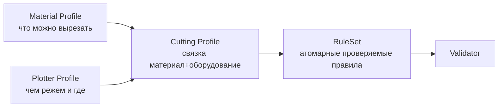
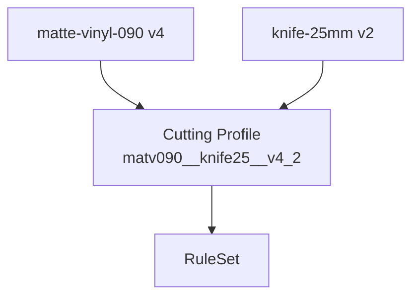
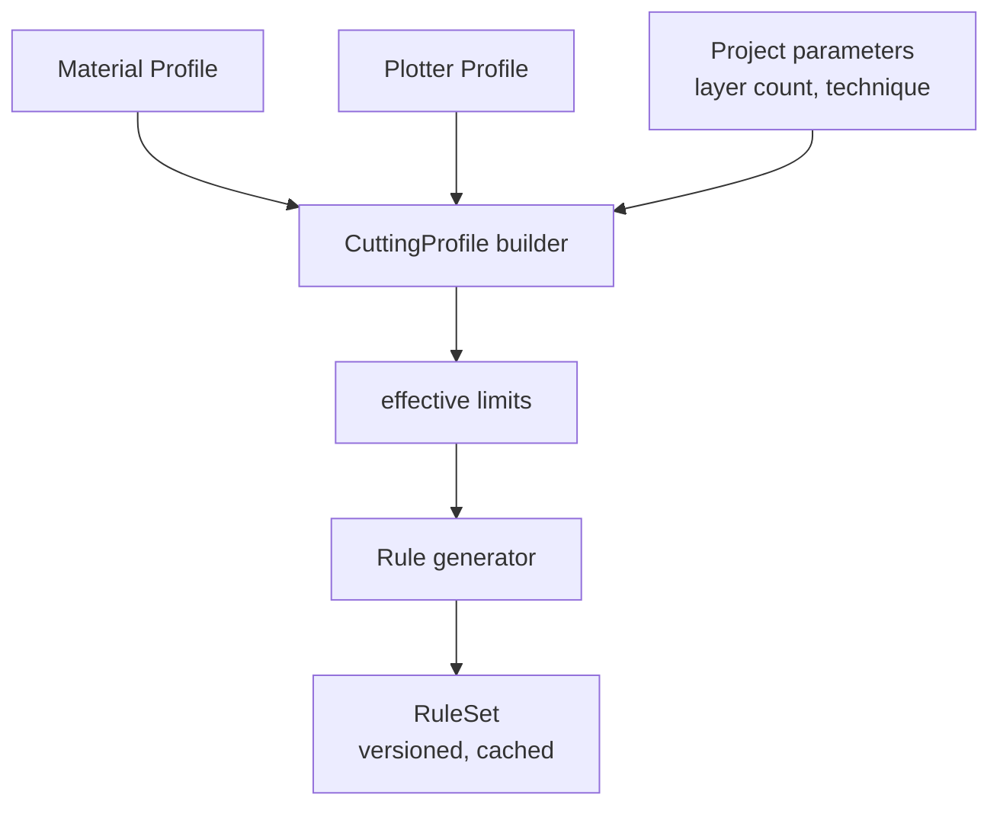
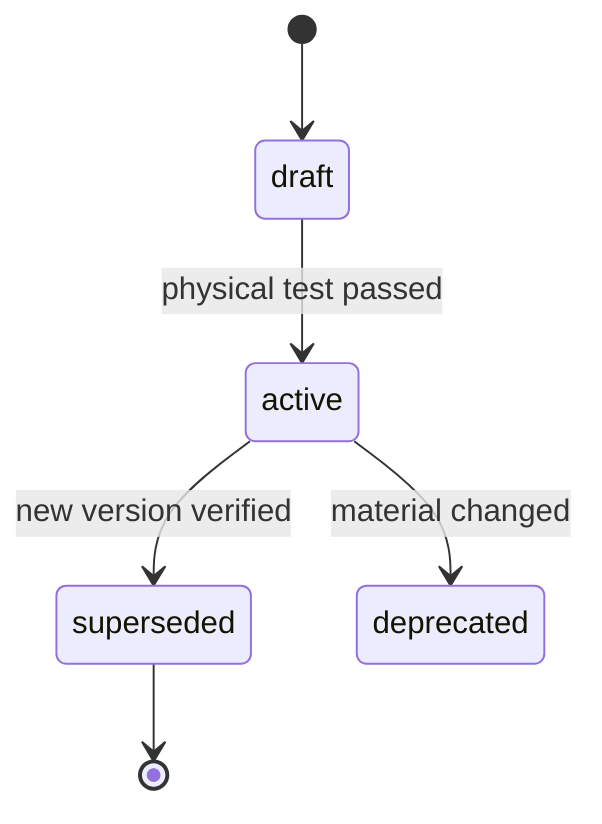
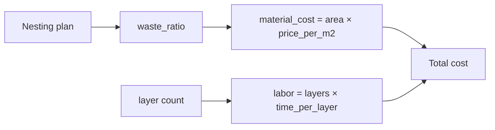

# MANUFACTURING_ENGINE

Правила производства — **данные**, а не код (P-05).

## 1. Две разные сущности



**Материал и оборудование — разные сущности.** Материал определяет, что
физически возможно. Оборудование определяет, где это возможно сделать
и с каким качеством.

## 2. Material Profile

```json
{
  "code": "matte-vinyl-090",
  "version": 4,
  "name": "Matte vinyl 0.09 mm",
  "family": "vinyl",
  "thickness_mm": 0.09,

  "minimums": {
    "line_width_mm": 0.80,
    "gap_mm": 0.90,
    "island_area_mm2": 2.40,
    "island_width_mm": 0.60,
    "feature_length_mm": 3.00,
    "corner_radius_mm": 0.40,
    "bridge_width_mm": 1.20,
    "bridge_length_mm": 25.0
  },

  "physical": {
    "adhesion": "medium",
    "adhesive_system": "water_sensitive",
    "stretch_tolerance": 0.004,
    "peel_angle_min_deg": 120,
    "peel_rate": "slow",
    "max_temp_c": 80,
    "surface_prep": ["degrease", "dry"],
    "tolerance_registration_mm": 0.35
  },

  "limits": {
    "max_density_per_100cm2": 180,
    "min_angle_deg": 30,
    "max_area_mm2": 400000
  },

  "economics": {
    "sheet_price_per_m2": 4.20,
    "default_sheet_mm": [1000, 1000]
  },
  "verified_physical": true,
  "verified_at": "2026-01-20",
  "notes": "Проверен на капоте A4 B9, 6 слоёв, результат годен"
}
```

### Ключевые поля и их физический смысл

| Поле | Смысл | Откуда берём |
|---|---|---|
| `minimums.line_width_mm` | Уже — плёнку не удержать при снятии | Физический тест |
| `minimums.gap_mm` | Уже — сольётся или порвётся при вырезании | Физический тест |
| `minimums.island_area_mm2` | Меньше — выпадет | Физический тест |
| `minimums.corner_radius_mm` | Острый внутренний угол = разрыв плёнки | Геометрия + опыт |
| `bridge_width_mm` | Узкий мост оторвётся | Физический тест |
| `physical.peel_angle_min_deg` | Слишком резкий срыв = отрыв краски | Инструкция производителя |
| `physical.tolerance_registration_mm` | Насколько можно совместить слои | Измерение |
| `limits.max_density_per_100cm2` | Слишком много мелких элементов = невозможно вырезать вручную | Опыт |

## 3. Plotter Profile

```json
{
  "code": "knife-25mm",
  "version": 2,
  "name": "Knife plotter 25 mm holder",
  "type": "knife_plotter",

  "blade": {
    "angle_deg": 45,
    "offset_mm": 0.10,
    "kerf_mm": 0.15,
    "curve_tolerance_mm": 0.08
  },

  "working_area": {
    "width_mm": 300,
    "length_mm": 1200,
    "usable_margin_mm": 8
  },

  "motion": {
    "max_speed_mm_s": 60,
    "accel_mm_s2": 200,
    "force_profile": { "corners": "reduce_40%", "sharp_turns": "lift" }
  },

  "accuracy": {
    "repeatability_mm": 0.05,
    "registration_method": "crosshair_marks",
    "max_registration_error_mm": 0.30
  },

  "output_formats": ["plt", "dxf"],
  "native_unit": "mm",
  "origin": "bottom_left",
  "y_axis": "up"
}
```

**Ориентация осей — критична.** Ошибка здесь даёт перевёрнутую маску.
Фиксируется в профиле; отдельное решение ADR отсутствует.

## 4. Cutting Profile (связка)



```json
{
  "code": "matv090__knife25__v4_2",
  "material": { "code": "matte-vinyl-090", "version": 4 },
  "plotter": { "code": "knife-25mm", "version": 2 },

  "effective_limits": {
    "line_width_mm": 0.80,
    "gap_mm": 0.95,
    "island_width_mm": 0.60,
    "corner_radius_mm": 0.45,
    "bridge_width_mm": 1.30,
    "max_features_per_100cm2": 170,
    "max_tile_width_mm": 284,
    "max_tile_length_mm": 1184
  },

  "derivation_notes": [
    "line_width = material.minimum + 0.00 (material dominates)",
    "gap = max(material.gap 0.90, kerf/2 + material.gap/2 + blade tolerance 0.05) = 0.95",
    "corner_radius = max(material 0.40, blade.curve_tolerance × 4) = 0.45",
    "max_tile = working area − 2×margin"
  ]
}
```

### Правила вычисления эффективных лимитов

```text
effective.line_width     = material.minimums.line_width
effective.gap            = max(material.gap, kerf + registration_tolerance)
effective.corner_radius  = max(material.corner_radius, curve_tolerance × K)
effective.bridge_width   = max(material.bridge_width, kerf × 2)
effective.island_width   = max(material.island_width, material.line_width × 0.75)
effective.max_tile_*     = working_area − 2 × usable_margin
```

`K` — коэффициент из профиля (`blade.curve_multiplier`, по умолчанию 4).
Все коэффициенты — **в профиле**, не в коде.

## 5. RuleSet

Плоский список атомарных правил, готовых к исполнению.

```json
{
  "id": "rs_matv090_knife25_v4_2",
  "cutting_profile": "matv090__knife25__v4_2",
  "generated_at": "2026-01-20T10:00:00Z",
  "rules": [
    {
      "code": "min_line_width",
      "severity": "error",
      "message_template": "{n} элементов слишком маленькие для выбранного материала.",
      "measure": "path.width",
      "operator": ">=",
      "threshold_ref": "effective.line_width_mm",
      "auto_fixable": true,
      "fix_operations": ["widen", "merge_nearby", "delete_micro"]
    },
    {
      "code": "min_gap",
      "severity": "error",
      "message_template": "{n} зазоров между элементами меньше {required} мм.",
      "measure": "gap.distance",
      "operator": ">=",
      "threshold_ref": "effective.gap_mm",
      "auto_fixable": true,
      "fix_operations": ["merge_nearby", "widen_narrow_side"]
    },
    {
      "code": "min_island",
      "severity": "error",
      "message_template": "{n} островков меньше {required} мм².",
      "measure": "island.area",
      "operator": ">=",
      "threshold_ref": "effective.island_width_mm",
      "auto_fixable": true,
      "fix_operations": ["merge_island", "delete_island"]
    },
    {
      "code": "island_anchored",
      "severity": "error",
      "message_template": "{n} островков не соединены с маской.",
      "measure": "island.anchored",
      "operator": "==",
      "threshold": true,
      "auto_fixable": true,
      "fix_operations": ["add_bridge"]
    },
    {
      "code": "corner_radius",
      "severity": "error",
      "message_template": "{n} углов острее {required} мм.",
      "measure": "corner.radius",
      "operator": ">=",
      "threshold_ref": "effective.corner_radius_mm",
      "auto_fixable": true,
      "fix_operations": ["round_corner"]
    },
    {
      "code": "feature_density",
      "severity": "warning",
      "message_template": "Слой {layer}: {measured} элементов на 100 см² (максимум {required}). Вырезать вручную будет долго.",
      "measure": "layer.density",
      "operator": "<=",
      "threshold_ref": "effective.max_features_per_100cm2",
      "auto_fixable": false
    },
    {
      "code": "registration_budget",
      "severity": "error",
      "message_template": "Число слоёв ({layers}) превышает бюджет совмещения ({max}) для этого материала.",
      "measure": "project.layer_count",
      "operator": "<=",
      "threshold_ref": "material.max_layers",
      "auto_fixable": false
    },
    {
      "code": "tile_area",
      "severity": "error",
      "message_template": "Маска {w}×{h} мм не помещается в рабочее поле {pw}×{pl} мм.",
      "measure": "layer.bbox",
      "operator": "<=",
      "threshold_ref": "effective.max_tile_width_mm",
      "auto_fixable": true,
      "fix_operations": ["nest"]
    }
  ]
}
```

## 6. Rule — формальная спецификация

| Поле | Тип | Назначение |
|---|---|---|
| `code` | string | Стабильный идентификатор, задокументирован |
| `severity` | `info \| warning \| error` | Влияет на вердикт |
| `measure` | string | Что измеряем (путь к метрике) |
| `operator` | `>= \| <= \| == \| != \| between` | Сравнение |
| `threshold_ref` | string | Ссылка на лимит (не число!) |
| `auto_fixable` | bool | Есть ли автоматическое решение |
| `fix_operations` | []string | Какие операции могут помочь |
| `message_template` | string | Шаблон человеческого сообщения |

**Правило:** правило никогда не содержит числового порога напрямую —
только ссылку на профиль. Это обеспечивает смену материала без изменения кода.

## 7. Формирование RuleSet



RuleSet кэшируется по `sha256(cutting_profile + project_class)`.
Проект хранит **снимок** RuleSet, а не только ссылку (P-10).

## 8. Версионирование профилей



```json
{
  "code": "matte-vinyl-090",
  "versions": [
    { "version": 1, "status": "superseded", "verified_physical": false },
    { "version": 2, "status": "superseded", "verified_physical": true },
    { "version": 3, "status": "superseded", "verified_physical": true },
    { "version": 4, "status": "active", "verified_physical": true }
  ]
}
```

| Статус | Значение |
|---|---|
| `draft` | Пороги взяты из datasheet, физически не проверены |
| `active` | Проверен физическим прогоном |
| `superseded` | Заменён новой версией |
| `deprecated` | Материал снят с производства |

**Проекты со снимком `draft`-профиля не могут получить статус `Approved`.**
Это защищает от производства на непроверенных допущениях.

## 9. Что может и не может менять профиль

| Можно | Нельзя |
|---|---|
| Уточнить порог после физического теста | Снизить порог, чтобы проект прошёл |
| Добавить новый материал | Изменить пороги без перепроверки существующих проектов |
| Добавить новое оборудование | Менять семантику существующего поля без ADR |

**Красный флаг:** если профиль меняется «чтобы конкретный проект стал PASS» —
это подгонка, а не калибровка. Так делать запрещено (P-01, P-05).

## 10. Экономика в профиле

Профиль влияет на себестоимость:



Эти данные используются для оценки заказа, но **не влияют на геометрию**.
Разделение: `manufacturing_limits` (влияют на геометрию) и `economics`
(влияют только на цену).

## 11. Связанные документы

* `VALIDATOR.md` — исполнение правил.
* `NESTING_ENGINE.md` — рабочее поле и разбиение.
* `EXPORT_ENGINE.md` — параметры оборудования в выходных файлах.
* `../05_GEOMETRY/TOPOLOGY_ENGINE.md` — применение порогов.