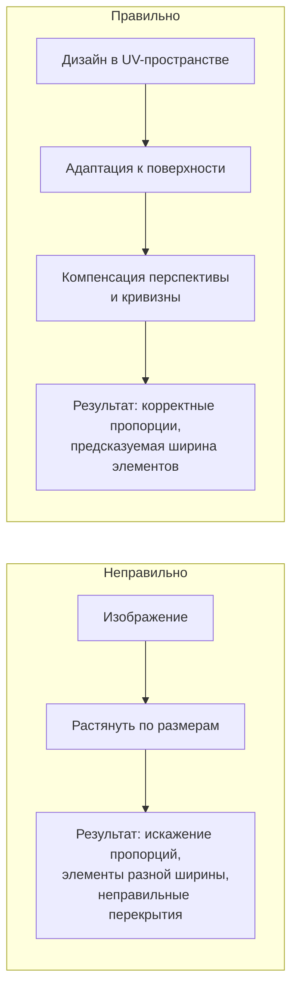
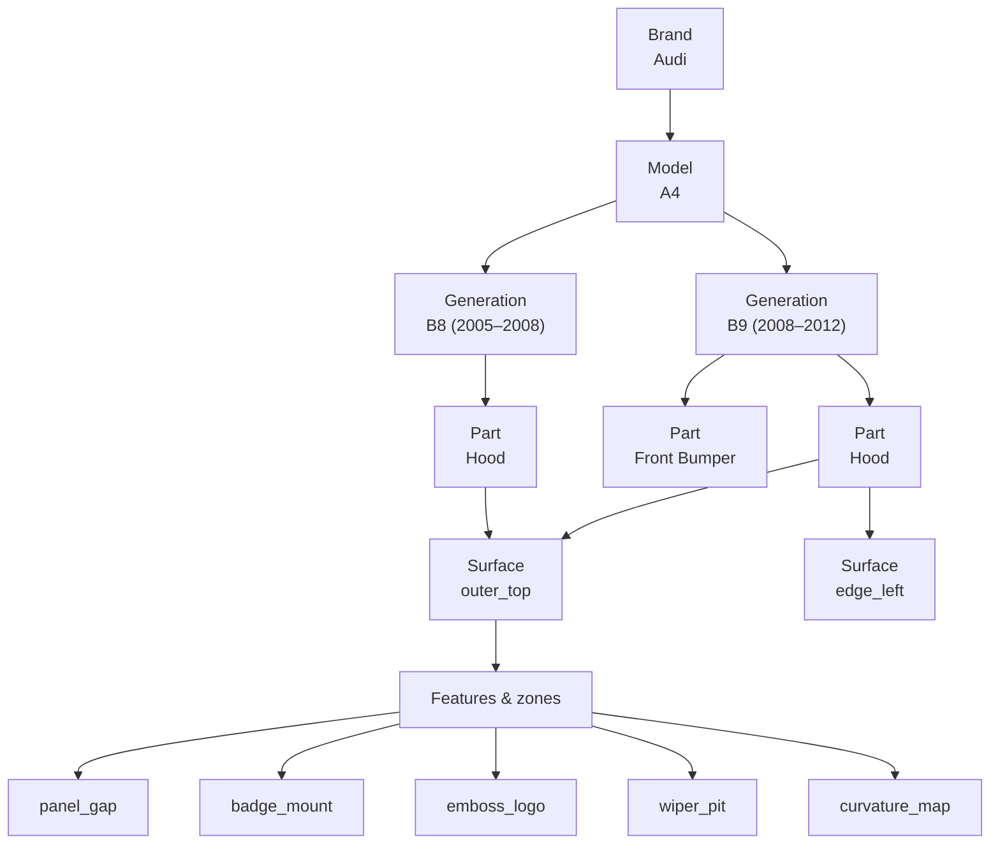
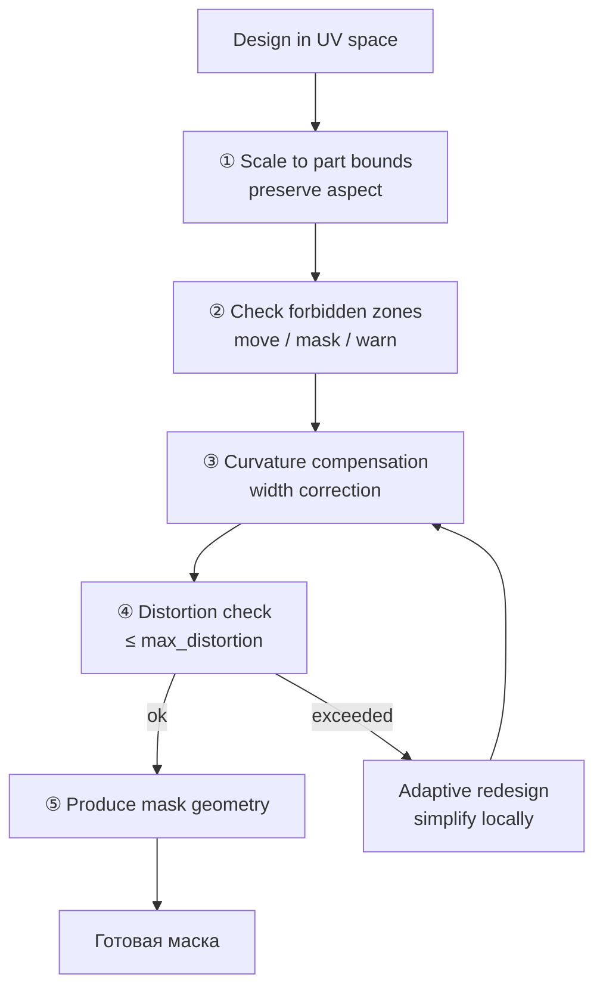
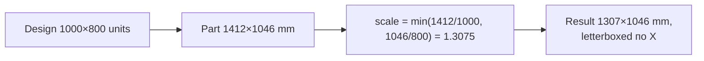
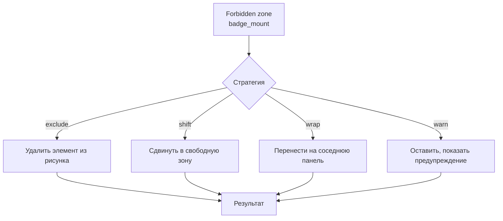
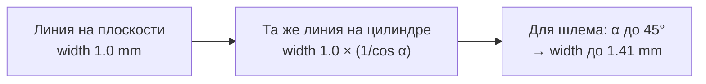
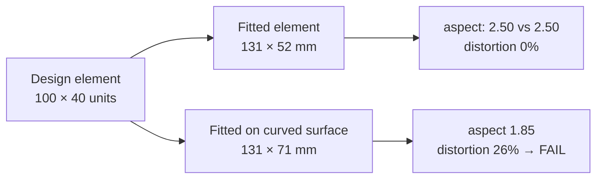
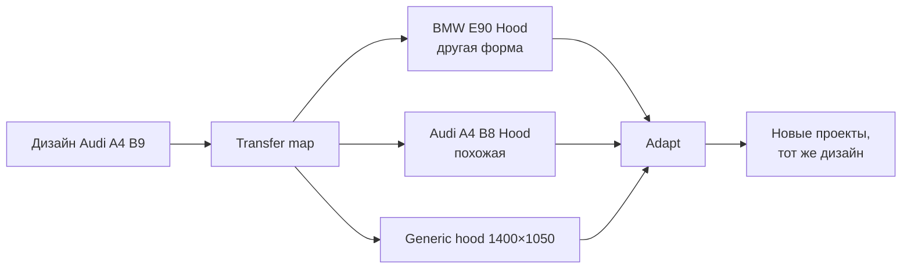

# MODEL_FIT

Связь дизайна с реальной геометрией объекта. Это то, что отличает платформу
от «картинки, натянутой на болванку».

## 1. Почему нельзя просто растянуть



| Проблема наивного растяжения | Что произойдёт на детали |
|---|---|
| Капот имеет уклон, шлем — сферу | Элементы «съедут», рисунок исказится |
| Разная кривизна в разных зонах | Ширина элемента плавает → непроизводимо |
| Есть рёбра, загибы, выступы | Маска не прилегает, края отрываются |
| Перспектива смены ракурса | Часть рисунка не видна |

## 2. Иерархия каталога



## 3. Модель объекта

```json
{
  "id": "om_audi_a4_b9",
  "brand": "Audi",
  "model": "A4",
  "generation": "B9",
  "year_from": 2008,
  "year_to": 2012,

  "parts": [
    {
      "id": "pt_a4b9_hood",
      "code": "HOOD",
      "name": "Hood / Bonnet (outer)",
      "version": 2,

      "dimensions_mm": { "width": 1412.0, "height": 1046.0, "depth": 58.0 },

      "surfaces": [
        {
          "id": "sf_hood_outer",
          "name": "Outer skin",
          "geometry_version": 3,
          "representation": "planar_2_5d",
          "uv_bounds": [0.0, 0.0, 1.0, 1.0],
          "reference_asset": "catalog/audi_a4_b9/hood/outer_ortho_3000.png",
          "reference_scale_mm_per_px": 0.4707
        }
      ],

      "features": [
        { "id": "ft_panel_gap_front", "type": "panel_gap", "kind": "gap", "depth_mm": 3.2 },
        { "id": "ft_badge_mount", "type": "mount", "kind": "forbidden", "shape_ref": "assets/badge_hood.svg", "clearance_mm": 2.0 },
        { "id": "ft_wiper_pit", "type": "pit", "kind": "difficult", "note": "рельеф меняет высоту на 12 мм" },
        { "id": "ft_emboss_logo", "type": "emboss", "kind": "forbidden", "note": "рельеф, рисунок не читается" },
        { "id": "ft_crease_left", "type": "crease", "kind": "difficult", "angle_deg": 28 },
        { "id": "ft_vent_right", "type": "vent", "kind": "forbidden" }
      ],

      "curvature": {
        "kind": "height_field",
        "amplitude_mm": 58.0,
        "max_slope_deg": 14.0,
        "anisotropy": "high_x"
      },

      "constraints": {
        "min_element_width_mm": 1.0,
        "max_distortion_percent": 18.0,
        "allow_over_panels": false
      },

      "source": { "type": "manual", "reference": "OEM parts catalog", "verified": true }
    }
  ]
}
```

## 4. Representation: от 2D к 3D

| Уровень | Представление | Когда | Сложность |
|---|---|---|---|
| **L0** | Прямоугольник с размерами | Абстрактная деталь, плоская поверхность | низкая |
| **L1** | Ортофото + масштаб + зоны | Плоские и слабо изогнутые панели | низкая |
| **L2** | 2.5D height field (карта высот) | Капоты, крышки, панели с рельефом | средняя |
| **L3** | Параметрическая поверхность (NURBS) | Шлемы, мотоциклетные детали | высокая |
| **L4** | Полный 3D mesh | Сложные объёмные детали | очень высокая |

**Порядок внедрения:** L0 → L1 → L2 → (после физической проверки) L3.
Не начинать с L4: он дорог и не нужен для доказательства концепции.

## 5. Пайплайн адаптации



### ① Масштабирование



**Правило:** масштабирование сохраняет пропорции, а не растягивает.
Остаток — поля. Поля не остаются пустыми: они используются для
выноса элементов или служат зоной отхода.

### ② Запрещённые зоны



| Тип зоны | Обработка |
|---|---|
| `forbidden` | Элемент переносится или удаляется. На месте — нельзя |
| `difficult` | Элемент остаётся, но получает `warning` и пониженную точность |
| `gap` | Маска разрезается по шву, элементы не пересекают шов |
| `crease` | Маска может пересекать, но мост обязателен |

### ③ Компенсация кривизны

> **Поправка по ADR-0018 (2026-10-09).** Формула ниже верна, но описывает
> **проекцию длины на плоскость**, а не ширину вырезанного элемента. Нож режет
> плоскую плёнку на столе, поэтому `min_width`, который мерит валидатор, кривизной
> не меняется и поправки в расчёт не требует. Что действительно ломается — прилегание
> плёнки, и определяется оно **гауссовой кривизной**, а не наклоном: цилиндр и конус
> развёртываемы и плёнка ложится на них без натяжения при любом наклоне.
> Исполняемое ядро расчёта — `engine/kernel/src/surface.rs`, решение — ADR-0018.



Формула коррекции ширины (для цилиндрической поверхности):

```text
w_actual = w_nominal / cos(α)
α = atan(dh/ds) — локальный наклон поверхности
```

| Поверхность | Типичный α | Коррекция |
|---|---|---|
| Плоская панель | 0–5° | +0…4% |
| Капот | 5–15° | +0…4% (cos 15° = 0.966) |
| Боковина мотоцикла | 20–35° | +6…22% |
| Шлем | 30–50° | +15…56% |

**Практическое правило:** для слабокривых поверхностей коррекция < 5%
и ею можно пренебречь (в пределах допуска). Для сильно кривых —
коррекция обязательна и становится частью расчёта min width.

**Что вместо этого надо проверять (ADR-0018).** Не поправка к ширине, а проходимость:
лежит ли плоская плёнка на детали вообще.

```text
strain = |K| · d²            d — диагональ пятна, K — гауссова кривизна
развёртываемая ⇔ strain ≤ 1%
разброс ширины одного элемента = max(stretch) / min(stretch)
```

| Поверхность | K | Развёртываемая |
|---|---|---|
| Плоская панель | 0 | да |
| Цилиндр (капот без рельефа) | 0 | да, при любом наклоне |
| Конус | 0 | да |
| Сфера R=300, значок 25 мм | 1.11·10⁻⁵ мм⁻² | да (strain 0.7%) |
| Сфера R=300, пятно 1400 мм | 1.11·10⁻⁵ мм⁻² | **нет** (strain 21.8) |

Отсюда и порядок: на L1 (ортофото + масштаб) кривизну **не вычисляют** — карты
высот нет. Проверяемо там только объявленный наклон и заполненность зон.

### ④ Проверка искажений



```text
distortion = |fitted_aspect / design_aspect − 1|
Порог: part.constraints.max_distortion_percent = 18%
```

## 6. Запрещено

| Действие | Почему |
|---|---|
| Растягивать изображение по габаритам | Искажение, непредсказуемая ширина элементов |
| Игнорировать кривизну при сильных изгибах | Маска не прилегает, отрывается, искажается рисунок |
| Наносить на запрещённые зоны | Невозможно или бессмысленно (рельеф, вентиляция) |
| Оставлять элементы без проверки на разрыв | Маска порвётся при снятии |

## 7. Перенос дизайна между моделями



Требует определения **anchor-признаков** дизайна:

| Признак | Пример |
|---|---|
| `must_fit_part` | Логотип по центру капота |
| `align_with_feature` | Разрез по шву переднего края |
| `avoid_zone` | Не заходить на зону вентиляции |
| `relative_position` | Элемент на 30% от левого края |
| `proportional` | Масштабируется вместе с деталью |

**Перенос — P1.** Требует стабильных каталогов и проверенных карт зон.

## 8. Инструменты получения данных каталога

| Уровень | Источник | Сложность |
|---|---|---|
| L0 | Размеры из каталога запчастей | очень низкая |
| L1 | Фото детали с масштабной линейкой, калибровка | низкая |
| L2 | Фотограмметрия с телефона (одна точка обзора не подходит — нужен обход) | средняя |
| L3 | Специализированное моделирование | высокая |
| L4 | CAD/сканер | очень высокая |

**Рекомендация для MVP:** L0 + L1 на 3–5 деталях. Ручная работа масштабируется
только если деталей мало; при росте каталога нужен автоматизированный сбор.

## 9. Что проверяет Validator в контексте Model Fit

| Проверка | Severity | Сообщение |
|---|---|---|
| Дизайн выходит за границы детали | error | «204 элемента выходят за границы капота на 12 мм» |
| Элемент в запрещённой зоне | error | «Логотип попадает на зону рельефа — маска там не приклеится» |
| Элемент пересекает шов панели | warning | «12 элементов пересекают шов; маска будет разрезана» |
| Искажение превышено | error | «Искажение 26% при допустимых 18% (зона шлема)» |
| Коррекция кривизны не применена при α > 15° | error | «Требуется коррекция ширины для наклона 32°» |
| Пробел в карте зон | warning | «Зона curvature_map не заполнена; коррекция не применена» |

## 10. Связанные документы

* `../03_DOMAIN/DOMAIN_MODEL.md` — сущности каталога.
* `../04_ENGINE/LAYER_ENGINE.md` — адаптация влияет на слои.
* `VALIDATOR.md` — проверки fit.
* `../13_ROADMAP/ROADMAP.md` — Stage 7.