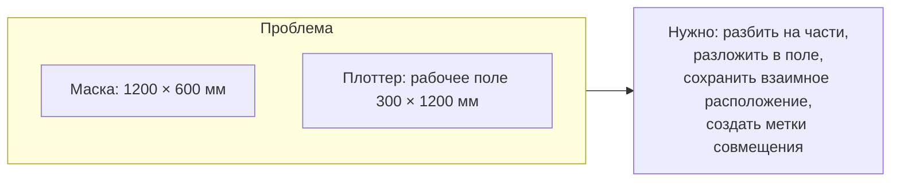
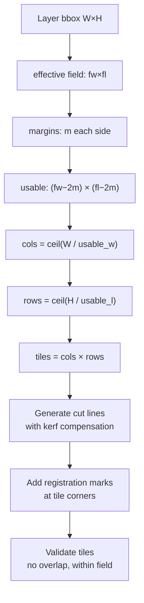
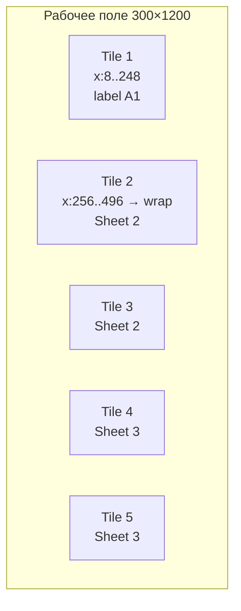
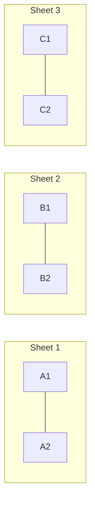
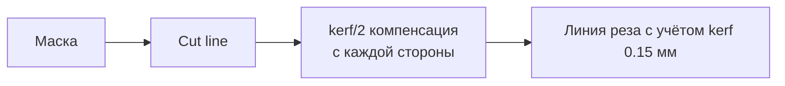
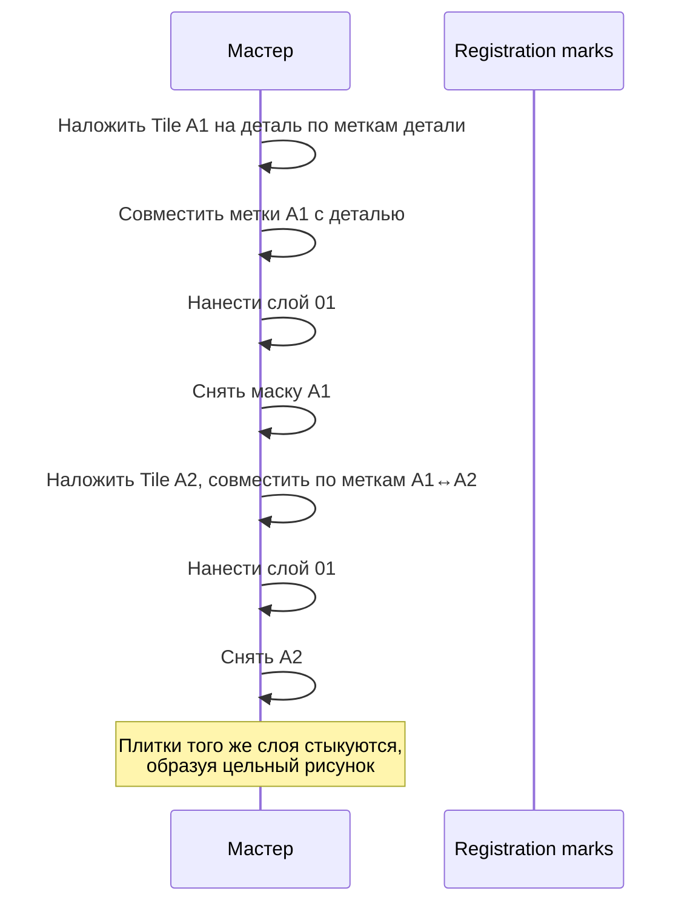
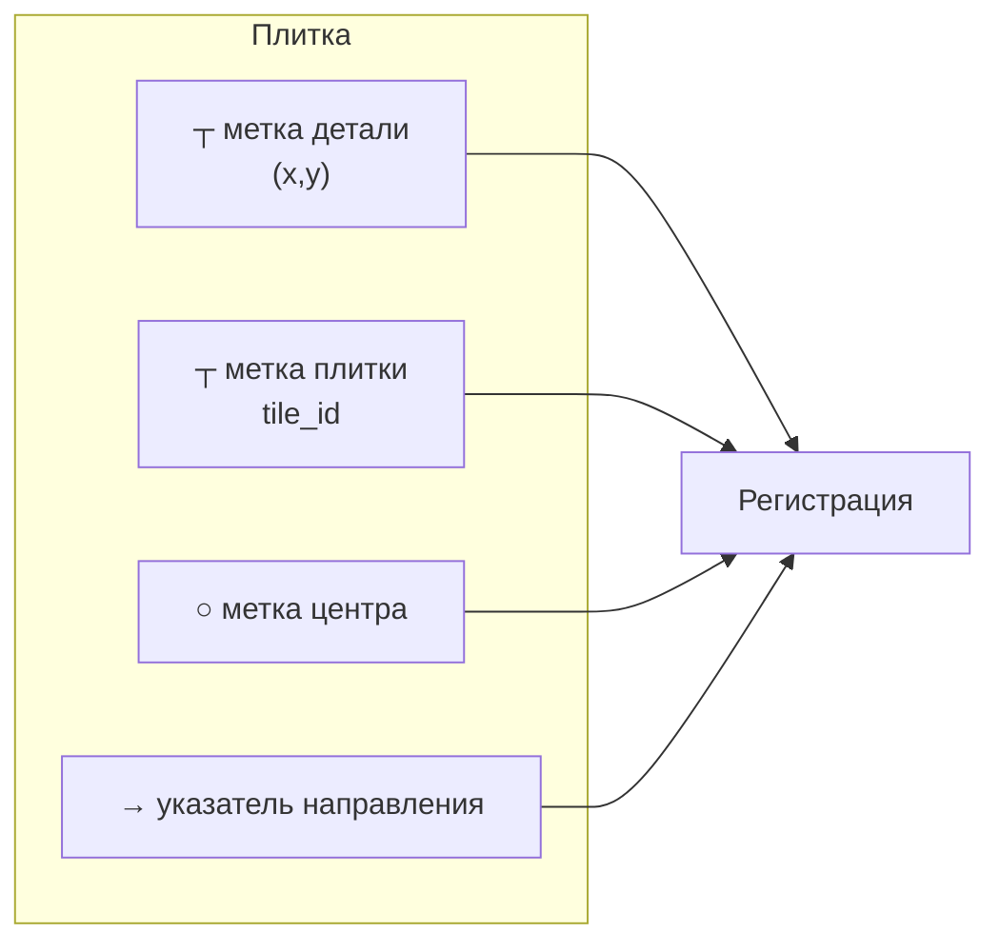
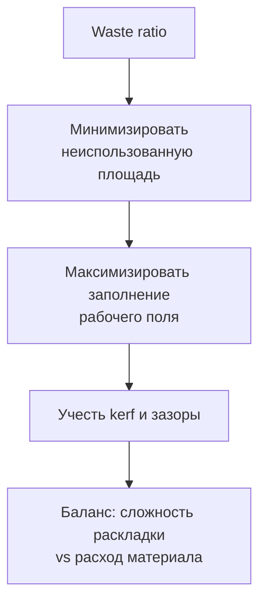
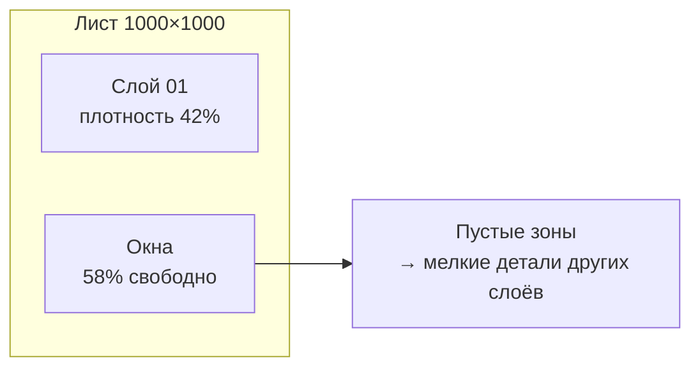
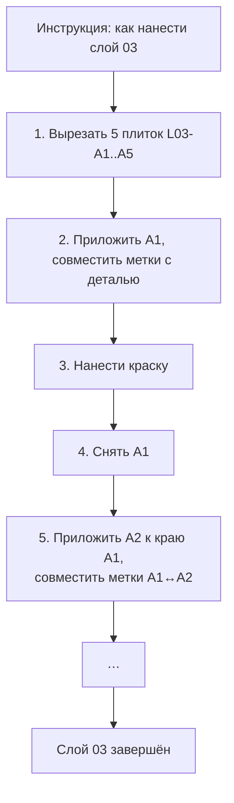

# NESTING_ENGINE

Маска часто больше рабочего поля оборудования. Nesting решает, как её разрезать
и как потом собрать обратно.

## 1. Постановка задачи



```text
Mask 1200×600 mm, plotter width 300 mm
→ минимум 4 tiles по горизонтали
→ плюс запас на поля → 5 tiles
→ waste зависит от раскладки
```

## 2. Стратегии

| Стратегия | Описание | Когда применять |
|---|---|---|
| `fixed_grid` | Регулярная сетка по габаритам | Простые маски, надёжно, предсказуемо |
| `guillotine` | Рекурсивное деление прямоугольника | Минимизация отходов при прямоугольных частях |
| `strip` | Длинные полосы вдоль длинной стороны | Вытянутые детали (капот, боковина) |
| `offset_nesting` | Произвольная укладка с обтеканием | Сложные формы, P1+ |
| `per_layer` | Отдельная раскладка для каждого слоя | Разные размеры слоёв |

**Статус:** `fixed_grid` реализован в `engine/nesting`, включая разделение по
шагу сетки, метки регистрации и отчёт об отходах. Проверка сохранения площади
есть в тестах. `strip` и `offset_nesting` не реализованы.

### Зазор задаётся шагом, а не отступом окна

Первая версия втягивала окно содержимого на `gap/2` со **всех** сторон,
одновременно увеличивая шаг на `gap`. Внешний край маски при этом срезался на
0.45 мм — а это не разрез, и зазор перед ним не нужен. На полосе 1200×2 мм
терялось 546 мм² из 2400. Теперь окно равно ровно одному полю, а зазор
возникает исключительно из шага:

```text
pitch_x = field_width + separation_gap
tile c content = [min_x + c·pitch_x,  min_x + c·pitch_x + field_width]
```

### Сравнение размеров — с полосой допуска

Плитка ровно в 284.0000001 мм не влезает в поле 284 мм при строгом `>`.
Сравнение идёт с полосой `MIN_WIDTH_EPS_MM` (ADR-0004), а сообщение
указывает ось, которая не прошла, а не максимум из двух.

## 3. Алгоритм: fixed_grid



```json
{
  "strategy": "fixed_grid",
  "field": { "width_mm": 300, "length_mm": 1200, "margin_mm": 8 },
  "usable": { "width_mm": 284, "length_mm": 1184 },
  "layer": { "width_mm": 1200, "height_mm": 600 },
  "grid": { "cols": 5, "rows": 1, "tile_w_mm": 240.0, "tile_h_mm": 600.0 },
  "tiles_count": 5,
  "cut_lines": [ /* вертикальные, с шагом 240 мм */ ],
  "waste_ratio": 0.204
}
```

## 4. Раскладка и координаты





## 5. Линии разреза



Линия разреза вычисляется с компенсацией на kerf: если нож съедает
`kerf/2` с каждой стороны, разрез нужно сместить на `kerf/2`, чтобы
получить зазор ровно `min_gap`.

| Параметр | Значение |
|---|---|
| Расчётный зазор между плитками | `min_gap × 2` (чтобы каждая плитка имела полноценный край) |
| Компенсация | `kerf/2` в каждую сторону |
| Тип линии | `cut`, роль `separation` |

## 6. Регистрация: как собрать обратно



### Метки совмещения



| Тип метки | Назначение | Форма |
|---|---|---|
| `part_anchor` | Привязка к детали | Перекрестье + код детали |
| `tile_anchor` | Совмещение плиток | Перекрестье + `A1`, `A2` |
| `center` | Контроль перекоса | Круг |
| `orientation` | Контроль поворота | Стрелка + «TOP» |
| `index` | Номер плитки | Текст крупно |

**Размер меток:** ≥ 6 мм, расстояние от реза ≥ 3 мм (иначе метка
отвалится при вырезании).

## 7. Проверка правильности раскладки

| Проверка | Severity |
|---|---|
| Плитки не пересекаются | error |
| Плитки в пределах рабочего поля | error |
| Число плиток соответствует расчётному | error |
| Каждая плитка имеет метки | error |
| Метки не ближе min_gap к резу | error |
| Метки не попадают в зону рисунка | warning |
| Плитки не пусты | error |

## 8. Оптимизация отходов



```text
waste_ratio = 1 − (Σ tile_area) / (Σ sheet_area)
```

| Стратегия | Waste | Сложность |
|---|---|---|
| `fixed_grid` по габаритам | ~20% | низкая |
| `guillotine` с сортировкой | ~12% | средняя |
| `offset_nesting` | ~6% | высокая |

**Компромисс:** для единичных заказов экономия 14% площади обычно не
окупает сложность и риск ошибки. Для B2B с регулярными заказами — окупается.

## 9. Учёт полостей в плёнке

Маска состоит из нескольких слоёв, и между ними остаётся **плёнка-пустышка**
(окна вырезаны). Эти окна — потенциальный отход, но также и полезная площадь
для вложенных элементов.



**Стратегия `sheet-level nesting`:** раскладывать **все слои проекта** на
одном листе, а не каждый отдельно. Это основная экономия в реальном
производстве и требует общего пула оккупации.

| Режим | Описание | Стадия |
|---|---|---|
| `per_layer` | Каждый слой отдельно | MVP |
| `per_project` | Все слои одного проекта на листах | Stage 4 |
| `per_batch` | Несколько проектов на листах | B2B, Stage 6+ |

## 10. Формат плана

```json
{
  "id": "nest_004512",
  "project_id": "MASK-000127",
  "ruleset_id": "rs_matv090_knife25_v4_2",
  "strategy": "fixed_grid",
  "mode": "per_layer",
  "plotter": { "code": "knife-25mm", "version": 2 },

  "layers": [
    {
      "layer_id": "L03-0b83",
      "bbox": { "w": 1330.0, "h": 980.0 },
      "grid": { "cols": 5, "rows": 1 },
      "tiles": [
        { "id": "L03-A1", "sheet": 1, "pos": { "x": 8.0, "y": 8.0 }, "size": { "w": 240.0, "h": 980.0 } },
        { "id": "L03-A2", "sheet": 2, "pos": { "x": 8.0, "y": 8.0 }, "size": { "w": 240.0, "h": 980.0 } },
        { "id": "L03-A3", "sheet": 3, "pos": { "x": 8.0, "y": 8.0 }, "size": { "w": 240.0, "h": 980.0 } },
        { "id": "L03-A4", "sheet": 4, "pos": { "x": 8.0, "y": 8.0 }, "size": { "w": 240.0, "h": 980.0 } },
        { "id": "L03-A5", "sheet": 5, "pos": { "x": 8.0, "y": 8.0 }, "size": { "w": 240.0, "h": 980.0 } }
      ],
      "separation_cuts": 4,
      "registration_marks": 20
    }
  ],

  "summary": {
    "total_tiles": 30,
    "total_sheets": 30,
    "sheet_size_mm": [1000, 1000],
    "material_area_m2": 30.0,
    "mask_area_m2": 24.4,
    "waste_ratio": 0.187
  }
}
```

## 11. Обратная сборка (для инструкции)



Порядок плиток определяется **топологией соседства**:
сначала плитка с `part_anchor`, далее — по графу смежности.

## 12. Что реализовано и что нет

| Возможность | Статус |
|---|---|
| `fixed_grid`, режим `per_layer` | реализовано |
| Разделение с зазором `separation_gap_mm` | реализовано |
| Метки: `part_anchor`, `tile_anchor`, `orientation`, подпись | реализовано |
| Отчёт об отходах и количестве плиток | реализовано |
| Экспорт плитки с метками | реализовано, `tile_to_svg` |
| `strip` | не реализовано |
| `guillotine`, `offset_nesting` | не реализовано |
| Режим `per_project` (все слои на листах) | не реализовано |
| Поворот деталей | запрещён |

### Отходы для штриховой графики

`waste_ratio` для линейной графики почти всегда близок к 100 %: всё поле
между линиями вырезается и выбрасывается. Это **не дефект раскладки**, а
свойство задачи. Денежная метрика — количество листов на слой, а не доля
 waste; это число выводится для диагностики, но не оптимизируется.

Прямоугольная упаковка по контурам (`offset_nesting`) дала бы экономию
материала порядка 10–14 % на плотных заливках, но не на штриховой графике,
где wasted определяется шагом сетки. Поэтому отложена: сложность и новые
режимы отказа без заметной выгоды на целевом классе рисунков.

## 13. Связанные документы

* `MANUFACTURING_ENGINE.md` — рабочее поле и kerf.
* `VALIDATOR.md` — проверка размещения.
* `EXPORT_ENGINE.md` — вывод плиток в файлы.
* `../07_STUDIO/MASK_STUDIO.md` — визуализация раскладки.