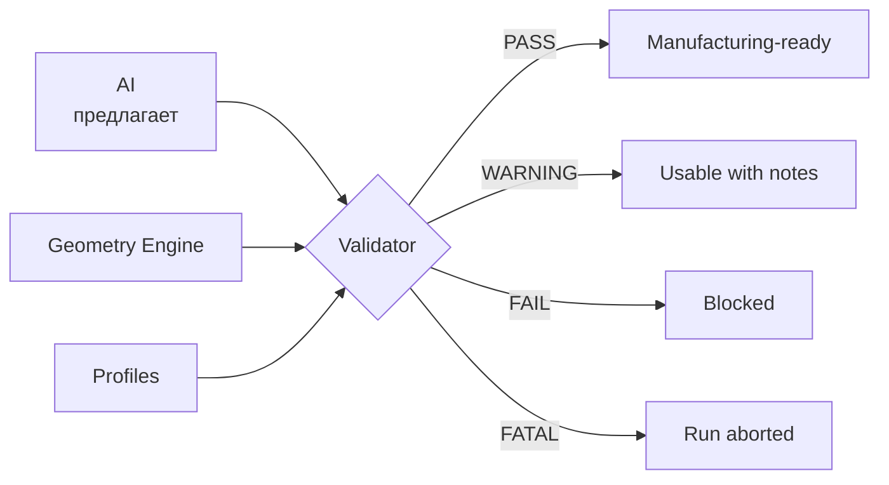
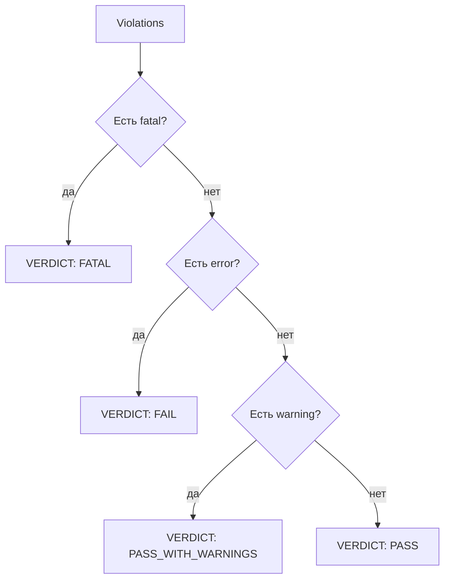
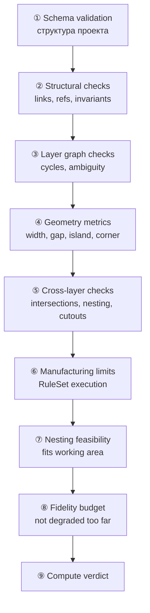
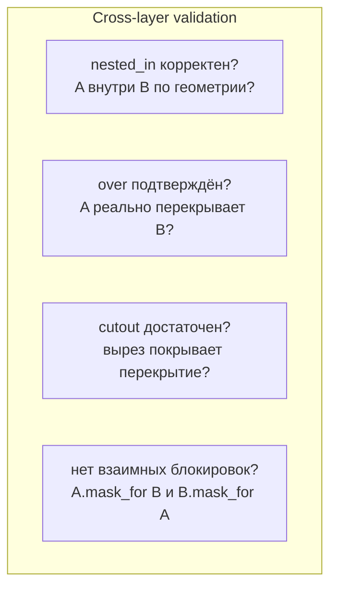
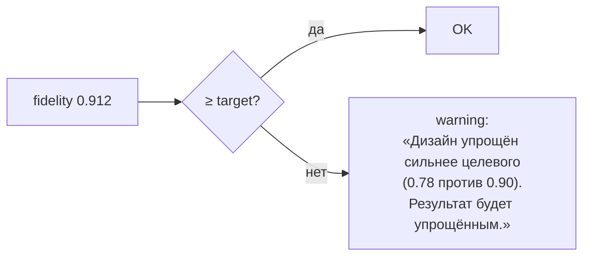

# VALIDATOR

Один из самых важных компонентов. Validator — единственный источник права
назвать проект производимым.

## 1. Правило полномочий



Ни AI, ни пользователь, ни генератор кода не могут присвоить проекту
вердикт `PASS`. Это делает **только** Validator, детерминированно, по правилам.

## 2. Severity и вердикт

| Severity | Значение | Влияет на вердикт |
|---|---|---|
| `info` | Стоит знать | нет |
| `warning` | Производимо, с оговорками | нет, но показывается |
| `error` | Не производимо | блокирует |
| `fatal` | Данные некорректны | прерывает прогон |



| Вердикт | Значение | Можно заказать |
|---|---|---|
| `PASS` | Все правила выполнены | да |
| `PASS_WITH_WARNINGS` | Производимо, есть замечания | да |
| `FAIL` | Есть блокирующие нарушения | нет |
| `FATAL` | Проект некорректен, прогон невозможен | нет |

## 3. Пайплайн валидации



### Порядок важен

Проверки выполняются **от дешёвых к дорогим** и **от структурных к геометрическим**.
При `fatal` на раннем этапе геометрия не анализируется вовсе.

## 4. Проверки по стадиям

### ① Schema

| Проверка | Severity | Сообщение |
|---|---|---|
| `schema_version` поддерживается | fatal | «Формат проекта v3 не поддерживается этой версией движка» |
| Обязательные поля | fatal | «Отсутствует target.part.id» |
| Типы и диапазоны | fatal | «layer_count 80 превышает максимум 64» |
| Enum-значения | error | «role "gloss" не поддерживается» |

### ② Структурные

| Проверка | Severity |
|---|---|
| Все ссылки графа существуют | error |
| Номера слоёв уникальны | error |
| Каждый слой имеет геометрию | error |
| Есть хотя бы один слой | error |
| `units` = mm | error |

### ③ Layer Graph

| Проверка | Severity | Сообщение |
|---|---|---|
| Ацикличность `under`/`over` | fatal | «Порядок слоёв не определён: L02→L04→L06→L02» |
| Отношения валидны | error | «Тип отношения "above" не существует, используйте "over"» |
| Пересечения имеют разрешение | warning | «L03 и L05 пересекаются без cutout» |
| `bridges` подтверждены геометрией | error | «Слой L04 объявлен мостом к L02, но мостов в геометрии нет» |

### ④ Геометрия

См. таблицу T-01…T-15 в `../05_GEOMETRY/TOPOLOGY_ENGINE.md`.

### ⑤ Межслойные



| Проверка | Severity | Типичное сообщение |
|---|---|---|
| `nested_in` не подтверждён геометрией | warning | «L02 объявлен вложенным в L01, но контуры этого не подтверждают» |
| `over` без фактического перекрытия | info | «L06 объявлен поверх L05, но перекрытий нет» |
| Недостаточный cutout | error | «Вырез в L03 не покрывает зону перекрытия с L04» |
| Взаимная блокировка | fatal | «L03 и L04 маскируют друг друга одновременно» |

### ⑥ Производственные лимиты

Исполнение RuleSet из `MANUFACTURING_ENGINE.md`.

### ⑦ Nesting

| Проверка | Severity |
|---|---|
| Габариты слоя ≤ рабочего поля | error (auto-fix: nest) |
| Число tiles ≤ лимита (разумность) | warning |
| Минимум 2 tiles, если маска больше поля | error |
| Плитки не пересекаются | error |

### ⑧ Бюджет сходства



**Важно:** низкое сходство — это **не блокирующая проблема**. Это честное
предупреждение: результат будет проще оригинала, но производим.

## 5. Формат нарушения

```json
{
  "id": "vio_004512_017",
  "rule_code": "min_line_width",
  "severity": "error",
  "layer_id": "L06-c90f",
  "layer_index": 6,
  "layer_name": "Detail",

  "measurement": {
    "measured": 0.42,
    "unit": "mm",
    "required": 0.80,
    "operator": ">="
  },

  "targets": {
    "path_ids": ["path_208", "path_213", "path_219", "path_224", "path_231", "path_240", "path_252"],
    "count": 7,
    "bbox": { "x": 812.0, "y": 640.0, "w": 96.0, "h": 72.0 }
  },

  "cause": "detail_below_resolution",

  "message": {
    "headline": "7 элементов слишком маленькие для выбранного материала.",
    "detail": "Минимум для matte-vinyl-090: 0.80 мм. Самый узкий элемент: 0.42 мм (слой 06 «Detail»).",
    "reason": "Детализация рисунка ниже разрешающей способности материала. Такие элементы невозможно вырезать и удержать на детали.",
    "consequence": "При вырезании плёнка в этих местах порвётся; при снятии маски деталь будет повреждена.",
    "actions": [
      {
        "id": "autofix",
        "label": "Исправить автоматически",
        "primary": true,
        "estimated_fidelity_loss": 0.02,
        "available": true
      },
      {
        "id": "show_elements",
        "label": "Показать элементы",
        "primary": false,
        "available": true
      },
      {
        "id": "change_material",
        "label": "Выбрать материал с меньшим минимумом",
        "primary": false,
        "available": true,
        "options": ["thin-vinyl-050 (0.50 мм)"]
      },
      {
        "id": "simplify_design",
        "label": "Упростить дизайн вручную",
        "primary": false,
        "available": true
      }
    ]
  },

  "auto_fix": {
    "available_operations": ["widen", "merge_nearby", "delete_micro"],
    "predicted_result": "min_width 0.80 mm, elements 34 (−4)",
    "risk": "low"
  }
}
```

## 6. Качество сообщений (P-09)

### Плохо

```text
ERROR 48291
```

### Хорошо

```text
⚠ 7 элементов слишком маленькие для выбранного материала.
  Минимум: 0.80 мм.  Худший элемент: 0.42 мм (слой 06, деталь D).

  Почему это важно: при снятии маски эти элементы оторвутся
  и повредят краску на детали.

  [Исправить автоматически]  [Показать элементы]  [Другой материал]
```

### Правила текста

| Правило | Пример |
|---|---|
| Начинать с количества и сути | «7 элементов слишком маленькие» |
| Называть конкретные числа | «0.42 мм при минимуме 0.80 мм» |
| Указывать слой и элемент | «слой 06, деталь D» |
| Объяснять **последствие** | «оторвутся и повредят краску» |
| Предлагать действия | 2–4 конкретных варианта |
| Указывать влияние действия | «потеря сходства ~2%» |
| Без кодов ошибок в UI | код — только для логов |

## 7. Отчёт валидации

```json
{
  "id": "val_004512",
  "run_id": "RUN-004512",
  "project_id": "MASK-000127",
  "project_revision": 4,
  "engine_version": "0.4.2",
  "ruleset_id": "rs_matv090_knife25_v4_2",

  "verdict": "PASS_WITH_WARNINGS",
  "counts": { "fatal": 0, "error": 0, "warning": 2, "info": 5 },

  "stages": [
    { "stage": "schema", "verdict": "PASS", "duration_ms": 1 },
    { "stage": "structural", "verdict": "PASS", "duration_ms": 3 },
    { "stage": "layer_graph", "verdict": "PASS", "duration_ms": 12 },
    { "stage": "geometry", "verdict": "PASS", "duration_ms": 180 },
    { "stage": "cross_layer", "verdict": "PASS_WITH_WARNINGS", "duration_ms": 45 },
    { "stage": "manufacturing", "verdict": "PASS_WITH_WARNINGS", "duration_ms": 20 },
    { "stage": "nesting", "verdict": "PASS", "duration_ms": 8 },
    { "stage": "fidelity", "verdict": "PASS", "duration_ms": 4 }
  ],

  "violations": [ /* … */ ],

  "metrics": {
    "fidelity": 0.912,
    "total_elements": 71,
    "min_width_mm": 0.80,
    "min_gap_mm": 0.95,
    "islands": 11,
    "bridges": 5,
    "physical_layers": 6,
    "tiles": 9,
    "waste_ratio": 0.187
  },

  "applied_fixes": [
    { "rule": "min_line_width", "operation": "widen", "targets": 7, "fidelity_delta": -0.014 },
    { "rule": "island_anchored", "operation": "add_bridge", "targets": 2, "fidelity_delta": -0.004 },
    { "rule": "min_gap", "operation": "merge_nearby", "targets": 3, "fidelity_delta": -0.008 }
  ],

  "duration_ms": 273,
  "created_at": "2026-01-15T16:02:58Z"
}
```

## 8. Устойчивость Validator

| Ситуация | Поведение |
|---|---|
| Профиль не найден | `fatal` + понятное сообщение |
| Профиль в статусе `draft` | `warning` + проект не может быть Approved |
| Геометрия содержит NaN/Inf | `fatal` + указание элемента |
| Пустая геометрия | `error` по слою |
| Правило падает с исключением | `fatal` на стадию, остальные стадии продолжают, инфраструктурный алерт |
| Таймаут стадии | `error` + предложение упростить |

**Инвариант:** Validator **никогда** не падает. Любая ошибка становится
нарушением с `severity: fatal`.

## 9. Что Validator не делает

| Не делает | Почему |
|---|---|
| Не оценивает «красиво» | Нет измеримого представления |
| Не решает, какой слой убрать | Это решение пользователя или Layer Engine |
| Не генерирует артефакты | Это Export Engine |
| Не изменяет геометрию | Только читает и предлагает фиксы |
| Не доверяет AI-вердиктам | AI не является источником истины |

## 10. Производительность

| Аспект | Решение |
|---|---|
| Кэш метрик геометрии | Ключ = sha256(геометрия) + tolerance |
| Инкрементальная проверка | После правки проверяются только изменённые слои |
| Ранний выход | Найден `fatal` → немедленный стоп |
| Двухфазная геометрия | Растр-оценка, затем offset для подозрительных |
| Параллелизм | Слои независимы → rayon |
| Бюджет | Синхронный путь < 500 ms; иначе очередь |

## 11. Связанные документы

* `MANUFACTURING_ENGINE.md` — правила и пороги.
* `../05_GEOMETRY/TOPOLOGY_ENGINE.md` — геометрические проверки.
* `NESTING_ENGINE.md` — проверка рабочего поля.
* `../04_ENGINE/MASK_ENGINE.md` — место в конвейере.