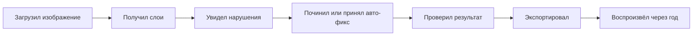
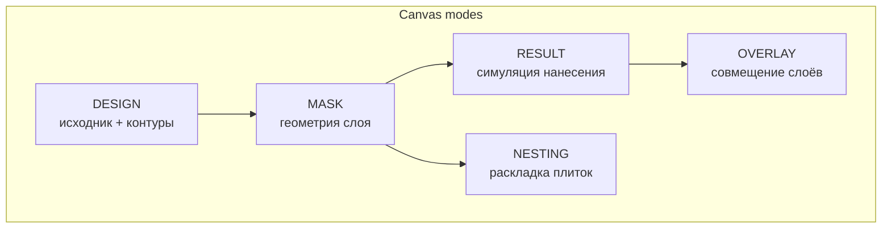
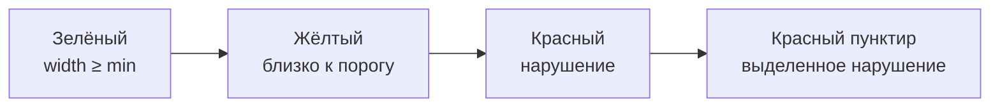
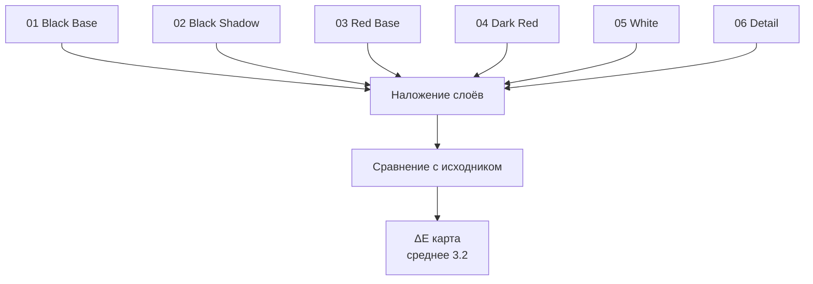
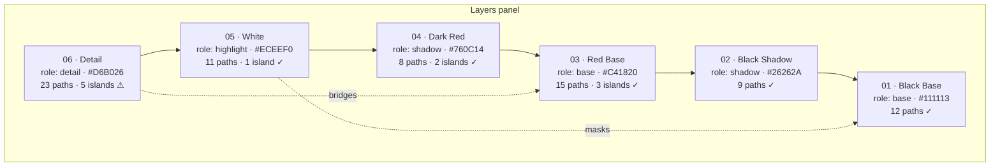
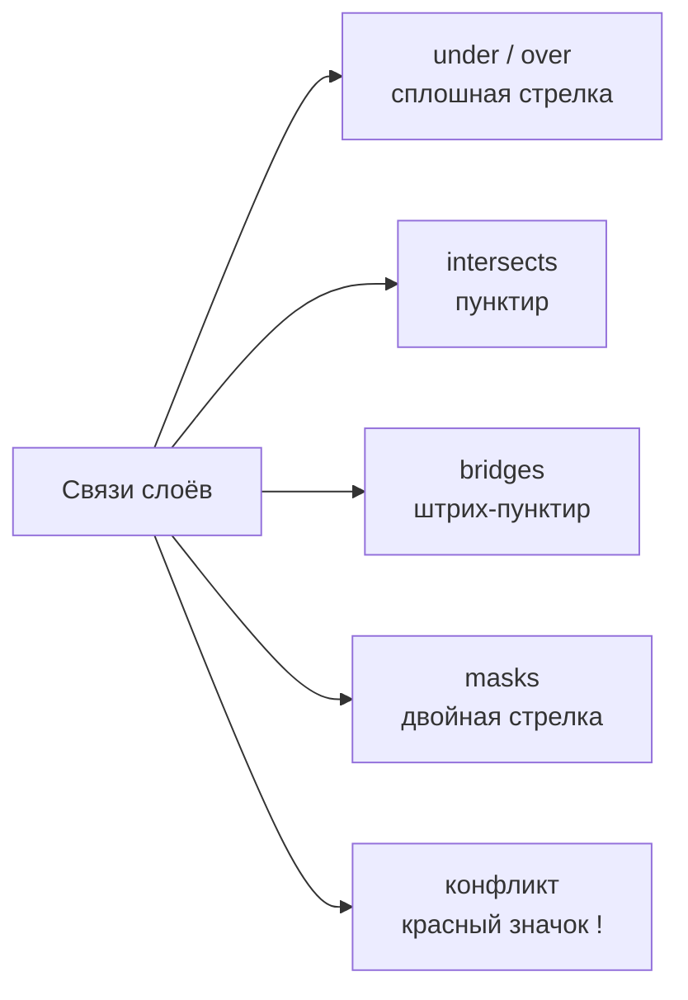
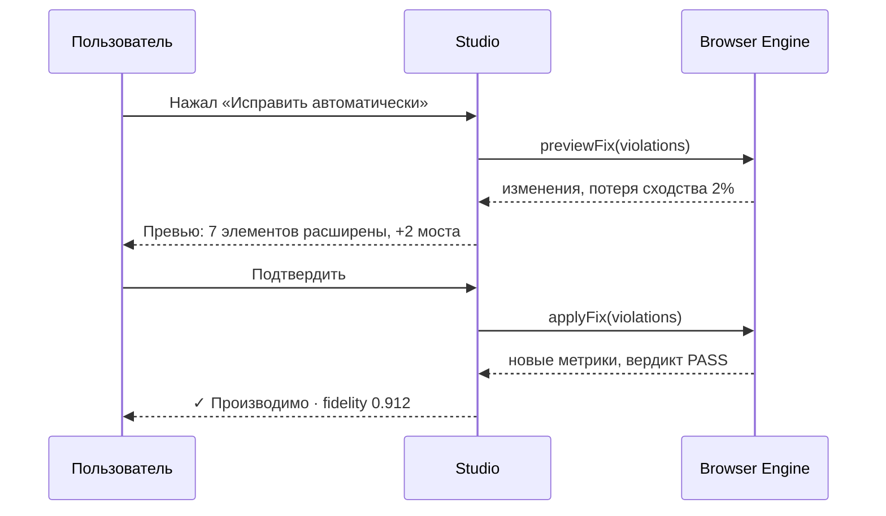

# MASK_STUDIO

Веб-редактор. Вдохновлён Figma / Illustrator / Photoshop / CAD — но **проще и
специализированнее**. Не универсальный редактор, а инструмент под одну задачу.

## 1. Целевая задача Studio



Не задача Studio: рисовать красиво. Не задача: универсальная векторная графика.
Задача: **довести проект до состояния `PASS` с минимальными усилиями.**

## 2. Layout

```text
┌─────────────────────────────────────────────────────────────────┐
│ MASK STUDIO   MASK-000127 · rev 4   [Save]  [Export]  [⋯]     │
│ Audi A4 B9 · Hood   ● PASS_WITH_WARNINGS   fidelity 0.912      │
├──────────┬──────────────────────────────────┬───────────────────┤
│ TOOLS    │                                  │ LAYERS            │
│          │                                  │                   │
│ ▸ Select │                                  │ 06 Detail      👁 │
│ ▸ Node   │           CANVAS                 │ 05 White       👁 │
│ ▸ Bridge │                                  │ 04 Dark Red    👁 │
│ ▸ Cut    │          DESIGN                  │ 03 Red Base    👁 │
│ ▸ Join   │                                  │ 02 Black Shadow👁 │
│ ▸ Widen  │                                  │ 01 Black Base  👁 │
│ ▸ Split  │                                  │                   │
│ ▸ Nest   │                                  │ GRAPH             │
│ ▸ Measure│                                  │  ⋯ bridges L03    │
│          │                                  │  ⋯ masks L01      │
│ ─────────│                                  │ ─────────────────│
│ VIEWS    │                                  │ INSPECTOR         │
│ ☑ Design │                                  │  role: detail      │
│ ☑ Result │                                  │  min W: 0.80 mm ✓  │
│ ☐ 3D     │                                  │  paths: 23         │
│ ☑ Nesting│                                  │  islands: 5        │
│ ─────────│                                  │  bridges: 2        │
│ ZOOM 100%│                                  │  paint: #D6B026    │
├──────────┴──────────────────────────────────┴───────────────────┤
│ ⚠ 2   ℹ 5   MIN LINE 0.80 ✓   MATERIAL matte-vinyl-090 v4     │
│ [Исправить автоматически]              RUN 004512 · 273ms      │
└─────────────────────────────────────────────────────────────────┘
```

## 3. Панели

| Панель | Содержимое | Приоритет |
|---|---|---|
| **Toolbar** | Инструменты | MVP |
| **Canvas** | Рабочая область: дизайн, геометрия, результат | MVP |
| **Layers** | Список физических слоёв + роли + видимость | MVP |
| **Graph** | Визуализация связей слоёв | MVP (упрощённая) |
| **Inspector** | Свойства выбранного: слой, элемент, метрики | MVP |
| **Validation bar** | Вердикт, количество нарушений, кнопка авто-фикса | MVP |
| **Material picker** | Выбор материала и оборудования | MVP |
| **Version history** | Ревизии, сравнение, откат | P1 |
| **Nesting view** | Раскладка плиток и метки | P1 |
| **3D preview** | Поверхность + нанесение | P2 |
| **AI assistant** | Предложения по слоям и упрощению | P2 |
| **Production log** | Физические прогоны | P2 |

## 4. Инструменты

### 4.1 Минимальный набор (MVP)

| Инструмент | Горячая клавиша | Действие |
|---|---|---|
| `Select` | `V` | Выделение элементов и слоёв |
| `Node` | `A` | Редактирование вершин path |
| `Cut` | `C` | Разрезать path в точке |
| `Join` | `J` | Объединить выбранные paths |
| `Widen` | `W` | Расширить элемент до целевой ширины |
| `Bridge` | `B` | Добавить мост к островку |
| `Split layer` | `S` | Разделить слой на два |
| `Measure` | `M` | Показать ширину/зазор/площадь |

### 4.2 Расширенный набор (P1)

| Инструмент | Действие |
|---|---|
| `Simplify` | Упростить геометрию с выбором уровня |
| `Reorder` | Изменить порядок слоёв (с проверкой графа) |
| `Nest preview` | Показать раскладку |
| `Registration` | Расставить/проверить метки |
| `Mask for` | Создать stencil-слой для зоны |
| `Colorkey` | Перекрасить слой (пересчёт paint spec) |

### 4.3 Опасные операции

| Операция | Защита |
|---|---|
| Удаление слоя с потомками | Предупреждение + пересчёт графа |
| Изменение порядка с циклом | Отказ с объяснением конфликта |
| Удаление островка | Показ площади и последствий |
| Массовый auto-fix | Превью изменений + оценка потери сходства |

## 5. Канвас



### 5.1 Режим DESIGN

| Слой отображения | Описание |
|---|---|
| Исходник | Растр с альфа-каналом |
| Сегментация | Результат AI-сегментации (полупрозрачно) |
| Вектор | Результат векторизации |
| Диффа | Сравнение с результатом (для оценки потерь) |

### 5.2 Режим MASK

Показывает геометрию **выбранного слоя** с цветовой кодировкой риска:



| Элемент | Визуальный признак |
|---|---|
| Cut path | Сплошная линия, толщина = kerf |
| Bridge | Пунктир |
| Registration | Тонкая линия + крестики |
| Island | Заливка 20% + номер |
| Нарушение | Обводка красным + номер правила |
| Выделенное | Усиленная обводка + tooltip с измерениями |

### 5.3 Режим RESULT



Показывает: композит слоёв, сравнение с исходником, карту отклонений.
**Fidelity вычисляется по этой карте**, а не на глаз.

### 5.4 Режим NESTING

| Элемент | Описание |
|---|---|
| Плитка | Прямоугольник с id (`A1`, `A2`) |
| Метки | Крестики, стрелки |
| Линии разделения | С kerf-компенсацией |
| Лист | Рамка листа с номером |
| Ошибка размещения | Красная обводка плитки |

## 6. Панель Layers



Для каждого слоя показывается:

| Поле | Источник |
|---|---|
| Порядковый номер и имя | проект |
| Роль | проект |
| Цвет и paint spec | проект |
| Paths, islands, bridges | метрики геометрии |
| Статус валидации | отчёт |
| Превью миниатюра | генерация превью слоя |

## 7. Панель Graph



| Действие | Результат |
|---|---|
| Клик по ребру | Выделить соответствующие элементы на канвасе |
| Клик по конфликту | Показать проблему и варианты решения |
| Drag для создания связи | Проверка на циклы, отказ с объяснением |
| Удаление связи | Пересчёт порядка |

## 8. Панель Inspector

### 8.1 Свойства слоя

```json
{
  "layer": "06 · Detail",
  "role": "detail",
  "paint": {
    "rgb": [214, 176, 38],
    "system": "detail",
    "technique": "airbrush_0_3G",
    "delta_e_tolerance": 2.5
  },
  "geometry": {
    "paths": 23,
    "islands": 5,
    "holes": 0,
    "bridges": 2,
    "min_width_mm": 0.80,
    "min_gap_mm": 1.10,
    "area_mm2": 18400.0,
    "bbox_mm": [1330.0, 980.0]
  },
  "order": { "index": 6, "depends_on": ["L05-3e6d"] },
  "validation": { "verdict": "PASS", "warnings": 0 },
  "nesting": { "tiles": 5, "waste_ratio": 0.204 }
}
```

### 8.2 Свойства элемента

При выделении отдельного path:

| Поле | Пример |
|---|---|
| ID | `path_208` |
| Тип | `contour` |
| Ширина | `0.42 mm` (минимум `0.80 mm`) ⚠ |
| Площадь | `14.2 mm²` |
| Длина периметра | `41.7 mm` |
| Островок | да, закреплён мостом `path_231` |
| Углы | мин. радиус `0.28 mm` ⚠ |
| Пересечения | `path_213` (разрешено) |
| Действия | Widen · Bridge · Merge · Delete |

## 9. Auto-Fix UX



| Требование | Реализация |
|---|---|
| Превью до применения | Обязательно |
| Оценка потери сходства | Обязательно |
| Возможность отмены | Обязательно (новая ревизия) |
| Выборочное применение | По слою или по правилу |
| Отчёт о применённом | Список операций с целями |

## 10. Превью результата

| Уровень | Что показывает | Стадия |
|---|---|---|
| L0 | Композит слоёв 2D | MVP |
| L1 | Композит с наложением на ортофото детали | MVP |
| L2 | Сравнение с исходником + карта ΔE | MVP |
| L3 | Порядок нанесения по шагам (анимация) | P1 |
| L4 | 3D-поверхность + нанесение | P2 |
| L5 | Реалистичная симуляция покрытия | P2 |

## 11. Технические требования

| Аспект | Требование |
|---|---|
| Фреймворк | Next.js + React + TypeScript |
| Рендеринг геометрии | Canvas 2D для совместимости; WebGL для > 5k paths |
| Редактирование геометрии | WASM-ядро (тот же Rust-код) |
| Live-валидация | Debounce 300 ms, WASM, не блокирует UI. **Измерено**: `validate_project` занимает 713.6 мс на 5 000 регионов — debounce не скрывает и половины работы |
| Состояние | Отдельное от React-стейта для больших геометрий |
| Производительность UI | 60 fps при 20k элементов — **заявлено, не измерено и не достигнуто**: `measure_layer` на 20 000 регионах занимает 1 820 мс при бюджете кадра 16.7 мс. См. `docs/13_ROADMAP/ROADMAP.md` §8 «Измерено, а не заявлено» |
| Офлайн | Локальная работа без сети после загрузки проекта |
| Горячие клавиши | Полный набор, документированный |

## 12. Ограничения MVP

| Входит | Не входит |
|---|---|
| 2D канвас | Полноценный 3D |
| Базовые инструменты | Профессиональный инструментарий CAD |
| Ручное редактирование вершин | Кривые Безье с полным контролем handles |
| Auto-fix с превью | Автоматический полный дизайн с нуля |
| Слои и граф | Свободное рисование |
| Экспорт всех форматов | Прямая отправка на плоттер |

## 13. Связанные документы

* `../04_ENGINE/MASK_ENGINE.md` — что делает ядро.
* `../04_ENGINE/LAYER_GRAPH.md` — граф в UI.
* `../06_MANUFACTURING/VALIDATOR.md` — данные для панелей.
* `../06_MANUFACTURING/NESTING_ENGINE.md` — режим раскладки.
* `../08_AI/AI_ARCHITECTURE.md` — AI-предложения в Studio.