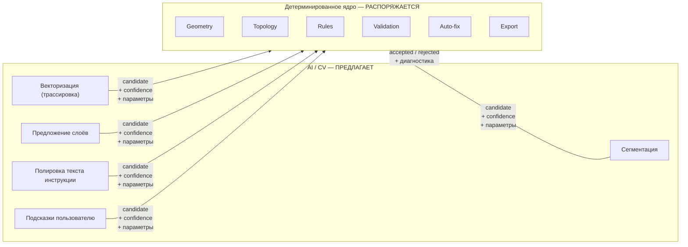
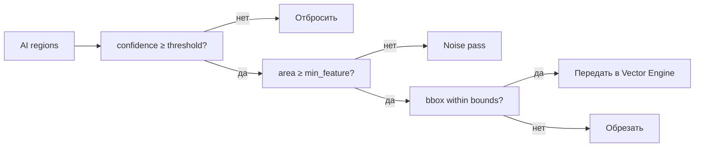
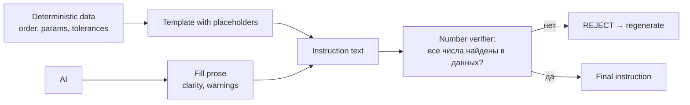
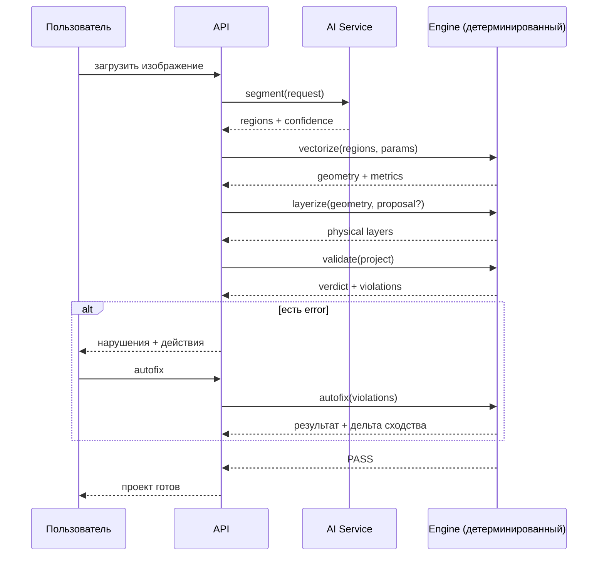
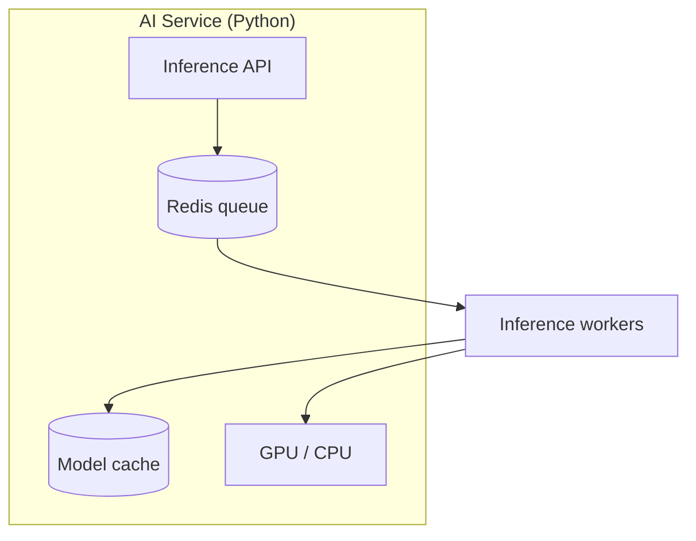
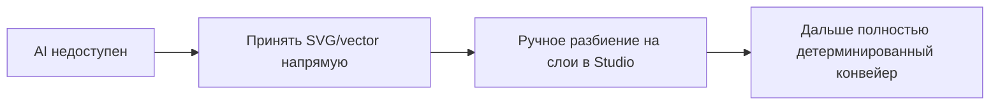
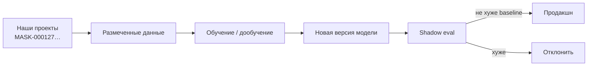

# AI_ARCHITECTURE

## 1. Граница ответственности



**AI не отвечает за физическую корректность производства. Никогда.**

## 2. Разделение по этапам конвейера

| Этап | AI допускается | Что делает AI | Кто решает |
|---|---|---|---|
| ① Загрузка | нет | — | — |
| ② Сегментация | **да** | выделение объектов, удаление фона | пороги профиля |
| ③ Color separation | **да** | кластеризация палитры, регионы | правило слияния |
| ④ Векторизация | **да** | трассировка контуров, аппроксимация кривых | tolerance геометрии |
| ⑤ Topology normalize | нет | — | детерминированно |
| ⑥ Model Fit | нет | — | детерминированно |
| ⑦ Layerize | **да** | предложение разбиения и ролей | Layer Engine |
| ⑧ Layer Graph | нет | — | детерминированно |
| ⑨ Topology | нет | — | детерминированно |
| ⑩ Rules | нет | — | профили |
| ⑪ Validate | нет | — | детерминированно |
| ⑫ Auto-Fix | нет | — | детерминированно |
| ⑬ Simplify | нет | — | детерминированно |
| ⑭ Nesting | нет | — | детерминированно |
| ⑮ Instruction | **да** | текст, формулировки | числа из проекта |
| ⑯ Export | нет | — | детерминированно |

## 3. Почему именно так

| AI-возможность | Почему нельзя в критическом пути |
|---|---|
| Сегментация | Недетерминирована по природе; качество вариативно |
| Трассировка контуров | Может пропустить элемент < порога; нужен последующий аудит |
| Предложение слоёв | Не знает физики покраски и свойств материала |
| Любая оценка производимости | Нет понятия «минимальная ширина плёнки»; модель не обучена на этом |

AI полезен там, где **распознавание шаблонов** сильнее алгоритмов,
и недопустим там, где нужна **гарантия**.

## 4. AI-модули

### 4.1 Segmentation

| Аспект | Значение |
|---|---|
| Задача | Удаление фона, выделение смысловых объектов |
| Вход | Растр |
| Выход | `mask` (alpha), `regions[]` с label и confidence |
| Модель | U-Net / SAM-подобная, дообученная на декоративной графике |
| Ответственность | Только предложение; результат проверяется порогами |
| Кэш | Ключ = sha256(растра) + версия модели |

```json
{
  "model": "segmenter-v2",
  "confidence_threshold": 0.72,
  "regions": [
    { "id": "reg_01", "label": "main_graphic", "bbox": [40, 12, 1330, 980], "confidence": 0.94, "area_ratio": 0.38 },
    { "id": "reg_02", "label": "secondary_element", "bbox": [120, 400, 400, 300], "confidence": 0.88, "area_ratio": 0.09 },
    { "id": "reg_03", "label": "noise", "bbox": [600, 100, 50, 40], "confidence": 0.61, "area_ratio": 0.002 }
  ]
}
```

**Детерминированная фильтрация после AI:**


### 4.2 Vectorizer

| Аспект | Значение |
|---|---|
| Задача | Растр → контуры + аппроксимация кривых |
| Вход | Бинарная маска региона |
| Выход | Paths с командами и измеренными метриками |
| Модель | Классический контурный трекинг + Douglas-Peucker / Bézier fit |
| Детерминизм | Да, при фиксированных параметрах |
| Ограничение | Все результаты проходят проверку min width |

AI-аналог (neural contour): допустим, но выход всё равно проходит
`TopologyEngine::measure`. Нет смысла обучать сеть на геометрию — алгоритм
точнее и объясним.

### 4.3 Layer Proposer

| Аспект | Значение |
|---|---|
| Задача | Предложить разбиение на слои и роли |
| Вход | Векторная геометрия + палитра регионов |
| Выход | Кандидат: набор слоёв с ролями и обоснованием |
| Модель | Правила + необучаемая эвристика (MVP) |
| Ограничение | Предложение — всегда кандидат, проверяется Layer Engine |

```json
{
  "proposal": {
    "layers": [
      { "role": "base", "name": "Black Base", "regions": ["reg_bg_black"], "rationale": "крупная заливка, базовый слой" },
      { "role": "shadow", "name": "Black Shadow", "regions": ["reg_shadow"], "rationale": "тёмная область внутри красного объёма" },
      { "role": "base", "name": "Red Base", "regions": ["reg_red"], "rationale": "основной цвет объекта" },
      { "role": "highlight", "name": "White", "regions": ["reg_white"], "rationale": "блик, требует воздушного нанесения" },
      { "role": "detail", "name": "Detail", "regions": ["reg_lines"], "rationale": "линии, тонкие элементы" }
    ]
  },
  "notes": [
    "Регион reg_04 (confidence 0.61) исключён как шум",
    "Красный объём рекомендуется разделить на base + shadow"
  ]
}
```

### 4.4 Instruction Writer

| Аспект | Значение |
|---|---|
| Задача | Превратить детерминированные данные в читаемый текст |
| Вход | Проект, профили, план nesting, отчёт валидации |
| Выход | Текст инструкции |
| Ограничение | **Все числа — из данных.** AI формулирует только слова |
| Проверка | Автоматическая сверка чисел в тексте с источником |



**Правило P-01 в действии:** если AI написал «нанесите слой на расстоянии 150 мм»,
а в профиле `120 mm` — текст отклоняется.

```json
{
  "instruction": {
    "id": "ins_004512",
    "sections": [
      {
        "title": "Нанесение слоя 03 — Red Base",
        "prose_source": "ai",
        "parameters_source": "project",
        "text": "Возьмите маску слоя 03. Совместите метку A1 с меткой детали в левом верхнем углу. Держите аэрограф на расстоянии 120 мм под углом 90°. Один проход. Сушить 15 минут.",
        "parameters": {
          "distance_mm": 120,
          "angle_deg": 90,
          "passes": 1,
          "dry_minutes": 15
        }
      }
    ],
    "verified_numbers": true
  }
}
```

## 5. Протокол взаимодействия AI с ядром



**AI никогда не вызывается повторно, если ядро может решить задачу детерминированно.**

## 6. Что AI умеет, чего не умеет алгоритм

| Задача | AI лучше | Алгоритм лучше | Решение |
|---|---|---|---|
| Отделить объект от фона | ✅ | средне | AI + проверка порогов |
| Найти сложный контур в растре | ✅ | средне | AI трассировка + measure |
| Аппроксимация кривой | средне | ✅ | Алгоритм (Bézier fit) |
| Разбить на смысловые элементы | ✅ | ❌ | AI предложение |
| Назначить роль слоя | средне | ✅ правила | Правила + AI fallback |
| Проверить min width | ❌ | ✅ | Только алгоритм |
| Определить цикл в графе | ❌ | ✅ | Только алгоритм |
| Разместить мост | ❌ | ✅ | Только алгоритм |
| Оптимизировать раскладку | ❌ | ✅ | Только алгоритм |
| Написать текст инструкции | ✅ | ❌ | AI + проверка чисел |

## 7. Что AI никогда не делает

| Запрещено | Причина |
|---|---|
| Присваивать `PASS`/`FAIL` | Только Validator |
| Записывать числа в инструкцию | Числа — из проекта |
| Менять профиль материала | Профиль — из физических измерений |
| Изменять геометрию напрямую | Только через ядро |
| Принимать решение об удалении элемента | Auto-fix по порогам |
| Определять порядок слоёв | Layer Graph |
| Быть источником истины для воспроизведения | Воспроизводимость требует детерминизма |

## 8. Инфраструктура AI



| Аспект | Значение |
|---|---|
| Язык | Python (PyTorch / ONNX Runtime) |
| Формат обмена | HTTP + JSON внутри кластера |
| Очередь | Redis Streams |
| Кэш | По sha256 входа + версия модели |
| Модели | Свои, на своих данных, версионированные |
| Fallback | Без AI система работает: ручная загрузка вектора, ручное разбиение слоёв |
| Версионирование | `model_version` записывается в provenance проекта |

## 9. Fallback: работа без AI



**Обязательное требование:** ядро должно работать без AI. AI ускоряет,
но не является условием работоспособности.

## 10. Метрики AI

| Метрика | Цель |
|---|---|
| Segmentation precision | > 0.95 на своём домене |
| Segmentation recall | > 0.90 |
| Vectorizer: доля отброшенных верных элементов | < 1% |
| Layer proposal: принято пользователем без правок | > 60% |
| Instruction: числа прошли верификацию | 100% |
| Доля проектов, где AI не был нужен | отслеживается |

**Метрика, которой нет:** «качество AI-картинок». И не должно быть —
это не наша метрика.

## 11. Обучение на своих данных



| Правило | Реализация |
|---|---|
| Данные — только свои | Не используем чужие проекты |
| Версионирование | `model_version` в каждом артефакте |
| Eval-набор | Фиксированный набор сложных изображений |
| Shadow-режим | Новая модсия сравнивается без влияния на результат |
| Откат | Если хуже — откат к предыдущей версии |

## 12. Связанные документы

* `../00_FOUNDATION/PRINCIPLES.md` — P-01.
* `../04_ENGINE/MASK_ENGINE.md` — этапы конвейера.
* `../04_ENGINE/LAYER_ENGINE.md` — куда приходят AI-предложения.
* `../06_MANUFACTURING/VALIDATOR.md` — что проверяет AI-вывод.
* `../13_ROADMAP/ROADMAP.md` — Stage 8.