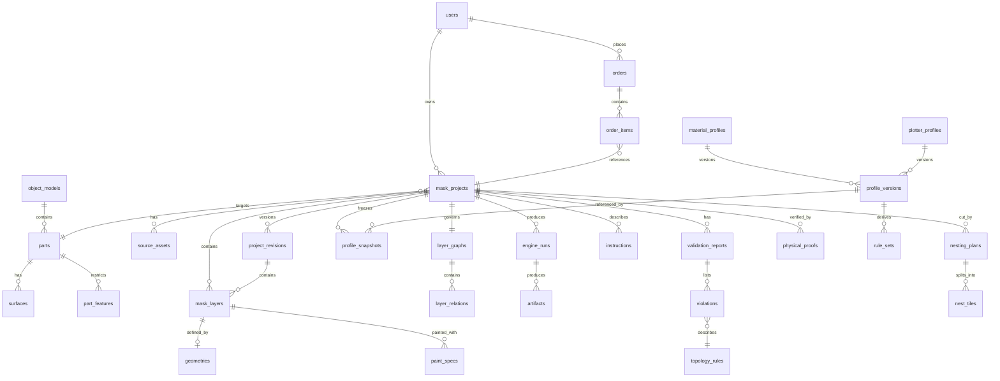
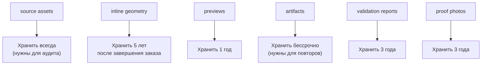

> **Статус документа: целевое состояние, не текущее.**
>
> Решение владельца 2026-10-06 (вариант **A1**): сервисный слой отложен, развиваются
> ядро и Studio. Ни одного `.go` файла, каталога `services/` или HTTP-сервера в
> репозитории нет; проверено поиском по всем 47 коммитам.
>
> Что это меняет для читателя: **эндпоинтов ниже нет, и планировать их надо не отсюда.**
> Действующий вход — `maskctl` (CLI, синхронный, локальные файлы) и `web/studio`
> (Next.js, вызывает WASM напрямую, без API).
>
> Если сервисный слой понадобится, первым делом придётся решить **BUG-005**: схема
> `mask-project.v1.json` не умеет нести геометрию — `designSpace` содержит трансформацию,
> единицу и допуск, а слой ссылается на строку `geometry_id`. Формат, который сервис
> должен читать и писать, пока не определён.

---

# DATABASE_ARCHITECTURE

PostgreSQL — источник истины для метаданных. Геометрия — в JSONB и, при
необходимости, в S3.

## 1. Выбор хранилищ и почему

| Данные | Хранилище | Обоснование |
|---|---|---|
| Проекты, статусы, метаданные | PostgreSQL | Транзакции, связи, индексы |
| Геометрия слоёв | PostgreSQL `jsonb` | Гибкая схема + GIN; типичный слой — десятки KB |
| Тяжёлая геометрия (> 1 MB) | S3 | Не раздувает БД; хеш в БД |
| Артефакты, превью, исходники | S3 | Большие объекты, версионирование |
| Очереди, кэш, idempotency | Redis | Эфемерно, быстро |
| Телеметрия прогонов | ClickHouse (P2) | Аналитика больших объёмов |

## 2. Схема



## 3. Основные таблицы

### 3.1 users

```sql
CREATE TABLE users (
  id              uuid PRIMARY KEY DEFAULT gen_random_uuid(),
  email           citext NOT NULL UNIQUE,
  password_hash   text,
  display_name    text NOT NULL,
  role            user_role NOT NULL DEFAULT 'user',
  locale          text NOT NULL DEFAULT 'en',
  created_at      timestamptz NOT NULL DEFAULT now(),
  updated_at      timestamptz NOT NULL DEFAULT now(),
  disabled_at     timestamptz
);

CREATE TYPE user_role AS ENUM ('user', 'operator', 'admin');
```

### 3.2 Каталог объектов

```sql
CREATE TABLE object_models (
  id              uuid PRIMARY KEY,
  brand           text NOT NULL,
  model           text NOT NULL,
  generation      text NOT NULL,
  year_from       int,
  year_to         int,
  slug            text NOT NULL UNIQUE,
  created_at      timestamptz NOT NULL DEFAULT now()
);

CREATE TABLE parts (
  id              uuid PRIMARY KEY,
  object_model_id uuid NOT NULL REFERENCES object_models(id),
  code            text NOT NULL,
  name            text NOT NULL,
  version         int NOT NULL DEFAULT 1,
  real_width_mm   numeric(10,3) NOT NULL,
  real_height_mm  numeric(10,3) NOT NULL,
  real_depth_mm   numeric(10,3),
  representation  geometry_level NOT NULL DEFAULT 'planar_2_5d',
  curvature       jsonb,
  constraints     jsonb,
  verified        boolean NOT NULL DEFAULT false,
  created_at      timestamptz NOT NULL DEFAULT now(),
  UNIQUE (object_model_id, code, version)
);

CREATE TYPE geometry_level AS ENUM ('rect', 'ortho', 'planar_2_5d', 'nurbs', 'mesh');

CREATE TABLE surfaces (
  id                uuid PRIMARY KEY,
  part_id           uuid NOT NULL REFERENCES parts(id),
  code              text NOT NULL,
  geometry_version  int NOT NULL,
  reference_key     text,          -- S3 key ортофото
  scale_mm_per_px   numeric(12,6),
  uv_bounds         numeric(4)[] NOT NULL DEFAULT ARRAY[0,0,1,1],
  height_field_key  text,          -- S3 key карты высот
  mesh_key          text,          -- S3 key 3D
  UNIQUE (part_id, code, geometry_version)
);

CREATE TABLE part_features (
  id          uuid PRIMARY KEY,
  part_id     uuid NOT NULL REFERENCES parts(id),
  type        text NOT NULL,          -- emboss, vent, panel_gap, crease, wiper_pit
  kind        feature_kind NOT NULL,  -- forbidden | difficult | gap | crease
  shape_key   text,
  params      jsonb
);

CREATE TYPE feature_kind AS ENUM ('forbidden', 'difficult', 'gap', 'crease');
```

### 3.3 Проекты

```sql
CREATE TABLE mask_projects (
  id                text PRIMARY KEY,           -- 'MASK-000127'
  owner_id          uuid NOT NULL REFERENCES users(id),
  part_id           uuid NOT NULL REFERENCES parts(id),
  name              text NOT NULL,

  status            project_status NOT NULL DEFAULT 'Draft',
  current_revision  int NOT NULL DEFAULT 1,

  engine_version    text NOT NULL,
  target_fidelity   numeric(4,3),
  verdict           validation_verdict,
  fidelity          numeric(5,4),
  last_run_id       text,

  created_at        timestamptz NOT NULL DEFAULT now(),
  updated_at        timestamptz NOT NULL DEFAULT now(),
  approved_at       timestamptz,

  CHECK (id ~ '^MASK-\d{6}$'),
  CHECK (current_revision >= 1),
  CHECK (fidelity IS NULL OR (fidelity >= 0 AND fidelity <= 1))
);

CREATE TYPE project_status AS ENUM (
  'Draft','Processing','NeedsWork','NeedsReview','Approved',
  'Ordered','InProduction','Completed','Failed','Archived'
);

CREATE TYPE validation_verdict AS ENUM (
  'PASS','PASS_WITH_WARNINGS','FAIL','FATAL'
);
```

### 3.4 Ревизии

```sql
CREATE TABLE project_revisions (
  project_id      text NOT NULL REFERENCES mask_projects(id) ON DELETE CASCADE,
  revision        int NOT NULL,
  snapshot        jsonb NOT NULL,        -- полная копия состава проекта
  summary         text,
  author_type     revision_author NOT NULL DEFAULT 'user',
  author_id       uuid REFERENCES users(id),
  geometry_hash   text,
  created_at      timestamptz NOT NULL DEFAULT now(),
  PRIMARY KEY (project_id, revision)
);

CREATE TYPE revision_author AS ENUM ('user','engine','autofix','system');
```

### 3.5 Слои и геометрия

```sql
CREATE TABLE mask_layers (
  id              uuid PRIMARY KEY,
  project_id      text NOT NULL REFERENCES mask_projects(id) ON DELETE CASCADE,
  revision        int NOT NULL,
  layer_index     int NOT NULL,
  layer_code      text NOT NULL,          -- 'L03-0b83'
  name            text NOT NULL,
  role            layer_role NOT NULL,
  visible         boolean NOT NULL DEFAULT true,

  paint_spec      jsonb NOT NULL,
  operations      text[] NOT NULL DEFAULT '{}',
  nesting_required boolean NOT NULL DEFAULT false,

  metrics         jsonb,
  bbox            numeric(12,3)[4],

  UNIQUE (project_id, revision, layer_index),
  UNIQUE (project_id, revision, layer_code)
);

CREATE TABLE geometries (
  id              uuid PRIMARY KEY,
  layer_id        uuid NOT NULL REFERENCES mask_layers(id) ON DELETE CASCADE,
  schema_version  int NOT NULL,
  units           text NOT NULL DEFAULT 'mm',
  storage_key     text,                -- если вынесено в S3
  inline_data     jsonb,               -- если помещается
  content_hash    text NOT NULL,
  path_count      int NOT NULL,
  bytes           int NOT NULL,
  bounds          numeric(12,3)[4],
  topology_summary jsonb,
  created_at      timestamptz NOT NULL DEFAULT now(),

  CHECK (inline_data IS NOT NULL OR storage_key IS NOT NULL)
);

CREATE TYPE layer_role AS ENUM (
  'base','shadow','highlight','gradient','detail','stencil','shim','cutaway'
);
```

**Решение:** `inline_data` для слоёв < 256 KB, `storage_key` для больших.
Инлайн даёт транзакционную целостность; вынос — производительность.

### 3.6 Граф слоёв

```sql
CREATE TABLE layer_graphs (
  project_id      text NOT NULL REFERENCES mask_projects(id) ON DELETE CASCADE,
  revision        int NOT NULL,
  version         int NOT NULL DEFAULT 1,
  nodes           text[] NOT NULL,          -- коды слоёв
  is_acyclic      boolean NOT NULL,
  topological_order text[] NOT NULL,
  PRIMARY KEY (project_id, revision)
);

CREATE TABLE layer_relations (
  id            uuid PRIMARY KEY,
  project_id    text NOT NULL REFERENCES mask_projects(id) ON DELETE CASCADE,
  revision      int NOT NULL,
  from_code     text NOT NULL,
  to_code       text NOT NULL,
  type          relation_type NOT NULL,
  geometry_ref  jsonb,
  tolerance_mm  numeric(6,3),
  UNIQUE (project_id, revision, from_code, to_code, type)
);

CREATE TYPE relation_type AS ENUM (
  'under','over','intersects','bridges','nested_in','masks','depends_on','same_paint_op'
);
```

### 3.7 Профили

```sql
CREATE TABLE material_profiles (
  code        text PRIMARY KEY,
  name        text NOT NULL,
  family      text NOT NULL
);

CREATE TABLE plotter_profiles (
  code        text PRIMARY KEY,
  name        text NOT NULL,
  type        text NOT NULL
);

CREATE TABLE profile_versions (
  id                uuid PRIMARY KEY,
  profile_kind      profile_kind NOT NULL,
  profile_code      text NOT NULL,
  version           int NOT NULL,
  status            profile_status NOT NULL DEFAULT 'draft',
  spec              jsonb NOT NULL,
  fingerprint       text NOT NULL,
  verified_physical boolean NOT NULL DEFAULT false,
  verified_at       timestamptz,
  notes             text,
  created_at        timestamptz NOT NULL DEFAULT now(),
  UNIQUE (profile_kind, profile_code, version)
);

CREATE TYPE profile_kind AS ENUM ('material','plotter','cutting');
CREATE TYPE profile_status AS ENUM ('draft','active','superseded','deprecated');

CREATE TABLE rule_sets (
  id            text PRIMARY KEY,          -- 'rs_matv090_knife25_v4_2'
  cutting_profile_id uuid NOT NULL REFERENCES profile_versions(id),
  rules         jsonb NOT NULL,
  generated_at  timestamptz NOT NULL DEFAULT now(),
  content_hash  text NOT NULL
);

CREATE TABLE profile_snapshots (
  project_id    text NOT NULL REFERENCES mask_projects(id) ON DELETE CASCADE,
  revision      int NOT NULL,
  profile_id    uuid NOT NULL REFERENCES profile_versions(id),
  kind          profile_kind NOT NULL,
  PRIMARY KEY (project_id, revision, profile_id)
);
```

**`profile_snapshots` — ключ воспроизводимости.** Проект хранит не ссылку,
а снимок каждого профиля, использованного в прогоне (P-10).

### 3.8 Валидация

```sql
CREATE TABLE validation_reports (
  id              uuid PRIMARY KEY,
  project_id      text NOT NULL REFERENCES mask_projects(id) ON DELETE CASCADE,
  revision        int NOT NULL,
  run_id          text,
  ruleset_id      text NOT NULL,
  engine_version  text NOT NULL,
  verdict         validation_verdict NOT NULL,
  counts          jsonb NOT NULL,          -- {'fatal':0,'error':0,'warning':2,'info':5}
  stages          jsonb,
  metrics         jsonb,
  applied_fixes   jsonb,
  duration_ms     int,
  created_at      timestamptz NOT NULL DEFAULT now()
);

CREATE TABLE violations (
  id            text PRIMARY KEY,
  report_id     uuid NOT NULL REFERENCES validation_reports(id) ON DELETE CASCADE,
  rule_code     text NOT NULL REFERENCES topology_rules(code),
  severity      severity NOT NULL,
  layer_code    text,
  path_ids      text[],
  measured      numeric(14,6),
  required      numeric(14,6),
  unit          text,
  cause         text,
  message       jsonb NOT NULL,        -- headline/detail/reason/consequence/actions
  auto_fix      jsonb
);

CREATE TYPE severity AS ENUM ('info','warning','error','fatal');

CREATE TABLE topology_rules (
  code            text PRIMARY KEY,
  title           text NOT NULL,
  description     text,
  measure         text NOT NULL,
  operator        text NOT NULL,
  severity_default severity NOT NULL,
  auto_fixable    boolean NOT NULL DEFAULT false,
  doc_reference   text
);
```

### 3.9 Прогоны и артефакты

```sql
CREATE TABLE engine_runs (
  id              text PRIMARY KEY,          -- 'RUN-004512'
  project_id      text NOT NULL REFERENCES mask_projects(id) ON DELETE CASCADE,
  revision        int NOT NULL,
  engine_version  text NOT NULL,
  status          run_status NOT NULL DEFAULT 'queued',
  request         jsonb NOT NULL,
  result          jsonb,
  stages          jsonb,
  error           jsonb,
  queued_at       timestamptz NOT NULL DEFAULT now(),
  started_at      timestamptz,
  finished_at     timestamptz,
  duration_ms     int
);

CREATE TYPE run_status AS ENUM ('queued','running','completed','failed','cancelled');

CREATE TABLE artifacts (
  id            uuid PRIMARY KEY,
  run_id        text NOT NULL REFERENCES engine_runs(id) ON DELETE CASCADE,
  project_id    text NOT NULL,
  revision      int NOT NULL,
  kind          artifact_kind NOT NULL,
  layer_code    text,
  tile_id       text,
  storage_key   text NOT NULL,
  sha256        text NOT NULL,
  bytes         int NOT NULL,
  created_at    timestamptz NOT NULL DEFAULT now()
);

CREATE TYPE artifact_kind AS ENUM (
  'cut_svg','cut_dxf','cut_plt','mask_sheet_pdf','instruction_pdf',
  'manifest','preview_png','preview_webp','heightmap','mesh','source'
);
```

### 3.10 Nesting

```sql
CREATE TABLE nesting_plans (
  id            uuid PRIMARY KEY,
  project_id    text NOT NULL REFERENCES mask_projects(id) ON DELETE CASCADE,
  revision      int NOT NULL,
  run_id        text,
  strategy      nesting_strategy NOT NULL,
  mode          nesting_mode NOT NULL,
  summary       jsonb NOT NULL,
  created_at    timestamptz NOT NULL DEFAULT now()
);

CREATE TABLE nest_tiles (
  id            uuid PRIMARY KEY,
  plan_id       uuid NOT NULL REFERENCES nesting_plans(id) ON DELETE CASCADE,
  layer_code    text NOT NULL,
  tile_id       text NOT NULL,             -- 'A1'
  sheet_index   int NOT NULL,
  position_mm   numeric(10,3)[2] NOT NULL,
  size_mm       numeric(10,3)[2] NOT NULL,
  source_rect   numeric(10,3)[4] NOT NULL,
  marks         jsonb,
  separation_count int NOT NULL DEFAULT 0,
  UNIQUE (plan_id, layer_code, tile_id)
);

CREATE TYPE nesting_strategy AS ENUM ('fixed_grid','guillotine','strip','offset_nesting');
CREATE TYPE nesting_mode AS ENUM ('per_layer','per_project','per_batch');
```

### 3.11 Заказы (P2)

```sql
CREATE TABLE orders (
  id            text PRIMARY KEY,          -- 'ORD-000045'
  user_id       uuid NOT NULL REFERENCES users(id),
  status        order_status NOT NULL DEFAULT 'draft',
  total_cents   int NOT NULL DEFAULT 0,
  currency      char(3) NOT NULL DEFAULT 'EUR',
  placed_at     timestamptz,
  created_at    timestamptz NOT NULL DEFAULT now()
);

CREATE TABLE order_items (
  id            uuid PRIMARY KEY,
  order_id      text NOT NULL REFERENCES orders(id) ON DELETE CASCADE,
  project_id    text NOT NULL REFERENCES mask_projects(id),
  revision      int NOT NULL,
  quantity      int NOT NULL DEFAULT 1,
  unit_cents    int NOT NULL,
  is_repeat     boolean NOT NULL DEFAULT false
);

CREATE TYPE order_status AS ENUM ('draft','placed','in_production','shipped','completed','cancelled');
```

### 3.12 Физические прогоны

```sql
CREATE TABLE physical_proofs (
  id            uuid PRIMARY KEY,
  project_id    text NOT NULL REFERENCES mask_projects(id) ON DELETE CASCADE,
  revision      int NOT NULL,
  material_lot  text,
  operator_id   uuid REFERENCES users(id),
  performed_at  timestamptz NOT NULL,
  duration_min  int,
  result        proof_result NOT NULL,
  defects       jsonb,
  notes         text,
  photos        text[]
);

CREATE TYPE proof_result AS ENUM ('pass','pass_with_defects','fail','rejected');
```

**Эта таблица — обратная связь для калибровки профилей.** Без неё пороги
остаются догадками.

## 4. Индексы

```sql
-- Проекты
CREATE INDEX idx_projects_owner ON mask_projects(owner_id, updated_at DESC);
CREATE INDEX idx_projects_status ON mask_projects(status) WHERE status NOT IN ('Archived','Completed');
CREATE INDEX idx_projects_part ON mask_projects(part_id);
CREATE INDEX idx_projects_verdict ON mask_projects(verdict) WHERE verdict IS NOT NULL;

-- Слои
CREATE INDEX idx_layers_project_rev ON mask_layers(project_id, revision);
CREATE INDEX idx_layers_role ON mask_layers(project_id, revision, role);

-- Геометрия: поиск по хешу для переиспользования
CREATE INDEX idx_geo_hash ON geometries(content_hash);
CREATE INDEX idx_geo_layer ON geometries(layer_id);

-- JSONB
CREATE INDEX idx_layers_metrics ON mask_layers USING gin(metrics jsonb_path_ops);
CREATE INDEX idx_profiles_spec ON profile_versions USING gin(spec jsonb_path_ops);
CREATE INDEX idx_validation_metrics ON validation_reports USING gin(metrics jsonb_path_ops);

-- Нарушения
CREATE INDEX idx_violations_report ON violations(report_id);
CREATE INDEX idx_violations_rule ON violations(rule_code, severity);
CREATE INDEX idx_violations_layers ON violations(layer_code) WHERE layer_code IS NOT NULL;

-- Прогоны
CREATE INDEX idx_runs_project ON engine_runs(project_id, created_at DESC);
CREATE INDEX idx_runs_status ON engine_runs(status) WHERE status IN ('queued','running');

-- Артефакты
CREATE INDEX idx_artifacts_project ON artifacts(project_id, revision, kind);
CREATE UNIQUE INDEX idx_artifacts_hash ON artifacts(project_id, revision, sha256, kind, COALESCE(layer_code,''));

-- Каталог
CREATE INDEX idx_parts_model ON parts(object_model_id);
CREATE INDEX idx_features_part ON part_features(part_id, kind);

-- Физические прогоны (для калибровки профилей)
CREATE INDEX idx_proofs_material ON physical_proofs(result, performed_at DESC);
```

## 5. Политика хранения



| Данные | Срок | Обоснование |
|---|---|---|
| Артефакты проекта | бессрочно | Основа воспроизведения |
| Исходные ассеты | бессрочно | Повторная обработка с новыми настройками |
| Inline геометрия | 5 лет после завершения | Оптимизация |
| Превью | 1 год | Регенерируются |
| Отчёты валидации | 3 года | Аудит и калибровка |
| Логи прогонов | 90 дней | Диагностика |
| Фото прогонов | 3 года | Обучение и калибровка |

## 6. Разделение и доступ

| Роль | Доступ |
|---|---|
| `app_user` | CRUD проектов, чтение каталога |
| `engine_worker` | Запись прогонов, артефактов, валидаций |
| `migrator` | DDL |
| `readonly_analyst` | Чтение отчётов, метрик |
| `admin` | Всё |

## 7. Транзакции

| Операция | Границы транзакции |
|---|---|
| Создать проект | Проект + ревизия 1 + граф |
| Применить правку | Ревизия + слои + граф + обновление проекта |
| Записать прогон | engine_runs |
| Записать валидацию | validation_reports + violations |
| Подтвердить проект | Проверка инвариантов → Approved |

**Инварианты проверяются в транзакции**, а не после:

```sql
-- Пример: нельзя подтвердить проект с error-нарушениями
BEGIN;
SELECT verdict INTO v FROM validation_reports
 WHERE project_id = $1 AND revision = $2
 ORDER BY created_at DESC LIMIT 1;

IF v IN ('FAIL','FATAL') THEN
  RAISE EXCEPTION 'project not manufacturable (verdict=%)', v;
END IF;

UPDATE mask_projects
   SET status = 'Approved', approved_at = now(), updated_at = now()
 WHERE id = $1;

COMMIT;
```

## 8. Миграции

| Аспект | Правило |
|---|---|
| Инструмент | `golang-migrate` |
| Формат | версионированные SQL-файлы, только вперёд |
| Запрещено | Изменение применённой миграции |
| Данные | Миграции данных — отдельно от DDL, с флагом |
| Блокировка | Проверка на долгую блокировку перед применением |
| Откат | Только через новую миграцию |

## 9. Целостность геометрии в БД

БД не понимает геометрию, но проверяет её **согласованность**:

```sql
-- Проверка при записи геометрии
CHECK (path_count > 0)
CHECK (jsonb_typeof(topology_summary) = 'object')
-- bounds должны соответствовать содержимому — проверяется в приложении
```

Полная проверка геометрии (min width, пересечения) — ответственность
`Validator`, а не ограничений БД. Иначе каждая правка в Studio стоила бы
секунд.

## 10. Метрики хранения

```sql
-- Размер проектов по слоям
SELECT
  width_bucket(v.path_count, 0, 1000, 10) AS paths_bucket,
  count(*) AS geometries,
  round(avg(g.bytes)/1024.0) AS avg_kb,
  round(percentile_cont(0.95) WITHIN GROUP (ORDER BY g.bytes)/1024.0) AS p95_kb
FROM geometries g
JOIN mask_layers l ON l.id = g.layer_id
JOIN (SELECT id, (metrics->>'paths')::int AS path_count FROM mask_layers) v
  ON v.id = l.id
GROUP BY 1 ORDER BY 1;
```

Ожидается: 95% слоёв < 200 KB, поэтому inline-стратегия оправдана.

## 11. Связанные документы

* `../03_DOMAIN/DOMAIN_MODEL.md` — доменная модель.
* `../02_ARCHITECTURE/SYSTEM_ARCHITECTURE.md` — роль хранилищ.
* `../06_MANUFACTURING/MANUFACTURING_ENGINE.md` — профили.
* `../11_INFRA/INFRASTRUCTURE.md` — развёртывание БД.