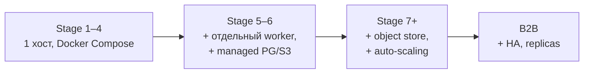
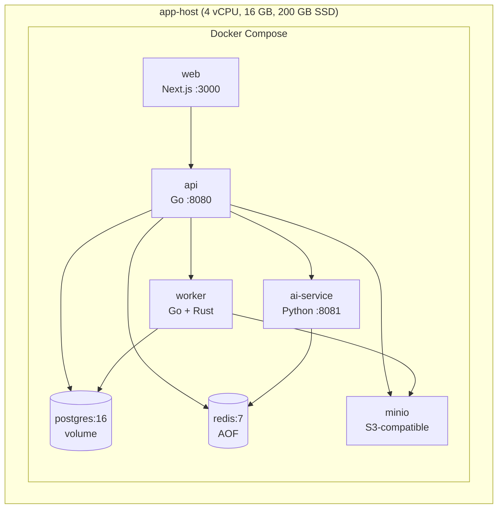
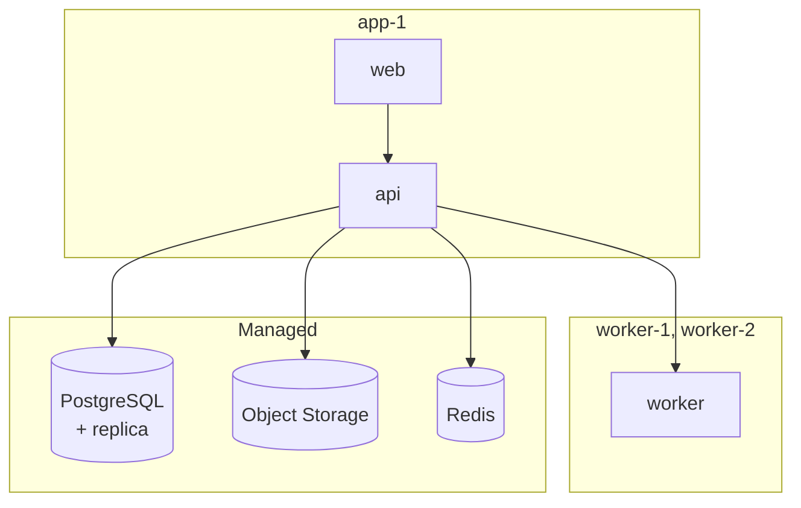
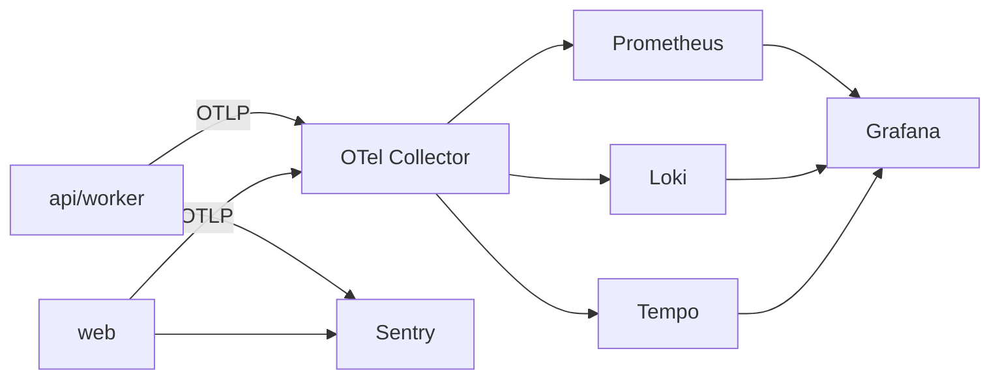
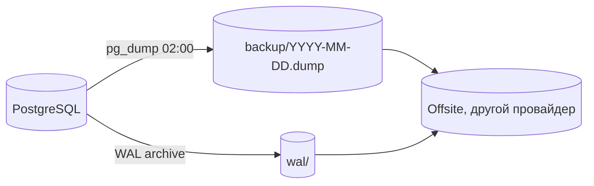

> **Статус документа: целевое состояние, не текущее.**
>
> Решение владельца 2026-10-06 (вариант **A1**): развиваются ядро и Studio, сервисный
> слой отложен. Что из перечисленного ниже есть на самом деле:
>
> | Пункт | Состояние |
> |---|---|
> | Docker Compose | ❌ нет ни `Dockerfile`, ни `compose.yml` |
> | Kubernetes | ❌ нет манифестов (помечен «позже» — это честно) |
> | CI/CD (GitHub Actions) | ✅ `.github/workflows/check.yml`, запускает `make check` на push в `main` и на PR. **Не выполнен:** требует push, первый реальный прогон ещё не было |
> | Мониторинг, алерты | ❌ OpenTelemetry не подключён, зависимости нет |
> | Бэкапы | ❌ БД нет, бэкапить нечего |
> | Rust toolchain | ✅ `rust-toolchain.toml` |
> | Тестовый гейт | ✅ `make check` — 427 Rust-тестов (1 `#[ignore]`), 32 веб-теста, схемы, wasm, контраст фасада |
>
> **Что делает гейт:** `clippy -D warnings`, `fmt --check`, весь `cargo test`,
> JSON Schema с 24 негативными случаями, валидация манифеста, который движок
> производит сам, сборка WASM под две цели, сверка фасада с настоящим артефактом,
> веб-тесты, typecheck и `next build`.
>
> **Чего гейт не делает:** не запускает `make physical` (нужен материал) и не
> проверяет `make spike` — это зонд, а не проверка.
>
> Известная слабость: `wasm-pack` ставится из cargo вручную и не проверяется на
> наличие, поэтому отсутствие бинарника даст `command not found`, а не подсказку.

---

# INFRASTRUCTURE

## 1. Принцип: не overengineer

| Что | Когда вводим |
|---|---|
| Docker Compose | с первого дня |
| Managed PostgreSQL / S3 | при первом внешнем пользователе |
| CI/CD (GitHub Actions) | с первого дня |
| Мониторинг (Prometheus/Grafana) | когда появляются внешние пользователи |
| Kubernetes | когда нагрузка требует — не раньше |
| CDN | когда начнут грузить превью |
| Kafka | не планируется |
| Multi-region | не планируется |

## 2. Stage 1–4: однохостовая конфигурация

### Ресурсы

| Сервис | CPU | RAM | Диск |
|---|---|---|---|
| `web` | 0.5 | 512 MB | — |
| `api` | 1 | 512 MB | — |
| `worker` | 2 | 4 GB | 10 GB tmp |
| `ai-service` | 2 | 6 GB | 20 GB models |
| `postgres` | 1 | 2 GB | 40 GB |
| `redis` | 0.2 | 512 MB | 1 GB |
| `minio` | 0.5 | 2 GB | 100 GB |
| **Итого** | ~7 | ~16 GB | ~200 GB |

**Ограничение этого этапа:** один хост = один отказ. Приемлемо, пока
нет внешних платящих клиентов.

## 3. Stage 5–6: разделение

Разделение происходит по одной причине: **worker нагружается геометрией**
и может потреблять 4–8 GB RAM, что не должно влиять на API.

## 4. Конфигурация

| Переменная | Пример | Назначение |
|---|---|---|
| `DATABASE_URL` | `postgres://…` | БД |
| `REDIS_URL` | `redis://…` | Очереди, кэш |
| `S3_ENDPOINT` | `https://s3…` | S3 |
| `S3_BUCKET` | `mask-platform` | бакет |
| `S3_ACCESS_KEY` / `S3_SECRET_KEY` | — | доступ |
| `ENGINE_VERSION` | `0.4.2` | версия ядра |
| `WORKER_CONCURRENCY` | `4` | параллелизм |
| `AI_SERVICE_URL` | `http://ai:8081` | AI |
| `AI_ENABLED` | `true` | отключение AI без падения |
| `OTEL_EXPORTER_OTLP_ENDPOINT` | `http://collector:4317` | телеметрия |
| `LOG_LEVEL` | `info` | логи |

**Правило:** все пороги производства — в профилях в БД, **не** в env.
Env — только инфраструктура.

## 5. Сети

| Сеть | Доступ |
|---|---|
| `frontend` | web → api:8080 |
| `backend` | api → postgres, redis, s3, worker, ai |
| `internal` | worker → postgres, s3 |
| **Публичный** | Только web (80/443) |

`api` и `worker` напрямую не публикуются. Доступ только через `web`/reverse proxy.

## 6. Сборка

```mermaid
flowchart LR
  A["Push в main"] --> B["CI: lint, test, build"]
  B --> C["Rust: cargo test + clippy"]
  C --> D["Go: go test + vet"]
  D --> E["Next: build + lint + typecheck"]
  E --> F["Golden tests: engine"]
  F --> G["Image build"]
  G --> H["Push в registry"]
  H --> I["CD: deploy staging"]
  I --> J["Smoke tests"]
  J --> K["Manual approve → prod"]
```

| Образ | Языка | Примечание |
|---|---|---|
| `api` | Go | multi-stage, distroless |
| `worker` | Go + Rust | статическая линковка |
| `web` | Node | standalone output |
| `ai-service` | Python | slim + CUDA опционально |

## 7. Наблюдаемость

### Обязательные метрики

| Метрика | Тип | Ссылка |
|---|---|---|
| `engine_stage_duration_ms{stage}` | histogram | производительность |
| `engine_run_total{status}` | counter | прогоны |
| `engine_violations_total{rule,severity}` | counter | качество |
| `engine_fidelity` | histogram | сходство |
| `engine_autofix_total{operation}` | counter | авто-фикс |
| `api_request_duration_ms{route}` | histogram | API |
| `worker_queue_depth` | gauge | очередь |
| `engine_panics_total` | counter | **должен быть 0** |

### Алерты

| Условие | Действие |
|---|---|
| `engine_panics_total > 0` | немедленно |
| p95 `engine_run_total` > 60 s | предупреждение |
| Доля FAIL валидаций > 30% на типовом входе | предупреждение |
| `worker_queue_depth > 50` | предупреждение |
| Диск БД > 80% | предупреждение |

**Паника ядра = дефект, а не событие.** Не «обрабатывать», а чинить.

## 8. Бэкапы

| Данные | Метод | Частота | Хранение |
|---|---|---|---|
| PostgreSQL | `pg_dump` + WAL-архив | ежедневно + непрерывно | 30 дней |
| S3/MinIO | версионирование + replication | непрерывно | 90 дней |
| Redis | AOF | непрерывно | не критично |
| Конфигурация | git | при изменении | навсегда |

**RPO:** 15 минут. **RTO:** 4 часа. Проверка восстановления — ежемесячно.

## 9. Окружения

| Окружение | Данные | Профили | Доступ |
|---|---|---|---|
| `dev` | синтетика | draft | открыто |
| `staging` | синтетика + копия профилей | active | команда |
| `prod` | реальные | active (verified) | публичный |

**Правило:** в `dev`/`staging` профили не проходят физическую проверку →
проекты там не могут получить `Approved`. Это защищает от ошибочных
«продакшн»-вердиктов на непроверенных порогах.

## 10. Секреты

| Тип | Хранение |
|---|---|
| Пароли БД | env из secret-файла, не в git |
| S3 keys | env / secret manager |
| JWT private key | файл 0400 или secret manager |
| Пароли пользователей | argon2id, хеш в БД |

Правило: секреты не в репозитории, не в образах, не в логах.

## 11. Масштабирование

| Узкое место | Признак | Решение |
|---|---|---|
| Worker занят | `queue_depth` растёт | + worker |
| Геометрия ест RAM | OOM на worker | Лимит на размер проекта, внешняя обработка |
| API медленный | p95 route > 500 ms | Кэш, индексы, вынести ворк |
| БД растёт | `pg_stat` показывает рост | Партиционирование по дате на `engine_runs`, `validation_reports` |
| S3 дорог | Много дублей | Дедупликация по `content_hash` |
| AI не успевает | Очередь AI | + worker, уменьшить `confidence_threshold` |

## 12. Ограничения MVP и их решение

| Ограничение | Решение |
|---|---|
| Один хост | Бэкапы + план восстановления; переезд на managed при росте |
| Нет GPU | AI на CPU с уменьшенными моделями; или CPU-инференс |
| Нет HA | Быстрое восстановление из бэкапа |
| Ручной каталог объектов | 3–5 деталей вручную; автоматизация позже |

## 13. Связанные документы

* `../02_ARCHITECTURE/SYSTEM_ARCHITECTURE.md` — компоненты.
* `../12_TESTING/TESTING_STRATEGY.md` — что тестируем в CI.
* `../10_DATABASE/DATABASE_ARCHITECTURE.md` — схема БД.