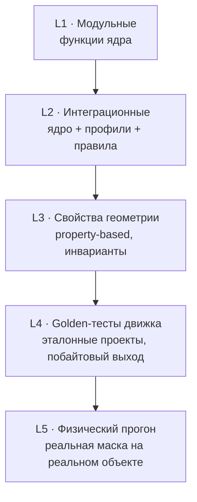
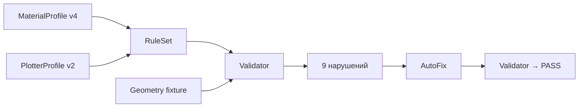
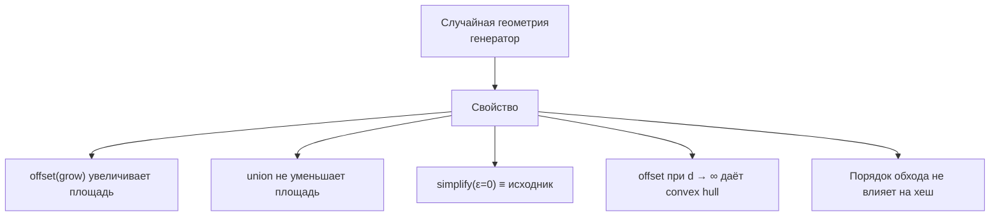
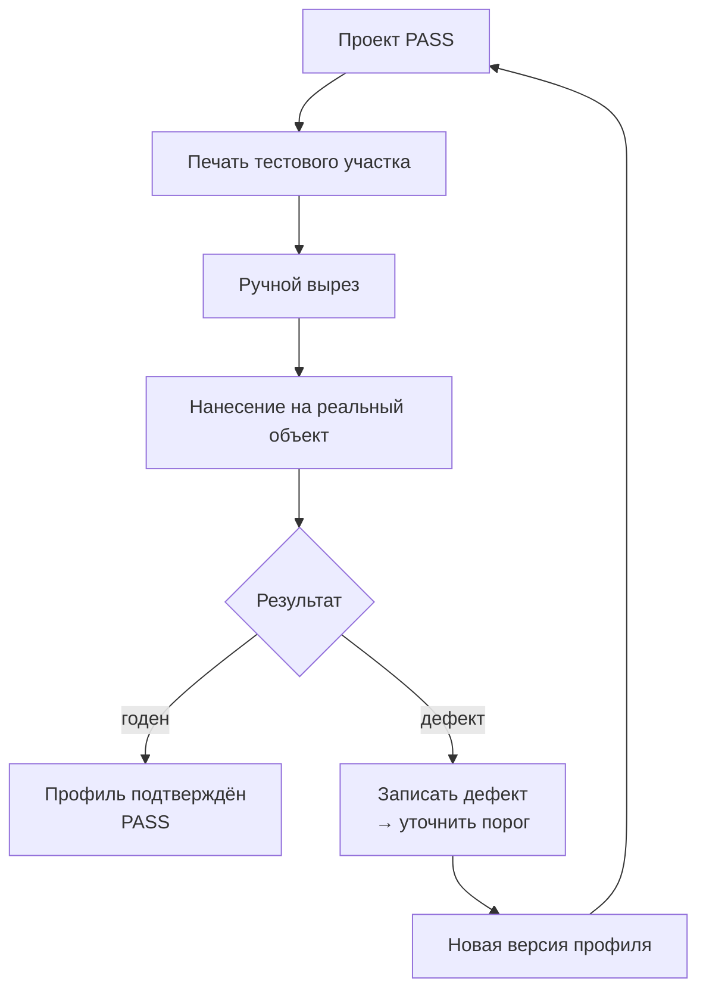

# TESTING_STRATEGY

Для геометрического ядра тесты — не «качество кода», а **гарантия производимости**.
Непокрытый геометрический код — это брак на полке.

## 1. Пирамида тестирования



| Уровень | Доля усилий | Что ловит |
|---|---|---|
| L1 | 30% | Ошибки в отдельных функциях |
| L2 | 25% | Неверная интеграция правил |
| L3 | 20% | Нарушения геометрических инвариантов |
| L4 | 20% | Регрессии поведения движка |
| L5 | 5% (по времени) | Физические дефекты |

## 2. L1 — Модульные тесты ядра

```rust
#[test]
fn offset_grows_contour_by_exact_delta() {
    let square = Square::new(10.0, 10.0);
    let grown = offset(&square, 2.0).unwrap();
    assert_close(grown.area(), 14.0 * 14.0, MEASURE_EPS_MM);  // ADR-0004
}

#[test]
fn offset_of_thin_strip_collapses_when_smaller_than_delta() {
    let strip = Rectangle::new(10.0, 0.5);
    let result = offset(&strip, 1.0);
    assert!(result.is_empty(), "expected collapse, got {:?}", result);
}

#[test]
fn min_width_of_1mm_line_measures_1mm() {
    let line = Rectangle::new(20.0, 1.0);
    let w = measure_min_width(&line).unwrap();
    assert_close(w, 1.0, MEASURE_EPS_MM);  // ADR-0004
}
```

> **Все допуски в тестах — именованные константы из ADR-0004.**
> Литералы вида `1e-6` / `1e-4` в тестах запрещены: они не выражают
> единицы измерения и расходятся между файлами.

### Что обязательно покрыто

| Модуль | Обязательные случаи |
|---|---|
| Primitives | создание, сериализация, round-trip |
| Offset | grow, shrink, collapse, join, self-intersect, cusp |
| Boolean ops | union, diff, intersect; пустые результаты; касание |
| Measure | area, length, min width, bbox |
| Simplify | RDP с разными ε; сохранение инвариантов |
| Winding / nesting tree | вложенные контуры; even-odd vs nonzero |
| Curve fit | точность ≤ tolerance на эталонных кривых |
| Layer graph | топологическая сортировка; обнаружение циклов |

## 3. L2 — Интеграционные тесты

Проверяют связки «профиль → правило → нарушение → авто-фикс → повторная проверка».



| Тест | Проверяет |
|---|---|
| Profile → RuleSet | пороги вычисляются по формулам из `MANUFACTURING_ENGINE.md` |
| Geometry → Violations | конкретные нарушения для конкретной геометрии |
| Violations → AutoFix | операции исправляют именно те нарушения |
| AutoFix → Re-validate | результат проходит |
| Profile change | проект, валидный на v3, может стать невалидным на v2 |
| Export round-trip | SVG → parse → геометрия ≡ исходной |

## 4. L3 — Property-based тесты

### 4.1 Геометрические инварианты



| Свойство | Формулировка |
|---|---|
| Monotonicity offset | `d1 < d2 → area(grow(d1)) < area(grow(d2))` |
| Union monotonicity | `A ⊆ B → area(A) ≤ area(B)` |
| Simplify identity | `simplify(g, 0) ≡ g` (в пределах tolerance) |
| Offset growth | `offset(g, ∞) = convex_hull(g)` |
| Order independence | Перестановка paths не меняет content_hash |
| No NaN | Ни одна операция не порождает NaN/Inf |
| Bounded expansion | `offset(g, d)` увеличивает bbox не более чем на `d` |

### 4.2 Инварианты проекта

| Инвариант | Проверка |
|---|---|
| I-3 | Layer Graph ацикличен после любой операции |
| I-5 | `PASS` ⇒ нет `error`-нарушений |
| I-8 | Каждый артефакт имеет `engine_version` |
| Детерминизм | Два прогона → одинаковый `content_hash` |

### 4.3 Генераторы

| Генератор | Диапазон |
|---|---|
| Случайные контуры | 3–200 path, выпуклые и невыпуклые |
| Островки | 0–50, размеры 0.1–20 мм² |
| Пересечения | 0–100 пар |
| Вложенные контуры | глубина 1–8 |
| Вырожденные случаи | 0 длина, совпадающие точки, NaN-инъекция |

## 5. L4 — Golden-тесты

### 5.1 Что такое эталонный проект

```text
fixtures/
├── interlocking_lines/      # переплетение линий, петли, узлы
│   ├── input.png
│   ├── source_geometry.json
│   ├── project.expected.json
│   ├── validation.expected.json
│   ├── L01.expected.svg
│   └── meta.yaml
├── nested_contours/
├── thin_detail_stress/      # намеренно непроизводимый вход
├── islands_requiring_bridges/
├── oversized_requires_nesting/
├── curved_surface_fit/
└── minimum_passable/         # граничный случай, ровно на пороге
```

`meta.yaml`:

```yaml
name: interlocking_lines
description: >-
  Переплетающиеся линии с петлями, узлами, ветвлениями, пересечениями,
  тонкими и толстыми участками, мостами и островками.
material: matte-vinyl-090
material_version: 4
plotter: knife-25mm
plotter_version: 2
target_fidelity: 0.90
expect_verdict: PASS_WITH_WARNINGS
expect_fidelity_range: [0.89, 0.93]
expect_layers: 6
expect_min_width_after: 0.80
tolerate_diff: [violations.order, metrics.floating_point]
```

### 5.2 Что сравнивается

| Сравнивается | Строгость |
|---|---|
| Вердикт | строго |
| Число слоёв | строго |
| Число элементов (paths, islands, bridges) | строго |
| Порядок слоёв | строго |
| min width, min gap | ±0.001 мм |
| Площади | ±0.01% |
| Содержимое SVG | структурно (путь команд, координаты ±tolerance) |
| Хеш артефакта | строго (при неизменной версии движка) |
| Сообщения нарушений | текст, порядок может меняться |

### 5.3 Политика обновления

```bash
# Явное обновление эталонов при ожидаемом изменении
UPDATE_GOLDEN=1 cargo test --test golden -- interlocking_lines
git diff fixtures/            # ОБЯЗАТЕЛЬНОЕ РЕВЬЮ
```

**Правило:** изменение эталона требует в PR объяснения, почему новое
поведение корректно. Массовое обновление эталонов = подозрение на регресс.

## 6. L5 — Физическая валидация



### Протокол

| Шаг | Что фиксируется |
|---|---|
| Материал | Код, версия, партия |
| Инструмент | Тип ножа, держатель |
| Вырез | Ручной / плоттер, время |
| Нанесение | Аэрограф, расстояние, краска, проходы |
| Время | Общее |
| Дефекты | Тип, размер, расположение |
| Вердикт | pass / pass_with_defects / fail |

### Обязательные тестовые случаи

| Случай | Цель |
|---|---|
| Минимальный элемент на пороге | Подтвердить порог |
| Элемент чуть ниже порога | Подтвердить, что порог необходим |
| Островок с мостом | Подтвердить, что мост держит |
| Островок без моста | Подтвердить, что выпадает |
| 6 слоёв на сложной детали | Подтвердить последовательность |
| Криволинейная поверхность | Подтвердить прилегание |
| Снятие маски | Подтвердить отсутствие повреждений |

**Результат каждого физического прогона попадает в `physical_proofs`
и используется для калибровки профилей.** Без этого профили остаются
предположениями.

## 7. Тесты AI

| Тип | Проверка |
|---|---|
| Precision/recall сегментации | На размеченном наборе |
| Стабильность вердикта | Один вход, N запусков → одинаковая геометрия |
| Влияние на метрики | AI-путь vs ручной путь: разница в fidelity и нарушениях |
| Отказоустойчивость | AI недоступен → система работает |
| Границы ответственности | AI не может присвоить `PASS` — тест на уровне API |
| Верификация чисел | Числа в инструкции ∈ источника данных |

## 8. Тесты безопасности

| Область | Проверка |
|---|---|
| Доступ к проектам | Чужой пользователь не читает чужой проект |
| Presigned URL | Срок жизни, право на ключ |
| Загрузка файлов | Тип, размер, отсутствие исполняемого контента |
| SQL injection | Параметризованные запросы |
| Path traversal в storage keys | Валидация ключей |
| Rate limiting | На прогон и загрузку |
| Логи | Нет секретов, нет PII в избытке |

## 9. Производительность

### Бюджеты

| Операция | Бюджет | Условия |
|---|---|---|
| Полный прогон | ≤ 6 s | 1 Мпикс, 6 слоёв |
| Валидация | ≤ 500 ms | 10k paths |
| Превью | ≤ 800 ms | 20k paths |
| Экспорт | ≤ 300 ms | 6 слоёв |
| Nesting | ≤ 400 ms | 30 плиток |
| 60 fps в Studio | ≤ 16 ms/кадр | 20k элементов |

### Нагрузочные сценарии

| Сценарий | Нагрузка |
|---|---|
| Один большой проект | 40 Мпикс, 20 слоёв |
| Много маленьких | 50 проектов по 1 слою |
| Одновременные прогоны | 10 параллельных |
| Много слоёв | 64 слоя |

## 10. CI-конвейер

```mermaid
flowchart LR
  A["lint<br/>clippy, vet, eslint"] --> B["unit tests<br/>cargo test, go test"]
  B --> C["property tests<br/>200 cases"]
  C --> D["integration<br/>профиль→правило→фикс"]
  D --> E["golden tests<br/>все fixtures"]
  E --> F["fuzz smoke<br/>60 s"]
  F --> G["API contract<br/>OpenAPI vs routes"]
  G --> H["determinism<br/>двойной экспорт"]
  H --> I["performance<br/>бюджеты"]
  I --> J["build images"]
  J --> K["deploy staging"]
  K --> L["smoke"]
```



| Этап | Время | Блокирует? |
|---|---|---|
| Lint | 2 min | да |
| Unit | 3 min | да |
| Property | 5 min | да |
| Integration | 3 min | да |
| Golden | 4 min | да |
| Fuzz (smoke) | 1 min | да |
| Contract | 1 min | да |
| Determinism | 2 min | да |
| Performance | 5 min | да (>2× бюджет) |
| Build | 3 min | да |

## 11. Fuzzing

| Цель | Метод |
|---|---|
| Парсер SVG | `cargo-fuzz` |
| Парсер DXF | `cargo-fuzz` |
| Offset | `cargo-fuzz`, проверка инвариантов |
| Boolean ops | `cargo-fuzz` |
| Сериализация проекта | round-trip property |
| JSON schema | мутация входа |
| Кернел-паники | любой вход → exit code 0 |

**Требование:** ни один вход не должен вызывать панику. Ошибка — типизированная.

## 12. Метрики качества тестов

| Метрика | Цель |
|---|---|
| Покрытие ядра (строки) | ≥ 85% |
| Покрытие правил | 100% правил имеют хотя бы один тест |
| Golden fixtures | ≥ 8, покрывают все классы топологии |
| Flaky-тесты | 0 |
| Время CI | ≤ 30 min |
| Эталонов обновлено без обоснования | 0 |

## 13. Что НЕ тестируется автоматически

| Аспект | Почему | Как проверяется |
|---|---|---|
| Реальное прилегание к детали | Требует физики | Физический прогон |
| Качество снятия маски | Требует практики мастера | Физический прогон |
| Читаемость рисунка на детали | Субъективно | Экспертная оценка + фото |
| Совместимость с конкретным плоттером | Зависит от устройства | Ручной прогон |
| Долговечность во времени | Требует месяцев | Отсроченное наблюдение |

**Признать это честно важнее, чем притвориться, что тесты покрывают всё.**

## 14. Связанные документы

* `../00_FOUNDATION/DEVELOPMENT_PROCESS.md` — DoD.
* `../05_GEOMETRY/TOPOLOGY_ENGINE.md` — что проверяем.
* `../06_MANUFACTURING/VALIDATOR.md` — правила и нарушения.
* `../13_ROADMAP/ROADMAP.md` — критерии этапов.