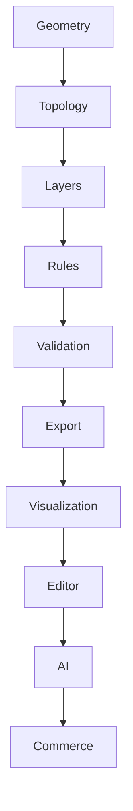
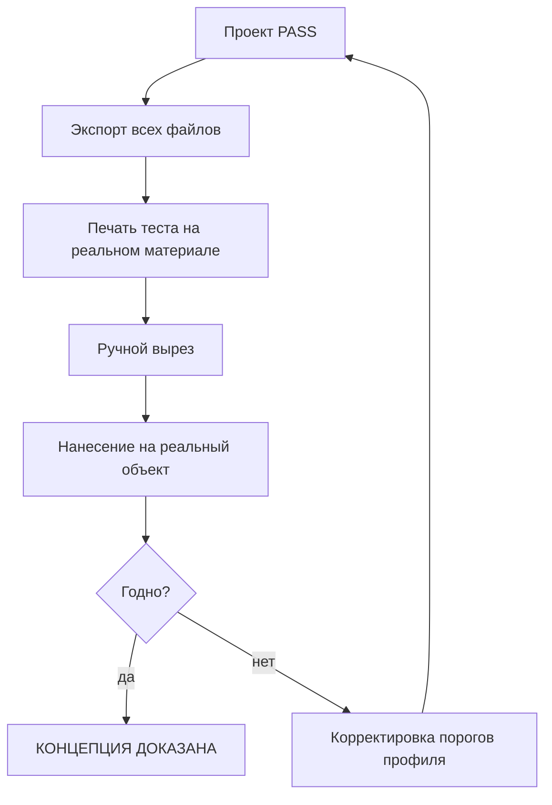
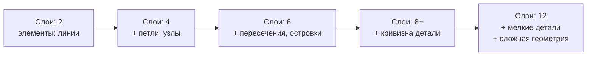
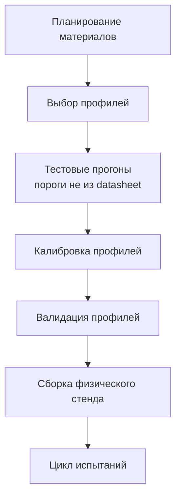
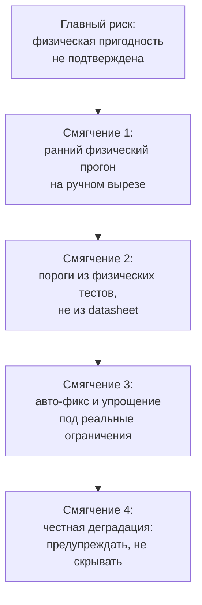

# ROADMAP

## 1. Принцип порядка



**Нельзя начать с AI, commerce или редактора**, пока не работает геометрия.
Иначе будет красивая оболочка без производственной ценности.

## 2. Обзор этапов

| Stage | Название | Цель | Критерий выхода |
|---|---|---|---|
| **1** | Foundation | Зафиксировать модель и правила | ADR приняты, документация консистентна |
| **2** | Core Geometry | Надёжная векторная геометрия | 100% геометрических инвариантов держатся |
| **3** | Layer Engine | Физические слои + граф | Разбиение корректно, граф ацикличен |
| **4** | Manufacturing Engine | Профили, правила, валидатор, авто-фикс | Проект проходит/падает корректно |
| **5** | Export | Производственные файлы | Round-trip, детерминизм |
| **6** | Mask Studio | Редактор и превью | Пользователь доводит проект до PASS |
| **7** | Model Fit | Привязка к геометрии объекта | Маска соответствует детали |
| **8** | AI | Ускорение, а не основа | Manufacturable Rate не ухудшился |

**Критический путь к доказательству концепции: Stage 1 → 5.**
Stage 6–8 — надстройка.

## 3. Stage 1 — Foundation

### Задачи

| # | Задача | Результат |
|---|---|---|
| 1.1 | Доменная модель и глоссарий | `03_DOMAIN/DOMAIN_MODEL.md`, `GLOSSARY.md` |
| 1.2 | Схема Mask Project v1 | JSON Schema |
| 1.3 | ADR-0001…0015 | принятые решения |
| 1.4 | Структура репозитория | monorepo layout |
| 1.5 | CI: lint, test, build | работающий pipeline |
| 1.6 | Модель детерминизма | ADR-0015 |
| 1.7 | Модель версионирования | ADR-0014 |

### Структура репозитория

```text
MASK-PLATFORM/
├── docs/                     # вся документация
│   ├── 00_FOUNDATION/ … 13_ROADMAP/
│   ├── adr/
│   └── schema/
├── engine/                   # Rust: Mask Engine
│   ├── kernel/               # чистая геометрия
│   ├── engine/               # конвейер
│   ├── wasm/                 # wasm-bindings
│   └── tests/fixtures/
├── services/
│   ├── api/                  # Go
│   ├── worker/               # Go + Rust binding
│   └── ai/                   # Python
├── web/                      # Next.js (Platform + Studio)
├── infra/
│   ├── docker/
│   ├── compose/
│   └── k8s/                  # позже
└── Makefile
```

### Критерий выхода

- [ ] Все ADR приняты
- [ ] JSON Schema валидна, пример проходит валидацию
- [ ] CI зелёный на пустом ядре
- [ ] Глоссарий согласован с кодом (нет расхождений терминов)

**Оценка:** 1–2 недели.

## 4. Stage 2 — Core Geometry

### Задачи

| # | Задача | Метрика успеха |
|---|---|---|
| 2.1 | Primitives: Point, Segment, Path, Contour | round-trip тест |
| 2.2 | Сериализация геометрии | детерминированный хеш |
| 2.3 | Offset (grow/shrink) | property: монотонность, collapse |
| 2.4 | Boolean ops (union/diff/intersect) | property: union монотонен |
| 2.5 | Measure: area, length, min width, bbox | точность ±0.001 мм |
| 2.6 | Winding order + nesting tree | even-odd, nonzero |
| 2.7 | Curve fit (Bézier) | Hausdorff ≤ tolerance |
| 2.8 | Simplify (RDP) | `simplify(g,0) ≡ g` |
| 2.9 | Self-intersection detection | полнота на fixtures |
| 2.10 | WASM-сборка | работает в браузере |

### Golden fixtures

| Fixture | Что проверяет |
|---|---|
| `interlocking_lines` | петли, узлы, переплетение |
| `nested_contours` | вложенность |
| `sharp_cusps` | острые вершины |
| `degenerate` | 0-длина, совпадающие точки |

### Критерии выхода

- [ ] Все property-инварианты держатся на 1000 случайных случаев
- [ ] Fuzzing 60 с без паник
- [ ] Точность измерений подтверждена на эталонных фигурах
- [ ] Покрытие ядра ≥ 85%
- [ ] WASM работает в браузере

**Оценка:** 3–4 недели. **Это самый рискованный этап.**

## 5. Stage 3 — Layer Engine

### Задачи

| # | Задача | Метрика |
|---|---|---|
| 3.1 | Модель visual → physical (ADR-0005) | схема |
| 3.2 | Назначение семантических ролей | правила |
| 3.3 | Правила слияния слоёв | тесты |
| 3.4 | Минимизация числа слоёв | ≥ 30% сокращение без потери сходства |
| 3.5 | Layer Graph: модель отношений | схема |
| 3.6 | Топологическая сортировка | детерминизм |
| 3.7 | Обнаружение циклов | fatal на цикле |
| 3.8 | Region-aware order | разрешение частичных пересечений |

### Критерии выхода

- [ ] Слой изображения корректно превращается в физические слои
- [ ] 5-6 слоёв из 4 визуальных на тестовых изображениях
- [ ] Граф ацикличен по построению
- [ ] Порядок детерминирован (тест на повторяемость)

**Оценка:** 2–3 недели.

## 6. Stage 4 — Manufacturing Engine

### Задачи

| # | Задача | Метрика |
|---|---|---|
| 4.1 | Профили как данные + версии | миграции |
| 4.2 | CuttingProfile builder | формулы из документации |
| 4.3 | Генерация RuleSet | детерминированно |
| 4.4 | Модель нарушений и severity (ADR-0007) | схема |
| 4.5 | Validator: все стадии | 9 стадий |
| 4.6 | Auto-fix: widen, bridge, merge, round | каждый фикс |
| 4.7 | Auto-simplify + бюджет сходства | fidelity delta |
| 4.8 | Nesting: fixed_grid, strip | MVP |
| 4.9 | Регистрационные метки | генерация |
| 4.10 | Человеческие сообщения (P-09) | тексты |

### Критерии выхода

- [ ] Профиль меняется без изменения кода
- [ ] Validator даёт корректный вердикт на всех fixtures
- [ ] Auto-fix устраняет ≥ 80% нарушений
- [ ] Потеря сходства при авто-фиксе ≤ 3%
- [ ] Каждое сообщение содержит причину и действие

**Оценка:** 3–4 недели.

## 7. Stage 5 — Export и Nesting

> **Фактическое состояние:** `SVG` с метаданными, раскладка `fixed_grid` с
> метками регистрации и экспорт плиток — реализовано в `engine/export` и
> `engine/nesting`. `DXF`, `PLT`, `PDF` и `per_project` раскладка — нет.
> Пройден путь от геометрии до печатного файла для плоской поверхности.

### Задачи

| # | Задача | Метрика |
|---|---|---|
| 5.1 | SVG (ADR-0009: единицы, ориентация) | ✅ сделано, round-trip ожидает импортёр |
| 5.2 | DXF R12 | открывается в стороннем софте |
| 5.3 | PLT/HPGL | на плоттере |
| 5.4 | PDF: mask_sheet + instruction | вёрстка |
| 5.5 | Production Manifest (ADR-0012) | схема |
| 5.6 | Инструкция из данных проекта | числа из источника |
| 5.7 | Детерминированный экспорт | побайтово |
| 5.8 | ZIP-архив проекта | полный комплект |

### Критерии выхода

- [ ] SVG → parse → геометрия ≡ исходной
- [ ] DXF открывается в ≥ 2 сторонних программах
- [ ] Два экспорта дают идентичные хеши
- [ ] Manifest согласован (все файлы, все хеши)
- [ ] Инструкция содержит все параметры из проекта

**Оценка:** 2 недели.

### Выполнено на текущем этапе

- [x] `fixed_grid` с зазором и метками регистрации
- [x] Экспорт плитки с метками (`tile_to_svg`)
- [x] Путь `геометрия → профиль → вердикт → печатный SVG`
- [x] Протокол физического прогона и 7 фикстур (`docs/protocols/`)
- [ ] Физический прогон выполнен — **ожидает материал**

### ⭐ Первый физический прогон



**Это главная точка проекта.** До неё всё — разработка.

## 8. Stage 6 — Mask Studio

### Задачи

| # | Задача | Метрика |
|---|---|---|
| 6.1 | Каркас Studio + layout | рабочий UI |
| 6.2 | Канвас: рендер геометрии | 60 fps при 20k |
| 6.3 | Панель слоёв | интерактивна |
| 6.4 | Инструменты: Select, Node, Cut, Join, Widen, Bridge | работают |
| 6.5 | Live-валидация через WASM | < 500 ms |
| 6.6 | Превью результата + карта ΔE | fidelity вычисляется |
| 6.7 | Auto-fix с превью | отменяемо |
| 6.8 | Материал picker | меняет профиль |
| 6.9 | Экспорт из UI | скачивание |
| 6.10 | Ревизии и откат | история |
| 6.11 | Вход из растра: трассировка и разделение цвета | `maskctl trace`, [IMAGE_TRACING](../05_GEOMETRY/IMAGE_TRACING.md) |
| 6.12 | Авто-фикс: мосты, скругление углов | `maskctl --bridge --round-corners` |

### Что сделано

- [x] Фасад браузерного ядра + 29 тестов против настоящего артефакта
- [x] Один слой с переключателем и живым измерением
- [x] Вход из растра: контурная трассировка, квантование палитры, `regions` в
      формате фикстуры, сквозной путь PNG → валидация → отказ по существу
- [x] Авто-фикс: мосты для незакреплённых островов, скругление острых углов
- [x] Проверки T-01 (ширина, включая горлышки), T-02 (зазор), T-03 (островок),
      T-04 (закрепление), T-06/T-07 (мосты), T-08 (самопересечения), T-09 (незамкнутые),
      T-05 (радиус), T-10 (длина), T-12 (пересечения), T-13 (плотность),
      T-14 (острый угол), T-15 (регистрация)

      **Уточнение 2026-10-06:** список выше — это проверки, которые выполняет
      `validate_project`. Из них в браузер доведены не все, и четыре не могут быть
      доведены в принципе:

      | Проверка | В браузере | Почему |
      |---|---|---|
      | T-01, T-02, T-03, T-04, T-05, T-08, T-09, T-10, T-11, T-13, T-14 | да | `validate_project` → `check_layer` |
      | T-06, T-07 | **нет** | мостики не пересекают границу: `extract_layers` заполняет `bridges: Vec::new()`, а без записи о язычке нечего проверять |
      | T-12, T-15 | **нет** | `validate_project` вызывает `validate_with_nesting`, а не `validate_with_registration`; пересечения слоёв и регистрация считаются только там |

      Итого 11 из 15. Раньше в этом разделе стояло «T-01…T-15 доведены до браузера»,
      что читалось как все пятнадцать.
- [x] Профиль теперь проверяет объявленные параметры снятия, которые раньше
      читались кодом и никогда не проверялись
- [x] Найдена и закрыта дыра в T-01: горлышки и мосты были не видны
- [x] Кривые в геометрии (`Contour.arcs`), T-05 (радиус) стала проверкой
- [ ] T-11 (снятие) объявлена неприменимой: это физический тест, а не измерение
- [x] T-02 (зазор) и T-08 (самопересечения) доведены до браузера: редактор видит
      зазор между элементами и называет точку пересечения контура, вместо того чтобы
      показать правдоподобную площадь фигуры, которая вырежется не та
- [x] Фикстуры стали исполняемой защитой: у каждой `_expect`, проверка обязана
      совпадать с реальностью, `make schema` валидирует формат (ADR-0014)

### Критерии выхода

- [ ] Пользователь доводит проект от загрузки до `PASS` без разработчика
- [ ] Все инструменты работают на реальном сложном проекте
- [ ] 60 fps при 20 000 элементов — **не достигается, см. измерение ниже**
- [ ] Live-валидация < 500 ms — **не выполняется уже на 5 000 регионов**

### Измерено, а не заявлено (2026-10-06)

Обе цифры выше были целями, а не результатом: их никто не измерил. Замерено на
собранном wasm-артефакте, на слое из отдельных квадратных регионов:

| Регионов | `measure_layer` | `validate_project` | payload |
|---|---|---|---|
| 100 | 6.7 мс | 12.6 мс | 8 КБ |
| 1 000 | 64.8 мс | 125.2 мс | 83 КБ |
| 5 000 | 350.3 мс | **713.6 мс** | 419 КБ |
| 20 000 | **1 820.5 мс** | — | 3.7 МБ |

**Live-валидация < 500 мс не выполняется уже на 5 000 регионов.**
**60 fps при 20 000 элементов недостижимо**: бюджет кадра — 16.7 мс, измерение
занимает 1 820.5 мс, то есть в 109 раз больше кадра.

Разложение стоимости (равное число вершин, ~40 000):

| Фигур | Измерение |
|---|---|
| 1 000 по 40 точек | 106 мс |
| 10 000 по 4 точки | 263 мс |

Вклад и на-вершину, и на-фигуру; `min_width` выполняет 28 шагов бисекции offset'а
**на каждую фигуру** (`kernel/src/offset.rs:25`). Патологического O(n²) нет.

**Что это значит для Stage 6.** Интерактивное редактирование вершины переизмеряет
слой на каждое движение мыши. При текущей стоимости это возможно на слое в сотни
регионов и невозможно на тысячах. До того как строить инструмент редактирования,
нужен либо инкрементальный пересчёт (изменилась одна фигура — пересчитать её), либо
явное признание, что редактирование живёт в другом масштабе, и измерение отложено
на живые слои (`PERF-002` в `docs/BACKLOG/MASTER_BACKLOG.md`).

**Оценка:** 4–5 недель, если производительность сначала довести до
работоспособной для редактирования.

## 9. Stage 7 — Model Fit

### Задачи

| # | Задача | Метрика |
|---|---|---|
| 7.1 | Иерархия каталога (ADR-0010) | схема |
| 7.2 | Ортофото + масштаб (L1) | 5 деталей |
| 7.3 | Зоны: forbidden, difficult, gap, crease | обработка |
| 7.4 | Масштабирование с сохранением пропорций | корректно |
| 7.5 | 2.5D height field (L2) | 2–3 детали |
| 7.6 | Компенсация кривизны | формула ширины |
| 7.7 | Проверка искажений | порог |
| 7.8 | Валидация fit | правила |

### Критерии выхода

- [ ] Маска на капоте соответствует геометрии
- [ ] Запрещённые зоны обрабатываются
- [ ] Коррекция кривизны работает на шлеме
- [ ] Искажение в пределах порога

**Оценка:** 3 недели.

## 10. Stage 8 — AI

### Задачи

| # | Задача | Метрика |
|---|---|---|
| 8.1 | Инфраструктура AI-сервиса | очередь, кэш |
| 8.2 | Сегментация по смыслу | precision > 0.95 |
| 8.3 | Доводка трассировки AI | recall > 0.90 |
| 8.4 | Предложение слоёв | принято > 60% |
| 8.5 | Полировка инструкции | числа верифицированы 100% |
| 8.6 | Fallback без AI | система работает |
| 8.7 | Обучение на своих данных | версии моделей |

### Важное уточнение

Детерминированная трассировка уже реализована в Stage 6
([IMAGE_TRACING](../05_GEOMETRY/IMAGE_TRACING.md)): квантование палитры, обход
рёбер, ориентация, точность до долей пикселя, `regions` без обводки.

Поэтому 8.3 — это **улучшение** работающей базовой линии, а не первая
векторизация. Классический трейсер и есть тот fallback, о котором говорит 8.6:
он детерминирован, работает без сети и без обучающих данных. AI здесь может
только предложить аккуратнее, а решить обязан валидатор.

### Критерии выхода

- [ ] Manufacturable Rate **не ухудшился** по сравнению с ручным режимом
- [x] Система полностью работает с выключенным AI — трассировка не зависит от AI
- [ ] Ни один AI-результат не попадает в проект без валидации (тест)
- [ ] 100% чисел в инструкции соответствуют источнику

**Оценка:** 2 недели после Stage 3.

## 11. Кривая физической сложности



| Уровень | Что добавляется | Сложность | Вероятность успеха |
|---|---|---|---|
| 1 | Прямые линии, 2–3 слоя | низкая | 90% |
| 2 | Изгибы, 4 слоя | низкая | 80% |
| 3 | Петли, пересечения, 6 слоёв | средняя | 65% |
| 4 | Островки + мосты, 8 слоёв | средняя | 55% |
| 5 | Криволинейная деталь + мелкие детали | высокая | 40% |

**Цель MVP:** уровень 3 — переплетающаяся графика, 6 слоёв,
маска на реальной детали.

## 12. Бизнес-этапы (после Stage 6)

| Этап | Что | Условие |
|---|---|---|
| B1 | Заказы без оплаты | есть PASS-проекты |
| B2 | Оплата, тарифы | есть повторные заказы |
| B3 | B2B: лицензия студии | подтверждён регулярный спрос |
| B4 | Marketplace дизайнов | есть аудитория дизайнеров |
| B5 | Автосборка заказа | стабильное производство |

## 13. Инфраструктура физической проверки



| Что | Статус | Примечание |
|---|---|---|
| Материалы для тестов | **пока не закупаем** | До первого прогона — прототип вручную |
| Инструмент | минимальный | нож, держатель, аэрограф |
| Плоттер | **после Stage 5** | когда есть файлы для проверки |
| Расчёт оборудования | после доказательства | по фактическим требованиям |

**Правило:** покупка оборудования — следствие доказательства, не его условие.

## 14. Метрики по этапам

| Stage | Ключевая метрика | Целевое значение |
|---|---|---|
| 2 | Property-инварианты | 100% |
| 2 | Точность min width | ±0.001 мм |
| 3 | Сокращение числа слоёв | ≥ 30% |
| 4 | Auto-fix success | ≥ 80% |
| 4 | Fidelity loss при фиксе | ≤ 3% |
| 5 | Round-trip | 100% |
| 5 | Детерминизм | 100% |
| 6 | Время до PASS | ≤ 15 мин |
| 7 | Искажение | ≤ 18% |
| 8 | Manufacturable Rate | не ниже ручного |

## 15. Критический риск и ответ



**Если физический прогон не удаётся три раза подряд** — вернуться к Stage 2
и пересмотреть модель минимальных размеров, а не упрощать документацию.

## 16. Определение «проект доказал концепцию»

```mermaid
flowchart LR
  A["Критерий успеха"] --> B["Взять сложное изображение"]
  B --> C["Получить многослойный Mask Project"]
  C --> D["Доказать производимость"]
  D --> E["Получить корректные файлы"]
  E --> F["Физически изготовить"]
  F --> G["Нанести на реальный объект"]
  G --> H["Результат годен"]
  H --> I["Повторить через симуляцию повреждения"]
```



Все семь пунктов обязательны. Пропуск любого = концепция не доказана.

## 17. Связанные документы

* `../00_FOUNDATION/VISION.md` — цели.
* `../00_FOUNDATION/PRINCIPLES.md` — принципы.
* `../00_FOUNDATION/DEVELOPMENT_PROCESS.md` — процесс.
* `../12_TESTING/TESTING_STRATEGY.md` — тесты по этапам.