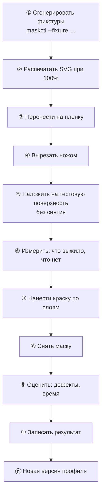
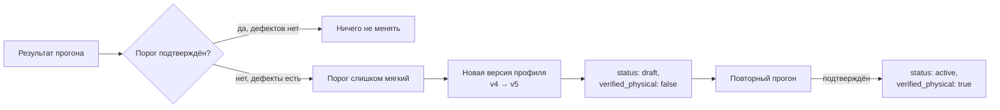

# Протокол физической валидации

> Статус: **подготовлен к запуску; материала нет, прогон не выполнялся**
> Цель: превратить пороги профилей из datasheet-значений в измерения.

```bash
make physical   # печатные файлы для всех семи случаев, включая падающие
```

Единственное, что осталось до начала работы, — плёнка, нож и вечер. Всё
программное обеспечено и проверено: файлы генерируются одной командой, а каждый
отказ движка записан в манифесте рядом с вердиктом, который он отменил.

## 1. Зачем это существует

Сейчас `matte-vinyl-090` имеет `status: draft` и `verified_physical: false`.
Все его числа взяты из типовых datasheet: минимум 0.80 мм, зазор 0.90 мм,
островок 0.60 мм, мост 1.20 мм. **Ни одно из них не проверено.**

Движок на этих числах выдаёт `PASS`. Это вычисление, а не факт. Каждый
экспортированный SVG несёт `limits_verified false` именно поэтому.

Пока протокол не выполнен, главный риск проекта остаётся открытым: система
может годами считать маску производимой, а плёнка на столе развалится при
снятии. Проверить это можно только ножом и куском металла.

**Это единственный способ узнать правду о физике. Никакой тест его не заменяет.**

## 2. Что нужно

| Что | Зачем | Примечание |
|---|---|---|
| Лист самоклеящейся плёнки ~300×300 мм | Материал для испытаний | Матовая виниловая, толщина близка к 0.09 мм |
| Нож + держатель 25 мм | Ручной вырез | То же, что в профиле `knife-25mm` |
| Линейка или штангенциркуль | Измерение ширины вырезанного элемента | Штангенциркуль точнее; 0.1 мм достаточно |
| Плоская поверхность, покрытая краской | Объект нанесения | Металл, пластик, кусок ДСП. Настоящая деталь не нужна на первом прогоне |
| Аэрограф или аэрограф-пульверизатор | Нанесение | Можно баллончик, но техника должна совпадать с профилем |
| Краска: база + 2–3 оттенка | Имитация многослойной покраски | |
| Удлинитель, перчатки, вентиляция | Безопасность | Аэрограф и растворитель — вредные пары |

**Стоимость вопроса — десятки евро и один вечер.** Это не покупка
оборудования; это покупка уверенности в собственной системе.

## 3. Порядок работы



Печатать **строго 100%**. Любое масштабирование искажает ширину элемента и
делает весь прогон бессмысленным: проверяется не фильм, а принтер.

## 4. Тестовые случаи

Все фикстуры уже сгенерированы и лежат в `engine/fixtures/`.
Ожидаемый вердикт указан в комментарии `_comment` внутри каждой.

| # | Фикстура | Ожидается от движка | Что доказывает на столе |
|---|---|---|---|
| **T1** | `t1_at_threshold.json` | `PASS` | Элемент шириной ровно 0.80 мм переживает вырезание, перенос и снятие. **Если нет — минимум завышен как минимум и занижен как факт: его надо поднять** |
| **T2** | `t2_below_threshold.json` | `FAIL` | Ширины 0.60 / 0.70 / 0.75 мм. Резать **всё равно**: нужно посмотреть, что именно ломается и когда. Это самый информативный тест из всех |
| **T3** | `t3_island_bridged.json` | `PASS` | Островок с мостом 1.5 мм держится на детали через weed, позиционирование и снятие |
| **T4** | `t4_island_unbridged.json` | `FAIL` | Тот же островок без моста. Если он останется на месте — правило слишком строгое и порог островка можно снизить |
| **T5** | `t5_six_layers.json` | `PASS` | Шесть слоёв подряд. Накопительная ошибка совмещения после шести циклов снятия-наложения. **Это целевая сложность MVP** |
| **T6** | криволинейная поверхность | — | Не выражается в фикстуре. Требует настоящей детали: шлем или боковина |
| **T7** | снятие маски | — | Процедура, не геометрия. Угол снятия, скорость, температура |

### Как запустить

```bash
cd engine
cargo run -q -p mask-cli --bin maskctl -- \
  --fixture fixtures/t1_at_threshold.json \
  --material profiles/data/matte-vinyl-090.v4.json \
  --plotter  profiles/data/knife-25mm.v2.json \
  --out out/t1
```

`maskctl` печатает измеренную ширину каждого слоя **до** того, как что-либо
будет вырезано. Записывайте эти числа в протокол: сравнение «ожидал 0.80,
получил 0.80» и «ожидал 0.80, измерил 0.42» говорит больше, чем любой вердикт.

### T2, T4 и T6 требуют особого обращения

Движок откажется экспортировать эти три фикстуры — вердикт `FAIL`. Это
правильное поведение, а не препятствие: все три существуют именно потому, что
должны провалиться. Но протокол требует их вырезать, а отказавшийся проект
файлов не пишет.

Решение — флаг `--export-anyway`:

```bash
cd engine
for f in t2_below_threshold t4_island_unbridged t6_min_gap_violated; do
  cargo run -q -p mask-cli --bin maskctl -- \
    --fixture fixtures/$f.json \
    --material profiles/data/matte-vinyl-090.v4.json \
    --plotter  profiles/data/knife-25mm.v2.json \
    --export-anyway --out out/physical
done
```

**Что он делает и что он не делает.** Файлы пишутся. Вердикт в манифесте
остаётся `FAIL`, статус остаётся `NeedsWork`, и рядом появляется
`export_override` с кодами правил, которые обошёл оператор:

```json
"export_override": {
  "codes": ["min_gap"],
  "reason": "the validator refused this project and the files were produced anyway",
  "verdict_at_export": "FAIL",
  "warning": "NOT A PRODUCTION RUN."
}
```

Ничего не правится молча: отказ остаётся в манифесте и читается без отчёта.
Поле `export_override` **отсутствует** у обычного прогона и появляется только
здесь — присутствие и есть сигнал, а не значение `false`, которое кто-то мог бы
проставить, чтобы отказавшийся прогон выглядел проверенным.

Код возврата — `3`, а не `0`: это не успех и не провал, а «файлы есть, вердикт
отрицательный». Скрипт обязан смотреть в манифест.

**Почему не экспериментальный профиль.** Для T2 такого профиля хватило бы, и
он существует: `matte-vinyl-090-experiment.v1.json` со сниженными минимумами.
Но T4 и T6 через него не проходят, и это по существу, а не по недосмотру:

* **T6.** Порог зазора нельзя опустить ниже `kerf + регистрация` = 0.15 + 0.30 =
  0.45 мм: два реза с меньшим зазором сольются независимо от материала. Правило
  `gap = max(material, kerf + registration)` — это физика ножа, а не настройка.
* **T4.** Незакреплённый островок — это топологический факт, а не порог.
  Никакое число не делает островок прикреплённым.

Понижение порога исправляет случаи, где число было слишком строгим. Здесь число
не строгое. Значит, отказ нужно обойти, а не отредактировать.

## 5. Что фиксировать

```markdown
### Прогон T1 · <дата> · <оператор>

- Материал: <код, партия>
- Нож: <тип, состояние лезвия>
- Поверхность: <материал, покрытие>
- Ожидание движка: PASS, min width 0.800 мм

Наблюдения:
- Ширина после вырезания: ___ мм (измерить у 5 элементов)
- Ширина после снятия:    ___ мм
- Элементы, порвавшиеся при снятии: ___
- Результат: pass / pass_with_defects / fail

Вывод о профиле:
- <какое число нужно изменить и почему>
```

### Обязательные поля

| Поле | Почему обязательно |
|---|---|
| Партия материала | Разные партии ведут себя по-разному; без этого сравнение бессмысленно |
| Состояние лезвия | Тупое лезвие даёт другой kerf и другие порвы |
| Ширина после вырезания | Отделяет проблему материала от проблемы геометрии |
| Ширина после снятия | Главный вопрос: удержался элемент или нет |
| Результат | Однозначное значение для автоматизации |

## 6. Как результат превращается в профиль



**Строго запрещено** снижать порог, чтобы проект стал `PASS`
(`MANUFACTURING_ENGINE.md` §9). Порог меняется только в сторону, подтверждённую
физическим прогоном, и всегда новой версией. Старые проекты продолжают
ссылаться на старую версию — это и есть воспроизводимость.

## 7. Когда профиль получает `active`

Все четыре условия одновременно:

- [ ] T1 прошёл: элемент на пороге выживает
- [ ] T2 подтвердил, что ниже порога элемент действительно неустойчив
- [ ] T3 прошёл: мост удерживает островок
- [ ] T5 прошёл: шесть слоёв не разъезжаются

T4 — уточнение порога островка, но не блокер: он может показать, что минимум
островка ниже 0.80 мм, и тогда это станет отдельной версией.

T6 и T7 — обязательны перед первым **заказом клиенту**, но не блокируют
перевод профиля в `active` для плоских поверхностей.

## 8. Известные ограничения этого прогона

| Ограничение | Следствие |
|---|---|
| Плоская поверхность | Не проверяет прилегание к кривизне |
| Ручной вырез | Не проверяет плоттер; kerf может отличаться |
| Одна марка краски | Не проверяет перекрытие слоёв разными красками |
| Один оператор | Не оценивает повторяемость между людьми |
| Нет плоттера | `plotter` профиль остаётся `draft` независимо от результатов |

**Честно:** эти пороги пока пригодны для плоских поверхностей и ручного
выреза. Расширение на реальные детали требует T6 и плоттера, и тогда
`MANUFACTURING_ENGINE.md` §8 начнёт работать по-настоящему.

## 9. Что должно произойти после прогона

1. Новая версия профиля с измеренными числами.
2. Записи в таблице `physical_proofs` (`DATABASE_ARCHITECTURE.md` §3.12).
3. Обновление `notes` в профиле: что подтверждено, что нет.
4. Пересчёт эталонных тестов, если порог изменился и влияет на вердикты.
5. Отметка в `ROADMAP.md` о том, что Stage 1–5 дали физический результат.

## 10. Связанные документы

* `../06_MANUFACTURING/MANUFACTURING_ENGINE.md` — откуда берутся пороги
* `../06_MANUFACTURING/VALIDATOR.md` — что именно проверяется
* `../12_TESTING/TESTING_STRATEGY.md` §6 — место физики в пирамиде тестов
* `../13_ROADMAP/ROADMAP.md` — этапы, где это обязательно
* `../../engine/cli/src/main.rs` — генератор файлов